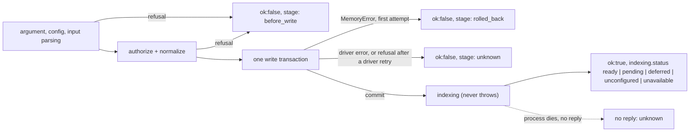

# Source Memory qualification for `memory.remember` (Q-SM-1…6)

**Bottom line:** Q-SM-1…6 pass through the real CLI transport against a disposable Neo4j 5.26.14. After a commit, `ingest` and `enrich` no longer throw, and the post-commit `authorize` is gone. Every `ingest`/`enrich` failure reply now carries `stage`, so a caller can tell a refusal that wrote nothing (`before_write`, `rolled_back`) from an outcome it must settle by exact read (`unknown`). The store's identity and the record-contract version appear in `status`.

Scope: Agency design `DESIGN-AGENCY-CUSTODY-EVENTSOURCED-FINAL.md` §9.4 (no_write rule) and §18.1 (Q-SM-1…6). Run command: `npm run test:integration -- --suite qualification`, or no `--suite` to also run the integration suite. Unit pins: `test/qualification.test.mjs`.

## Results

Run of 2026-11-09 on `feat/qualification-q-sm`: the full integration run passed 96 checks including Q-SM-1…6 (container `source-memory-test-0310e434…`), and the qualification-only run passed 6 (container `source-memory-test-1178b2e8…`). `npm test`: 625 pass, 0 fail. A later qualification run (#49) adds a seventh check, a refusal after a real driver retry: attempt 1 lost its connection (`ServiceUnavailable`, retryable), and the retry's `record_identity_conflict` replied `stage:unknown`.

| Q | Requirement | Result | Evidence (CLI replies) |
|---|---|---|---|
| Q-SM-1 | Same id and normalized record twice: one record, success both times | **PASS** | Both `enrich` replies `ok:true, records:["q1-decision"]`. The second used another key order, wrote the default `status`, and carried an unknown field. Scope holds 1 record and its stored digest equals the normalized record's. A replayed `ingest` gives `replayed:true` and 1 turn |
| Q-SM-2 | Same id, other bytes: `record_identity_conflict`, record unchanged | **PASS** | `{"ok":false,"error":"record_identity_conflict","stage":"rolled_back"}`, exit 1. The stored record is deep-equal before and after, and the count is unchanged |
| Q-SM-3 | Each no_write code only before the first `MERGE`; each in-transaction code rolls back | **PASS** | 25 of the 26 pre-commit-only codes returned `stage:before_write`; the 26th, `unknown_command`, has no stage because no write command was named. All 10 in-transaction codes returned `stage:rolled_back`, `relation_endpoint_unavailable` also for a missing far endpoint of a cross-scope relation. Each `enrich` case carried a valid companion record; none was written, and store counts were unchanged after all 39 refusals. For `record_identity_conflict` and `relation_identity_conflict` the companion's `MERGE` ran first and was rolled back. The run fails if any code in the table below goes unexercised. The source-order test puts all seven † checks before the relation id lock and the first content `MERGE` in `Neo4jStore.enrich`. The id lock (a `MERGE` of a placeholder `SMLink` node, deleted in the same transaction) is excluded from "first `MERGE`" because it writes nothing durable: the placeholder is never visible after commit, and no classification changes. An unreachable database gives `operation_failed`, `stage:unknown` |
| Q-SM-4 | Injected failure after commit (indexing, process exit), then exact read: one record | **PASS** | Indexing endpoint returns 503: `ok:true`, `indexing:{status:"unavailable",reason:"model_request_failed",source_retained:true}`, which is a receipt. Writer killed with `SIGKILL` while its post-commit embedding request was open, for `ingest` and `enrich`: no stdout, no reply, so the outcome is unknown. Exact read finds the turn (`turn_by_key`) and the record, whose digest equals the normalized submission. A resend converges on the same single record |
| Q-SM-5 | Store and record-contract identity procedure | **PASS** | `status.store = {system:"neo4j", database_id, database:"neo4j", record_contract:"source-memory.record/1"}`, the same from two processes and two scopes. The two runs' disposable containers reported different ids (`7A7EFD72…` and `A2CFA6D8…`). The record-contract pin is in `test/qualification.test.mjs`. Procedure below |
| Q-SM-6 | No post-commit `scope_denied`; the transport shows code provenance | **PASS** | `scope_denied` gives `stage:before_write` for both `ingest` and `enrich`, with nothing written. A conflict gives `stage:rolled_back`. A post-commit indexing failure gives `ok:true` with `indexing.status:"unavailable"`. All 44 `ingest`/`enrich` failure replies in the suite carried a stage (41 before the three cross-scope Q-SM-3 cases). Unit test: revoking the write grant during the store write no longer throws; on `main` the same test fails with `scope_denied` |

## Reply contract (CLI transport)

| Reply | Meaning for the caller | Agency evidence (§9.4) |
|---|---|---|
| `{"ok":true,...}` on stdout, exit 0 | Committed. `indexing.status: unavailable` with `reason` means indexing failed after the commit; the write stands | `receipt` |
| `{"ok":false,"error":C,"stage":"before_write"}` on stderr, exit 1 | Refused before the write transaction began; nothing was written | `no_write` |
| `{"ok":false,"error":C,"stage":"rolled_back"}`, exit 1 | Raised inside the write transaction on its first attempt; the transaction rolled back, so nothing was written | `no_write` (`record_identity_conflict`, `relation_identity_conflict`, `source_identity_conflict`: T5 `conflict`) |
| `{"ok":false,"error":C,"stage":"unknown"}`, exit 1 | The write may have committed (driver or database error, or a refusal after the driver retried a transaction whose commit reply may have been lost) | `unknown` → exact read |
| No parseable reply, signal or other exit | The process may have died after the commit | `unknown` → exact read |

`stage` is set only on `ingest` and `enrich` failure replies, on the CLI and on the extension's NDJSON transport; other commands keep `{"ok":false,"error":C}`. A stage is set only by an explicit marker at the raise site (`markStage` in `src/core.mjs`). An unmarked error is `unknown`, so a new raise site can never be misreported as no_write.

Exact read: `show {"kind":"record","id":ID}` returns the stored record; its body minus `uid` and `scope` has the same canonical digest as the normalized submitted record (`match`), or a different one (`differs`). Turns: `show {"kind":"turn_by_key",...}`.

## Changes behind the results

| Change | Where | Why |
|---|---|---|
| `indexAfterWrite` catches every error and returns `{status:'unavailable', reason, source_retained:true}` | `src/memory.mjs` | A throw after the commit made a committed write look unwritten |
| The post-commit `authorize` is dropped; `index` (the command) still authorizes | `src/memory.mjs` | The write path already ran `authorize(this.config, scope, 'write')` with the same config object, scope and operation. The second call could only differ if the config changed in between, which is the post-commit `scope_denied` Q-SM-6 names |
| Pre-write steps run in `beforeWrite`, which marks `before_write` | `src/memory.mjs` | Positive provenance for refusals before the store call |
| `ingest`/`enrich` use `atomicWrite`, which marks a `MemoryError` `rolled_back` only on the first transaction attempt | `src/store.mjs` | The driver retries retryable errors, including a commit whose reply was lost. A refusal on a later attempt may follow a commit, so it stays unmarked |
| CLI failure replies get `stage`; argument, config and input errors are `before_write`; a `close()` error after the outcome is ignored | `bin/memory.mjs` | Transport-level provenance. A close failure used to turn a success into `operation_failed` |
| `status.store = {system, database_id, database, record_contract}` | `src/store.mjs`, `src/core.mjs` | Q-SM-5 store and contract identity |

Return values of a successful `ingest`/`enrich` are byte-identical to the previous behaviour for `ready`, `pending`, `deferred`, `unconfigured` and `unavailable` (golden test in `test/qualification.test.mjs`). Indexing `reason` codes are unchanged.

## Store and record-contract identity (Q-SM-5)

`status` returns `store`:

| Field | Source | Changes when |
|---|---|---|
| `system` | constant `neo4j` | the backend changes |
| `database_id` | `CALL db.info()` `id`, the database's own store id | the database is recreated (a new store). It is the same across scopes, processes and restarts of one database |
| `database` | `db.info()` `name` | the configured database changes |
| `record_contract` | `RECORD_CONTRACT` in `src/core.mjs`, now `source-memory.record/1` | the record uid derivation, `normalizeEnrichment` output or the replay digest changes for the same input |

Procedure for a binding owner (Agency registry, §9.1):

1. Record `{system, database_id, database}` as the binding domain's `store` and `record_contract` as its `contract_version` when the binding is qualified.
2. Before claims on a binding, and after any Source Memory deploy or store change, read `status` and compare. Equal values: the binding still holds. A different `database_id`, `database` or `system` is a new store, so a new `binding_id` with a new domain. A different `record_contract` over the same store is a new `binding_id` with the same domain. Either way the old binding goes `read_only` for its pinned operations, which are never resent to the new one.
3. On the Source Memory side, `test/qualification.test.mjs` pins the version-1 uid, body and digest of a fixed record and relation. A change that moves any pinned value fails the test, and the fix is to bump `RECORD_CONTRACT`, which is what makes the change visible to step 2.

Limit: `database_id` is Neo4j's store id. A backup restored with `neo4j-admin database load` may keep it. That is the same record set, but a restore of an *older* backup loses records written since, which IR5 (retention) forbids. Source Memory cannot detect that; it is an operator procedure.

## Codes

Every code a `requireThat` or `new MemoryError` can raise in the modules `bin/memory.mjs` loads, plus the four codes the CLI and `safeCode` synthesize. `test/qualification.test.mjs` fails if this table and the source disagree. `test/qualification.mjs` (Q-SM-3) raises every `pre-commit-only` and `in-transaction-rolled-back` code through the CLI and checks its `stage` and that the store did not change.

Classes, for `ingest` and `enrich`:

- **pre-commit-only**: raised before the write transaction begins. Reply `stage: before_write`.
- **in-transaction-rolled-back**: raised inside the write transaction, which rolls back. Reply `stage: rolled_back` on the first attempt, `unknown` after a driver retry. Codes marked † are raised before the transaction's relation id lock and its first content `MERGE`; the others after a `MERGE` whose effect the rollback discards (for a call with relations and no records that may be only the id lock's placeholder `MERGE`). The id lock takes the `SMLink(uid)` unique-index entry of each relation id through a placeholder node created and deleted in the transaction, so it writes nothing durable.
- **post-commit**: appears only as `indexing.reason` inside an `ok:true` reply, never as an error reply. Any other code can also appear as a reason; it is still a committed write.
- **stage-dependent**: `stage` decides it.
- **not-on-write-path**: not raised by `ingest` or `enrich` (read commands, `init`, `warm`).

| Code | Class | Raised at |
|---|---|---|
| `config_and_scope_required` | pre-commit-only | `bin/memory.mjs` argument parsing |
| `invalid_arguments` | pre-commit-only | `bin/memory.mjs` argument parsing |
| `unknown_command` | pre-commit-only | `bin/memory.mjs` argument parsing; no `stage`, the command is not a write command |
| `input_too_large` | pre-commit-only | `bin/memory.mjs` `readBounded` |
| `invalid_json` | pre-commit-only | `bin/memory.mjs`, a `SyntaxError` from parsing config or input |
| `input_file_unavailable` | pre-commit-only | `bin/memory.mjs`, `ENOENT`/`EACCES` on config or input |
| `database_config_required` | pre-commit-only | `Neo4jStore` constructor |
| `invalid_database_uri` | pre-commit-only | `Neo4jStore` constructor |
| `database_must_be_loopback` | pre-commit-only | `Neo4jStore` constructor |
| `database_credentials_unavailable` | pre-commit-only | `Neo4jStore` constructor |
| `scope_denied` | pre-commit-only | `authorize` in `ingest`/`enrich` (the post-commit call is removed) |
| `cross_scope_denied` | pre-commit-only | `Memory.enrich` `beforeWrite`: no read grant on a cross-scope relation's `to.scope`, or `to.scope` is a selector; checked before any storage call, so it says nothing about the far scope |
| `invalid_input` | pre-commit-only | `text`/`integer`/shape checks in `normalizeTurn`, `normalizeEnrichment` (including a malformed `to` object or `expected_digest`), `authorize` |
| `duplicate_entry` | pre-commit-only | `normalizeTurn` |
| `invalid_role` | pre-commit-only | `normalizeTurn` |
| `invalid_timestamp` | pre-commit-only | `normalizeTurn` |
| `source_too_large` | pre-commit-only | `normalizeTurn` |
| `enrichment_too_large` | pre-commit-only | `normalizeEnrichment` |
| `duplicate_record` | pre-commit-only | `normalizeEnrichment` |
| `invalid_kind` | pre-commit-only | `normalizeEnrichment` |
| `invalid_status` | pre-commit-only | `normalizeEnrichment` |
| `evidence_required` | pre-commit-only | `evidenceSpans` |
| `evidence_too_large` | pre-commit-only | `evidenceSpans` |
| `duplicate_relation` | pre-commit-only | `normalizeEnrichment` |
| `invalid_relation` | pre-commit-only | `normalizeEnrichment`; `Memory.enrich` for a `to.scope` equal to the written scope |
| `self_relation` | pre-commit-only | `normalizeEnrichment` |
| `evidence_unavailable` | in-transaction-rolled-back | † `Neo4jStore.enrich` evidence turn lookup |
| `invalid_evidence_span` | in-transaction-rolled-back | † `sourceExcerpt` inside `Neo4jStore.enrich` |
| `derived_is_not_original_evidence` | in-transaction-rolled-back | † `sourceExcerpt` inside `Neo4jStore.enrich` |
| `relation_endpoint_unavailable` | in-transaction-rolled-back | † `Neo4jStore.enrich` endpoint lookup, including a cross-scope `to` looked up by uid in its own scope |
| `relation_endpoint_digest_mismatch` | in-transaction-rolled-back | † `Neo4jStore.enrich`, right after the endpoint lookup: a cross-scope `to.expected_digest` differs from the far record's stored hash (or the far record has no string hash) |
| `invalid_outcome_relation` | in-transaction-rolled-back | † `Neo4jStore.enrich`: an `outcome_of` edge whose source is not an `outcome` or whose target is not an `action`, `decision` or `intention` |
| `outcome_referent_required` | in-transaction-rolled-back | † `Neo4jStore.enrich`: an `outcome` in the bundle with no `outcome_of` edge in the bundle and either no stored `outcome_of` edge or a stored one whose target is not an `action`, `decision` or `intention` |
| `record_identity_conflict` | in-transaction-rolled-back | `Neo4jStore.enrich`, after the record `MERGE` (IR3) |
| `relation_identity_conflict` | in-transaction-rolled-back | `Neo4jStore.enrich`, after the relation `MERGE`, and at the cross-label check just before it (the id already names a relation of the other form in the written scope) |
| `source_identity_conflict` | in-transaction-rolled-back | `Neo4jStore.ingest`, after the turn `MERGE` |
| `model_request_failed` | post-commit | `localJson` during indexing |
| `model_timeout` | post-commit | `localJson` during indexing |
| `model_response_too_large` | post-commit | `localJson` during indexing |
| `invalid_model_endpoint` | post-commit | `localEndpoint` during indexing |
| `model_endpoint_must_be_loopback` | post-commit | `localEndpoint` during indexing |
| `embedding_model_mismatch` | post-commit | `embed` during indexing |
| `invalid_embedding_response` | post-commit | `embed` during indexing |
| `invalid_embedding` | post-commit | `validateVector` during indexing |
| `database_unavailable` | post-commit | `safeCode` for a non-`MemoryError` during indexing |
| `operation_failed` | stage-dependent | `bin/memory.mjs` for any non-`MemoryError`: `before_write` during parsing or store construction, `unknown` after dispatch (e.g. the database is unreachable) |
| `not_found` | not-on-write-path | `show`, `sourceChunks`, vector status reads |
| `source_unavailable` | not-on-write-path | recall and bundle reads |
| `conversation_unavailable` | not-on-write-path | grouped recall admission |
| `index_scope_mismatch` | not-on-write-path | lexical and vector reads |
| `embedding_unconfigured` | not-on-write-path | vector status reads (indexing returns `unconfigured` before `embed` could raise it) |
| `reranker_model_mismatch` | not-on-write-path | recall reranking |
| `invalid_rerank_response` | not-on-write-path | recall reranking |
| `output_envelope_exceeded` | not-on-write-path | grouped recall serialization |
| `vector_index_schema_mismatch` | not-on-write-path | `init`, `status`, recall |
| `vector_index_dimension_mismatch` | not-on-write-path | `init`, `status`, recall |
| `vector_index_quantization_mismatch` | not-on-write-path | `init`, `status`, recall |
| `index_not_ready` | not-on-write-path | `warm --db v1` |
| `malformed_reply` | not-on-write-path | `warm --db v1` |

## Consequence for §9.4

The §9.4 table for `memory.remember@2` was written against the defect. With this change:

| §9.4 row | Now |
|---|---|
| `scope_denied` → `unknown` | `scope_denied` is raised only before the write (`stage: before_write`); no post-commit site remains (Q-SM-6) |
| `evidence_unavailable` … `outcome_referent_required` → `unknown` until Q-SM-3 | Raised before the first `MERGE` and rolled back (Q-SM-3), `stage: rolled_back` |
| Classification by code | A codec can classify by `stage` alone: `before_write`/`rolled_back` → `no_write`, anything else → `unknown`. That is a new codec version, as §9.4 requires for a reclassification |
| `record_identity_conflict`, `relation_identity_conflict`, `source_identity_conflict` | Not covered by that shorthand. With `stage: rolled_back` they are conflicts (the stored record, relation or turn differs), not no-write retries. With `stage: unknown` they are `unknown`, as is every `stage: unknown` reply |

Not covered here: the Agency codec, registry and consumer adapter (§18.1, Memory owner), concurrent original and redispatch deliveries (§9.3, class I only), and the class-I ruling.
