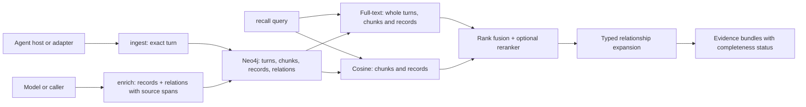

# Source Memory

**Agent memory that keeps the original conversation turns, then finds them again through full-text search, chunk embeddings, and explicit relationships between recorded decisions.** Interpretation (decisions, outcomes, corrections) is attached to exact source spans rather than replacing the source. A Neo4j server holds everything; a JSON CLI and an agent skill expose it.



Why source-first: compressed or extracted memories lose qualifications and the context needed for questions nobody anticipated. Recent benchmark work (Bao et al., [*Is Complex Agentic Memory Always Needed?*](https://arxiv.org/abs/2610.30755)) found plain retrieval over raw history competitive with complex agentic memory systems, largely because it retains more sufficient evidence. Source Memory keeps that raw retrieval path and adds explicit, evidence-backed relationships, so a matched old decision arrives with the decision that superseded it even when the successor scores poorly for the query.

## Quick start (Docker)

Requires Docker with Compose. Create a `.env` file beside `docker-compose.yml` containing one line, `NEO4J_PASSWORD=<a long random password>`. `.env` is git-ignored; never commit it.

```sh
docker compose up -d neo4j
docker compose run --rm memory init --scope default
docker compose run --rm -T memory ingest --scope default < examples/turn.json
echo '{"query":"dashboard"}' | docker compose run --rm -T memory recall --scope default
```

The container uses [`config/docker.json`](./config/docker.json), which reaches Neo4j by its Compose service name. Neo4j's Bolt port is also published on `127.0.0.1` only, so host-side tools can share the same database.

## Quick start (host Node.js)

Requires Node.js 22+ and a Neo4j 5.26+ server.

```sh
npm ci
export SOURCE_MEMORY_NEO4J_PASSWORD=...   # use your normal secret mechanism
node bin/memory.mjs init --config config/host.json --scope default
node bin/memory.mjs ingest --config config/host.json --scope default --input examples/turn.json
echo '{"query":"dashboard"}' | node bin/memory.mjs recall --config config/host.json --scope default
```

`--config` defaults to `$SOURCE_MEMORY_CONFIG`. The package executable is `source-memory`.

## Configuration

| Key | Meaning |
|---|---|
| `neo4j.uri` | `bolt://`, `neo4j://`, `bolt+s://`, or `neo4j+s://`. Loopback by default. |
| `neo4j.allow_remote` | `true` to permit a non-loopback server (another host, a Compose service name). Prefer `+s` schemes off-host. |
| `neo4j.database`, `neo4j.user` | Database name (default `neo4j`) and user (default `neo4j`). |
| `neo4j.password_env` | Name of the environment variable holding the password; the password never lives in the file. |
| `neo4j.auth` | `"none"` only for a disposable, isolated test database. |
| `scopes.read`, `scopes.write` | Allowlists. An entry names one scope exactly, or `S/**` names `S` and every descendant (see [Nested scopes](#nested-scopes)). Every command names a scope; others are refused before storage is touched. |
| `chunking.words`, `chunking.overlap` | Word-window size and overlap for embedding chunks (default 256 / 32). |
| `index_on_write` | `false` makes `ingest`/`enrich` return without embedding; run `index` separately. Use it on latency-sensitive paths. |
| `embedding` | Optional `{url, model, dimensions, timeout_ms, allow_remote}`; OpenAI-compatible `/v1/embeddings`. |
| `reranker` | Optional `{url, model, timeout_ms, allow_remote}`; see the rerank protocol below. |
| `vector_scan_limit` | Legacy scan bound only when a vector index is missing (default 10,000); healthy native indexes do not use it. |

To use a different Neo4j server, change `neo4j.uri` (plus `allow_remote` if it is not on loopback) and the credential variable. Nothing else in the code assumes the bundled server.

Model endpoints receive memory text. They are loopback-only unless that endpoint sets `allow_remote: true`. Redirects are refused. [`config/host.json`](./config/host.json) shows a local [Ollama](https://ollama.com) `embeddinggemma` endpoint (768 dimensions). No model is downloaded or contacted unless configured.

## Commands

Every command prints one JSON object on stdout. Failures print `{"ok":false,"error":"<code>"}` on stderr with a nonzero exit; database and model error text is not echoed. `ingest` and `enrich` failures add `"stage"`: `before_write` or `rolled_back` (nothing was written) or `unknown` (the write may have committed; settle it with an exact `show`). Once their write commits, `ingest` and `enrich` always reply `ok:true` and report an indexing failure in `indexing`. See [QUALIFICATION.md](QUALIFICATION.md) for every code. JSON input comes from `--input FILE` or stdin.

| Command | Input | Behavior |
|---|---|---|
| `init` | None | Create uniqueness constraints, scope full-text indexes, and native vector indexes when embedding is configured; for a nested scope or `S/**`, the shared tree indexes and the subtree's labels |
| `ingest` | Turn envelope | Atomically retain exact source and its chunks; then embed unless `index_on_write` is false |
| `enrich` | Records and relations | Validate source spans and endpoints; commit the whole bundle atomically |
| `index` | Optional `{"limit":256}` | Embed missing or out-of-date chunks/records |
| `recall` | `{"query":"...", "limit":8}` plus bounds | Search turn/chunk/record lexical and chunk/record vector channels, fuse, rerank, expand relationships, return evidence bundles |
| `recall` | Optional `mode`, `group:"conversation"`, `per_conversation`, `follow` | Echo a mode contract; opt into admission, atomic conversation units, and bounded folded following (below) |
| `recall` | add `"exclude_conversations":[{"source":"...","conversation_id":"..."}]` (at most 16) | Rank without those conversations: their turns, chunks and records whose evidence lies only in them are dropped inside every channel before its limit, and their unindexed text does not make a channel partial. Records with other evidence stay. Turns stored before lineage properties existed are never excluded |
| `show` | `{"kind":"turn"\|"record","id":"..."}` | Full retained turn, or a record with its source evidence |
| `show` | `{"kind":"bundle","seed":{"kind":"turn"\|"record","id":"..."},"max_nodes":48,"max_hops":4}` | One seed's relationship-closed bundle (same shape as a recall bundle), rebuilt without a query; hash it to detect later relationship changes |
| `show` | `{"kind":"units","units":[{"key":{"scope":"...","source":"...","conversation_id":"..."},"seeds":[{"kind":"turn"\|"record","id":"..."}]}],"follow":{}}` | Recheck up to 4 units of up to 20 exact seeds each, optionally folding following; no ranking or exclusion |
| `show` | `{"kind":"following","turn":"<turn id>","limit":2}` | Later turns of the same conversation by exact `parent_turn_id` links (see below) |
| `show` | `{"kind":"turn_by_key","source":"...","conversation_id":"...","turn_ids":["..."]}` | Which of up to 16 caller turn keys already name stored turns (`found`, in request order); for callers that must reuse an existing identity |
| `list` | Optional `--input` `{"kind","status","source","conversation_id","limit","max_bytes","cursor","relations"}`; never reads stdin | Exact enumeration of turns and records over a scope or `'S/**'`, newest first, keyset-paged (below) |
| `status` | None | Counts, unindexed items, configured models, and `store` (`system`, `database_id`, `database`, `record_contract`) naming the physical store and the record-contract version |
| `warm` | None | Sends one fixed embedding request (no memory text) through the configured `embedding` endpoint, never connecting to Neo4j or writing, and returns `{warm:{model,embedding_key,ms}}`, or `{warm:{status:"unconfigured"}}` with no request. It keeps a local embedding model resident: that consumes shared model memory on the endpoint, so callers should schedule it only while recall is in use |
| `warm --db v1` | None | Opt-in database warm-up (below). Needs read authorization for `--scope`; makes no model call and no write |

### Warming the database (`warm --db v1`)

A freshly started Neo4j is cold: in measurements, the first fulltext/recall transaction took about 2 s and exceeded the 2500 ms recall limit, while an identical repeat took 350–600 ms. A trivial `RETURN 1` did not warm it. `warm --db v1 --config FILE --scope SCOPE` pays that cost ahead of recall by running recall's own read paths once (listed next), under its own ceiling (`WARM_RUN_CEILING_MS`, 20 s). The recall limit is unchanged and recall gets no first-call tolerance.

For each of turn, record and chunk it runs, through the same store methods recall uses, the index status read (chunk also runs its separate chunk status read), then the ungrouped lexical query and the grouped admission query, each of those two with an empty and with a non-empty `exclude` (the status reads take no `exclude`). It also runs the reads a bundle makes (turn, evidence records, neighbors, record) against an id that names nothing. It does **not** warm the vector, rerank, following or multi-hop expansion paths, so `ready` means "these paths answered", not "every recall channel is warm". The query is the fixed neutral text `source memory warm`; results are discarded, and the reply holds no memory text and nothing about the scope. It is read-only, never touches an embedding or reranking endpoint, and is not a recall: its result is never injected.

```json
{"ok":true,"warm":{"db":{"status":"ready","ms":1800,"ceiling_ms":20000,
 "channels":{"turn":{"steps":{"status":4,"lexical_empty":900},"result":"completed","ms":1200},"record":{},"chunk":{}},
 "bundle":{"steps":{},"result":"completed","ms":40}}}}
```

(`steps` abbreviated here; each channel lists the milliseconds of every step it completed.)

**The single gate is `warm.db.status === 'ready'` and nothing else.** Not `ok`, not the exit code, not any field inside `channels` or `bundle`: those carry `result: "completed" | "failed"` (plus `reason`), and the text `"status":"ready"` occurs only at `warm.db.status`. A run that fails in one channel still has completed siblings.

| `warm.db.status` | Meaning |
|---|---|
| `ready` | Every one of the turn, record, chunk and bundle records completed, every answer was well-formed, and the whole run took no longer than the ceiling |
| `unavailable` | Anything else. `reason` is a closed code: `ceiling` (the timer fired, or the measured total exceeded `ceiling_ms` even though every step finished), `index_not_ready` (index populating, failed or missing), `malformed_reply`, `database_unavailable`, or a store error code. A thrown error without a usable code is `database_unavailable`. Never reported as `ready` |

The exit code is 0 with `ok:true` in both cases; the caller reads `warm.db.status`. Invalid configuration or scope keeps the usual error reply and nonzero exit. `--db` accepts only `v1` and only with `warm`; plain `warm` is unchanged and never touches the database. The ceiling abandons slow reads rather than cancelling them. Each transaction carries a 15 s timeout that the client requests (`src/store.mjs`, `transaction`); the process closes its driver after the run. The 20 s ceiling bounds when the result is decided, not when the underlying work ends: the requested transaction timeout is not a guarantee that abandoned reads have ended, and sequential reads after the ceiling fires depend on the driver being closed. Exit after a ceiling against a hung socket has not been tested.

`warming` is the caller's state while a run is in flight; this command never emits it. The caller also owns freshness: how long a `ready` result may be trusted is its policy (the window is deliberately not defined here, pending idle measurements), and it must warm again after any Neo4j restart because a restart makes the server cold again. The figures above are single measurements on private fresh containers (`/var/tmp/source-memory-direct-classifier-01/summary.json`, warm-series reports `/var/tmp/source-memory-warm-series-S*-01/`), measurement rather than qualification.

### Turn envelope

```json
{
  "source": "my-agent-host",
  "conversation_id": "stable-conversation-id",
  "turn_id": "stable-turn-id",
  "parent_turn_id": "previous-turn-id",
  "occurred_at": "2026-10-23T12:00:00Z",
  "entries": [
    {"id": "entry-1", "role": "user", "text": "Use blue for the demonstration dashboard."},
    {"id": "entry-2", "role": "assistant", "text": "I will use blue for this demonstration."}
  ]
}
```

Roles: `user`, `assistant`, `tool`, `system`, `derived`. A `derived` entry (for example a compaction summary) is searchable but cannot serve as original evidence. Text is stored exactly; total source per turn is capped at 2 MB.

`parent_turn_id` names the previous turn's `turn_id` in the same conversation and branch. Set `"lineage_root": true` only when the turn is known to be the first of its branch; otherwise a missing parent is treated as unknown. Neither field is inferred or backfilled.

Identity is scope + `source` + `conversation_id` + `turn_id`. Identical retries return the same ID with `replayed: true`; different content under the same identity is refused (`source_identity_conflict`). A turn is retained and lexically searchable whether or not anything is ever extracted from it, and an embedding outage never rolls it back.

Chunks are word windows inside a single entry, recorded with exact UTF-16 offsets. They are search handles; `show` returns the retained original rather than stitching chunks together.

### Records and relations

```json
{
  "records": [{
    "id": "decision-1",
    "kind": "decision",
    "status": "accepted",
    "text": "Use blue for the demonstration dashboard.",
    "attribution": "user statement in entry-1",
    "evidence": [{"turn": "<id returned by ingest>", "entry_id": "entry-1", "start": 0, "end": 41}]
  }],
  "relations": []
}
```

- Kinds: `decision`, `observation`, `outcome`, `question`, `intention`, `episode`, `action`. Status: `proposed` (default), `accepted`, `observed`. Status and attribution are caller assertions.
- Relation types: `supersedes` (new → old), `qualifies`, `contradicts`, `depends_on`, `outcome_of` (outcome → action, decision or intention). Each relation has its own `id`, `attribution`, and `evidence`.
- An `outcome` must have an `outcome_of` relation to an `action`, `decision` or `intention`, supplied in the same bundle or already stored. Any other target is refused with `invalid_outcome_relation`. Example: "the deploy failed" is `outcome_of` the decision "skip staging".
- Evidence offsets are half-open UTF-16 offsets into an entry of a retained turn, may not split a surrogate pair, and are resolved from stored source; callers never supply quoted text.
- Records and relations are append-only by identity. Record a correction as a new record with a `supersedes` or `qualifies` relation. Chronology and similarity never create relations automatically.
- Limits: 128 records and 256 relations per call; 16 spans per item; 16,000 characters per span, 32,000 per item. Any invalid span, endpoint, or identity conflict rolls back the entire call.

## Nested scopes

A scope that is a path, 1–8 segments of `[A-Za-z0-9_-]{1,64}` joined by `/` (at most 256 characters), also names a subtree: `acme/init-7/actor-3` sits under `acme/init-7` and `acme`. Any other name (for example `my scope`) is an opaque scope with no parent or subtree.

| Rule | Behaviour |
|---|---|
| Grants | `"S"` grants exactly `S`. `"S/**"` grants `S` and every descendant, including ones created later. A subtree read `S/**` needs a pattern on `S` or an ancestor; exact grants on its members never add up to it. Opaque names are granted only exactly |
| Writes | `ingest`, `enrich` and `index` name one exact scope. A selector is refused `scope_denied` with `stage:"before_write"`. Evidence and relation endpoints stay in the written scope |
| Reads | `recall`, `list`, `status` and `init` accept `--scope 'S/**'` (quote it in a shell). Every subtree hit, bundle and unit names its own exact `scope`; relations, evidence and following stay inside it. `show` takes an exact scope only |
| Identity | Unchanged: ids hash the full scope, so the same record id in two scopes is two records. `RECORD_CONTRACT` stays `source-memory.record/1` |

A flat scope (a depth-1 path or an opaque name) keeps its own labels and indexes, and its stored nodes and reads are byte-identical to those before nested scopes: an integration check has `589658d` write and read a fixed corpus, then reads it with this code before and after opt-in and after a replay, and compares the `export-scope` snapshot of a flat scope written by each commit. The normalizations cover only what `589658d` itself does not fix: recall fuses its concurrent lexical channels in completion order, so a candidate keeps the text, match and conversation fields of whichever channel found it first, and that text is what a reranker scores. The check sorts the ranking-only reply's channel keys and traces, drops those first-channel fields there, and uses a fixture reranker that scores the sentence every representation of a turn shares. Fused scores are exact and are compared unchanged.

Every root segment has its own tree: labels `SMTree<d>Turn`, `SMTree<d>Chunk`, `SMTree<d>Record` and indexes `smtree_t_<d>`, `smtree_r_<d>`, `smtree_c_<d>`, `smtree_vc_<d>`, `smtree_vr_<d>`, where `<d>` is a digest of the root. Every write to a nested scope sets its root's labels and a `scope_terms` property (one term per ancestor-or-self, one exact term). A depth-1 root's own writes join its tree only after `init 'root/**'` has opted it in; until then the root's stored data is exactly what it was. Full-text queries filter by scope term inside Lucene before their limit, with boost 0 so the filter leaves scores unchanged. The tree vector indexes have no pre-filter: a selection with at most 4,096 eligible vectors is scored exactly; a larger one uses its root's ANN index, filtered inside the existing widening loop, and can report `partial` / `vector_overfetch_cap`. Nested and subtree rankings are computed over the root's tree and are not comparable to a flat read's. Roots are isolated from one another and each has its own vector dimension.

`init acme/x` (nested) creates its root's tree and the scope range indexes without waiting for them to populate, and labels `acme/x`'s own unlabelled nodes. `init 'acme/**'` (write grant on `acme/**`) also opts in the depth-1 root `acme` and labels every unlabelled path-scope node of the subtree (data the root held before opt-in, or a name containing `/` written before nested scopes) in bounded batches. Both reply `scope_tree: {labelled, pending, indexes}`; rerun until `pending` is all zero. Until then, nested and subtree reads mark each affected channel `partial` with `reason:"scope_tree_pending"` and `scope_tree_pending`, and add `scope_tree.pending` by kind. `status` on a nested scope or subtree reports the same counts and index states. A nested name that a pre-r1 `init` gave its own index is flagged `legacy_flat_index: true` by `init` and `status`; such names now read through the tree (owner ruling; no supported writer produced them). `pi-extension/export-scope.mjs` and `restore-scope.mjs` stay flat-only: restore refuses the tree labels of an opted-in root or a nested scope.

## Listing

`list` enumerates what a scope or subtree holds, exactly, in retention order: `{kind:"list", scope, order:"stored_desc", items, next_cursor}`. Pass `next_cursor` back as `cursor` until it is `null`.

| Rule | Behaviour |
|---|---|
| Order | Newest first by `(stored_at, uid)`. Every item carries `stored_at`, its write time, as per-item freshness; it is outside the record body and hash. `stored_at` is the store's write-time `created_at` (Neo4j statement clock, stamped in milliseconds and compared exactly); equal times are common and are ordered by uid. A node without it sorts last with `stored_at: null` |
| Exactness | A full walk returns every item committed before its first page exactly once; an item committed during the walk appears at most once. There is no `since`/`until`: the statement clock does not follow commit order, so a time window could miss an item. Exactness assumes every page reads the same up-to-date store, as a single Neo4j instance does; a cluster read from a lagging follower is not covered |
| Selection | The request's exact scope, or every path scope in `S/**` (an opaque name under the prefix is not a member). It does not depend on tree labels, so a subtree lists completely before `init 'S/**'` |
| Filters | `kind`: `turn` or a record kind; `status` (records only); `source` and `conversation_id` match a turn, or any evidence turn of a record |
| Turn items | `{kind:"turn", scope, id, source, conversation_id, turn_id, parent_turn_id, occurred_at, stored_at, entry_count}`, cut from the stored envelope inside the database so entry text is never returned; text via `show` |
| Record items | `{kind:"record", scope, id, record_kind, status, text, attribution, evidence, stored_at}`; evidence as span coordinates; excerpts via `show` |
| Bounds | `limit` 1–64 (default 16); `max_bytes` 4,096–1,000,000 serialized UTF-8 bytes of `items` (default 65,536). A page stops before an item that would exceed it. An item that cannot fit in `items` alone (`bytes + 2 > max_bytes`) is listed as `{kind, scope, id, stored_at, bytes, content_omitted:"max_bytes"}` and the walk moves on |
| Cursor | Opaque and bound to the request's scope and filters; any other use is `invalid_input` |
| Cost | One query per page: filters run inside it, before its limit, and it sorts the matching part of the selection. With the scope range indexes (created by any nested or subtree `init`) selection is a seek; a store without them scans every turn or record |
| Relations | `relations: true` (refused with `kind:"turn"`) adds `relations`: every relation whose `from` or `to` is a record of the page, as `{scope, id, type, from, to, attribution, evidence, stored_at}`, `supersedes` first, so a replaced record can be folded under its replacement. Both endpoints are records of the relation's `scope`; one off the page is an id only. `stored_at` is `null` for a relation without a datetime `created_at` (written before this release, or by another writer). A relation touching records on two pages appears on both; dedupe by `(scope, id)`. At most 256 relations and 131,072 bytes; `relations_truncated` says whether that cut any, and `relations_total` counts them all. `items` and `next_cursor` do not change. Cost: one more query per page with records, seeking each page record by uid and following its relation edges, with or without the scope range indexes. A store that never ran `init` has no uid constraint and scans instead |

## Following a conversation

`show {"kind":"following"}` walks exact parent links forward from one turn and returns up to `limit` later turns (default 2, at most 16) with their entries and roles.

| Field | Meaning |
|---|---|
| `has_more` | More linked turns exist beyond `limit` |
| `end` | `recorded_end` (last turn this store holds, not proof the conversation ended), `limit`, `branched`, or `cycle` |
| `lineage` | `linked`; `branched` (two children: the active branch cannot be chosen from storage); `cycle`; or `unknown` when a same-conversation turn has no recorded place (stored before lineage existed, a non-root missing parent, or a parent this store does not hold) |
| `unlinked_turns` | How many such turns make the lineage unknown |

Later turns are context, not supersession: a later statement does not by itself replace an earlier decision.

## Recall

Five independent channels run under the requested scope: `turn_lexical`, `chunk_lexical`, `record_lexical`, `chunk_vector`, `record_vector`. Query text is treated as literal terms, never as Lucene or Cypher syntax. Results merge by reciprocal rank fusion; an optional reranker then reorders them. Each flat scope has its own full-text and vector indexes, and nested scopes and subtrees use the shared tree indexes ([Nested scopes](#nested-scopes)); traversals and evidence reads enforce scope, and native vector candidates are scope/model/exclusion-filtered inside the query before the channel limit.

Chunk lexical hits identify the entry, role, UTF-16 span, and qualified `conversation` key (`scope`, `source`, `conversation_id`). Legacy roles resolve from the parent turn's stored entries; a missing or ambiguous entry yields `unknown` without dropping the hit. Body-derived conversation keys carry `legacy: true` and are informational only. The channel queries only an `ONLINE` chunk index: `POPULATING` reports `pending` without hits; missing or failed indexes report `unavailable`.

From each seed, expansion follows `supersedes` (both directions), `qualifies`, `contradicts`, `depends_on`, and `outcome_of`, with node, hop, and edge limits. Cycles terminate. Limits that cut context are reported as gaps, and a bundle that does not fit the output budget is omitted whole rather than trimmed of its successor.

```json
{"query": "why did the dashboard color change?", "limit": 8, "candidates": 64, "max_nodes": 48, "max_hops": 4, "max_chars": 24000}
```

| Field | Meaning |
|---|---|
| `status` | `ready`, `no_matches`, `budget_limited`, or `degraded` (a configured channel failed) |
| `channels` | Per-channel `ready` / `partial` / `pending` / `unconfigured` / `unavailable`, with reasons |
| `retrieval_complete` | All channels ran without known index or scan gaps. Not a guarantee every relevant memory was found. |
| `relationship_context_complete` | Expansion from the returned seeds hit no limit |
| `bundles[]` | Match provenance, source excerpts, records with supporting evidence, relations with evidence |

The cosine channels use scope-local Neo4j HNSW vector indexes. ANN candidate selection is approximate; only the returned, post-filtered window is rescored with cosine and sorted by score then UID. This avoids transferring/scoring the corpus and removes the 10,000-vector readiness cliff on an online index. It does not guarantee exact global nearest neighbours.

`recall --diagnostic-phases v1` is an opt-in timing aid: it writes start/end markers (`phase v1 <span> <start|end> +<ms>ms`) for the lexical channels, their admission queries, and each serial bundle and its evidence reads to **stderr**, followed by one footer `phase v1 footer emitted=<n> dropped=<n>`. At most 48 markers, 6144 bytes in total (footer included) and 128 bytes per line are written; later markers are dropped and counted. Stdout, queries, ranking and exit code are unchanged, and a failing stderr is ignored.

Recalled material is evidence, not authority. A proposal is not an accepted decision, a changed justification does not repeal a decision by itself, and several channels matching the same turn are one source, not corroboration.

### Vector indexes, widening, and fallback

With `embedding` configured, `init` idempotently creates `smvc_<scope digest>` and `smvr_<scope digest>` on the scope's Chunk/Record labels and `embedding` property, with configured dimensions, cosine similarity, and quantization disabled. Without embedding configuration it creates no vector indexes. Existing indexes are not silently rebuilt: dimension conflicts fail clearly with `vector_index_dimension_mismatch`, and quantization enabled or missing is refused with `vector_index_quantization_mismatch`. Resolve incompatible schemas explicitly. `init` waits only for this scope's full-text indexes, then creates/checks native schemas without waiting for vector population; its configured result includes per-kind `vector_indexes` states.

Native queries start with `k=max(candidates*4,64)`. They filter scope, embedding identity, and requester exclusions **inside the query**, rescore the surviving window with exact cosine, then apply admission/limits. A count-only eligible census runs on both paths: a result is complete when it covers `min(candidates, eligible_count)`, or when the filtered window demonstrably considered every eligible node before grouped quota/dedup. A short approximate provider return is **never** exhaustion evidence. Otherwise `k` doubles through 4096; an unresolved capped window is `partial` with `reason:"vector_overfetch_cap"`. Cosine values and UID tie-breaking apply within the ANN candidate window, not an exact global ranking guarantee.

Widening has at most **7 rounds per kind / 14 per recall**, with a shared 14-round backstop (`vector_query_budget` if exhausted). Each grouped round also reads legacy-parent grouping keys before its ANN/admission query. Census and catalog reads are additional work; existing driver retries and 15s transaction bounds remain. A query-count bound is not a 4s whole-CLI guarantee.

`status.vector_indexes` reports each kind's catalog state. Recall channel objects carry no index field; a non-ready index surfaces only through the channel's `status` and `reason`:

| Index state | Channel behaviour |
|---|---|
| `online` | Native query; no `vector_scan_limit` scan. Pending embeddings can still make the channel partial. |
| `populating` | `partial`, reason `vector_index_populating`, no query/scan and no fabricated admission counters |
| `missing` | Explicit legacy fallback; exceeding the scan bound remains `partial` / `scan_truncated` |
| `failed`, incompatible schema/dimensions/quantization, or failed fallback | Only that kind becomes unavailable with a safe reason; the healthy sibling still runs. No silent fallback on incompatibility. |

Catalog validation and fallback preparation are isolated per kind. `status.vector_index_errors` reports kind-specific incompatibilities alongside the healthy kind's state. When both indexes are missing, the fallback retains the original shared eligible UID scan bound. If only one is missing, only that kind is scanned under the bound; the healthy kind still uses its native index. Run `init` to populate indexes over an old store's existing embeddings. A fresh or rebuilt scope serves vector channels as partial until its indexes become online; poll `status` and inspect `vector_indexes.chunk` / `vector_indexes.record`. There is no `--wait` flag. Neither a native index nor a ready channel establishes currentness or completeness.

### Modes and conversation units

The default envelope, lexical, grouping, and authority rules are retained, but native ANN may change vector candidates/ranks relative to a full exact scan. Channel traces and availability keys retain the stable ordering documented below. Optional `mode` accepts only `evidence_advice` or `history_search` and adds `mode` plus its exact `mode_contract`; mode alone does not change admission or selection. These contracts describe intent and bounds, not assertion, authority, currentness, or completeness. Lane selection, carried-evidence collapse, following-read refusal, and adapter deadlines belong to the consumer, not this CLI.

```json
{"query":"backup window", "mode":"history_search", "group":"conversation", "per_conversation":2, "limit":12, "max_chars":24000}
```

Only `group:"conversation"` enables grouping. `per_conversation` must be an integer from 1 to 4 (default 2); it applies inside each channel's query before `candidates`. Exclusion precedes admission and all caps. Duplicate chunks count as one turn seed; shared records must fit every cited conversation's per-channel quota. Keys are qualified by `scope`, `source`, and `conversation_id`. Legacy keys are decoded read-only from stored turn bodies and marked `legacy: true`; they never affect exclusion or lineage.

Both vector channels prefer native indexes. Filtering and exact cosine rescoring of their bounded ANN windows precede per-conversation admission and the candidate cap. `exhausted` retains its eligible-pre-admission meaning through a count-only scope/model/exclusion census, not a guessed ANN-window total. Floating-point precision and approximate candidate selection can differ from the legacy JavaScript scan. Missing indexes alone use the fallback scan below. Grouped full-text channels search only `ONLINE` indexes; populating full-text indexes remain `pending`, missing/failed ones remain `unavailable`.

Admission fields are present only on retrieval channels that actually ran with status `ready` or `partial`. A `partial` channel whose vector index is still populating did not run and carries no admission fields. Pending, unavailable, unconfigured, and reranker entries also omit both fields rather than reporting fabricated zero activity.

| Grouped output | Meaning |
|---|---|
| `channels[name].admitted_conversations` | Integer count of distinct qualified keys represented by that channel's returned seeds |
| `channels[name].exhausted` | Boolean: eligible matches before conversation admission exceeded that channel's `candidates` cap |
| `units[]` | `{key, legacy?, seeds, seeds_truncated, also_cites}`; `seeds` contains unchanged bundle objects in final seed rank order |
| `units[].seeds_truncated` | Integer count of unique turn/record identities omitted by admission for that conversation, excluding identities admitted by another channel |
| `units[].also_cites` | Other qualified conversation keys cited by the unit; a multi-conversation record is packaged once under the conversation with the best final seed rank, with qualified-key tie order |
| `pool_truncated` | Integer count of units beyond `limit`, or 0; `limit` counts units, not seeds |
| `budget_unit` | `utf8_bytes`: grouped `max_chars` measures UTF-8 JSON unit bytes; the default path keeps character counting |
| `budget_omitted` | Number of whole units skipped for the rendering budget; placement continues with the next unit inside the pool |
| `bundles[]` | Flattened seeds from accepted units, retaining the existing bundle shape |

Units are ordered by their best final seed rank, after the optional reranker. Every admitted seed is rendered before budgeting: the CLI never drops a seed or trims a unit to make it fit. A byte-budget omission still means `budget_limited` and `relationship_context_complete:false`; pending/unavailable channels and bundle relationship gaps keep their own meanings and are never relabeled as omissions.

### Grouped `evidence_advice` pool budget and stdout bound

Only `recall` with `mode:"evidence_advice"` **and** `group:"conversation"` accepts `max_chars` up to **1,000,000** (default 24,000 and minimum 256 are unchanged; 1,000,001 is `invalid_input`). For this request `max_chars` is a budget of **serialized UTF-8 JSON bytes**: `U = Σ Buffer.byteLength(JSON.stringify(unit))` over the returned whole units, `U ≤ max_chars`, and the reply keeps `budget_unit:"utf8_bytes"`. Quotes, backslashes, control characters (`\u00XX`) and non-BMP text count at their serialized size, so 1,000,000 bytes may admit much less raw text. A unit that does not fit is skipped whole (`budget_omitted`, `budget_limited`); nothing is truncated.

The reply repeats every seed in the top-level `bundles` (`D`, at most `U`). Everything else (`E`: channels, counts, contracts, array framing and the trailing newline) is the transport envelope. For this request the CLI serializes the reply once and requires `E ≤ 65,536` bytes and total stdout bytes `≤ 2 × max_chars + 65,536` (2,065,536 at the maximum). A violation prints no reply: the CLI writes `{"ok":false,"error":"output_envelope_exceeded"}` to stderr and exits 1.

Every other mode and group keeps the 200,000 cap, its existing unit (UTF-16 code units for ungrouped recall, UTF-8 JSON bytes for grouped recall) and no envelope check.

### Folded following and exact batch rechecks

`follow` is optional, valid on grouped recall and `show {"kind":"units"}` only. `{}` enables defaults: `turns:8` (integer 1–16) and `bytes:16384` (integer 1–65536). Bounds apply **per root**, not per unit or request. Roots are every distinct retained turn cited by a unit's seed bundles: source turns plus record/relation evidence turns. A root's following walk is computed once per request, cached by UID, and carried by every unit that cites it.

Each unit gains `following` only when `follow` is supplied:

```json
{"following":[{"after":"<root turn uid>","status":"recorded_end","bound":null,"turns":[{"id":"<turn uid>","turn_id":"<caller turn key>","occurred_at":null,"entries":[{"id":"<entry id>","role":"user","text":"Exact retained text."}]}],"unlinked_turns":0}]}
```

| Following field / rule | Meaning |
|---|---|
| `status` | `recorded_end`, `has_more`, `branched`, `cycle`, or `unknown`; exact parent links and existing unlinked-turn rules only, with no new inference |
| `bound` | `turns` or `bytes` only for `has_more`; `null` for every other status |
| `turns` | Whole turns projected exactly to `id`, `turn_id`, `occurred_at`, `entries:[{id,role,text}]`; never truncated mid-turn |
| `bytes` accounting | Sum of `Buffer.byteLength(JSON.stringify(projectedTurn))` for included turns; empty payload is 0, excluding array/separator overhead |
| Lookahead | An actual next turn that cannot fit yields `has_more`; an exactly-at-bound chain with no next child still yields `recorded_end` |
| Bounds precedence | Count is checked before bytes when both would exclude the next turn; existing branch/cycle checks remain unchanged |
| Unit budget | All following fields and framing count inside the unit's UTF-8 `max_chars` size; skip a whole oversized unit, never a root or seed |

Following bounds are disclosed by `status`/`bound`, not relabeled as budget omissions or channel readiness. No new wall-clock deadline is added. Standalone `show {"kind":"following"}` retains its existing response and lineage behavior.

Batch recheck input:

```json
{"kind":"units","units":[{"key":{"scope":"default","source":"my-host","conversation_id":"chat"},"seeds":[{"kind":"turn","id":"<turn uid>"},{"kind":"record","id":"<record id>"}]}],"follow":{"turns":8,"bytes":16384},"max_nodes":8,"max_hops":2}
```

The response is `{kind:"units",units:[{key,seeds:[<existing bundle shape>],missing:[{kind,id}],following?}]}`. Units, exact found seeds, and missing references preserve input order; no ranking or other seeds are added. Empty batches are allowed. Each key's scope must equal the caller's scope, even if another scope is readable. Exclusion does not apply to explicit IDs. Absent `follow` omits `following`, just as in grouped recall.

### Stable ordering (intentional byte-order change)

| Output | Stable key / preserved semantics |
|---|---|
| `bundle.match.channels` | Channel name ascending, on recall and every show/batch path; trace values and ranks are unchanged |
| `channels` availability keys | Channel name ascending, independent of asynchronous query completion |
| Recall seeds / units | Final cosine/rank-fusion/optional-reranker policy; units follow their best seed's final rank. Native ANN candidate selection may differ from a full scan; authority rules do not change |
| `also_cites` | Qualified key tuple: scope, source, conversation ID |
| `following` entries | Root UID ascending; each entry's turns retain exact parent-link traversal order, not timestamp sorting |
| Batch units / seeds / missing | Input order, not ranking order |
| Entry / evidence arrays | Existing retained or evidence order is preserved |

Compatibility tests cover the missing-index fallback's pinned older semantic values, normalizing declared index metadata and canonical trace/key ordering. Native ANN candidate sets/ranks and old raw bytes are intentionally not promised identical.

## Local model protocols

Embedding: `POST {"model": "...", "input": ["text", ...]}` returning `{"data": [{"index": 0, "embedding": [...]}]}`; vectors must match `dimensions`, be finite, and be nonzero.

Rerank: `POST {"model": "...", "query": "...", "documents": ["...", ...], "top_n": N}` returning `{"results": [{"index": 0, "relevance_score": 0.9}]}` covering every document exactly once. Candidate text sent for reranking is capped at 16,000 characters each.

If a response names a `model`, it must equal the configured one. Changing the endpoint, model, or dimensions changes the embedding identity; `index` rebuilds affected vectors and recall never mixes identities. Without models, lexical recall works and vector channels report `unconfigured`.

## Agent skill

[`skills/source-memory/SKILL.md`](./skills/source-memory/SKILL.md) teaches an agent to recall, inspect, and record source-backed memory with this CLI. Automatic capture belongs in a host adapter: the host knows when a turn completes and holds the original text, and it should copy that text into `ingest` before any asynchronous interpretation runs. A model should cite source entries, never retype them as evidence.

## Development

```sh
npm ci
npm test                 # unit and HTTP-boundary tests
npm run check            # syntax and JSON checks
npm run test:integration # disposable loopback Neo4j container; needs Docker
```

`npm run test:integration` starts a throwaway `neo4j:5.26.14-community` container with no published credentials, runs transaction, search, scope, graph, outage, and CLI checks with fictional data and deterministic model fixtures, then the Q-SM-1…6 write qualification ([QUALIFICATION.md](QUALIFICATION.md); `-- --suite qualification` runs only that), and stops the container. Set `SOURCE_MEMORY_REAL_EMBEDDING_URL` (and optionally `SOURCE_MEMORY_REAL_EMBEDDING_MODEL`, default `embeddinggemma`) to additionally exercise a real local embedding endpoint. Fixture results test plumbing, not retrieval quality. `node scripts/vector-benchmark.mjs` runs the isolated 768-dimensional 10k/50k scan-versus-index benchmark under the same disposable resource limits; any 50k resource/timeout failure is reported explicitly.

### Vector-stage benchmark

Warm medians in milliseconds: one warmup, five measured samples, 64 candidates; private Neo4j 5.26.14, 1536m memory, 2 CPUs, 512m heap, 128m pagecache. These measure vector retrieval/scoring/top-k including the native eligible census, **not** catalog readiness, model calls, fusion, rendering, or full-CLI latency. Synthetic data is not a retrieval-quality benchmark.

| Dimensions | Vectors | Exact scan | Native, quantization off | Native, quantization on |
|---:|---:|---:|---:|---:|
| 3 | 10,000 | 157.539 | 79.424 | — |
| 3 | 50,000 | 755.527 | 188.061 | 183.268 |
| 768 | 10,000 | 1257.761 | 143.452 | — |
| 768 | 50,000 | Timed out at the existing 15s transaction bound | 264.636 | — |

The 768-d container held all 50,000 vectors and stopped cleanly; only the exact scan failed its original transaction deadline, so no scan median/speedup is invented for that row. Quantization remains off for fidelity; the 50k off/on sample ranges overlap, with a small median difference. Both paths retain bounded exact cosine rescoring.

Worst-case widening at 768d/10k: 9999 excluded nearest vectors plus one eligible far vector, one candidate, all 7 ANN rounds through 4096, ending truthfully partial. Ordinary median: 618.143 ms. Grouped median: 630.483 ms, including 7 legacy-parent reads. These are vector-stage costs, not whole-CLI latency guarantees.

## Limitations

- Scope allowlists come from a local configuration file. They are an operator boundary, not isolation from other processes running as the same user. Do not expose the CLI as a network service.
- No deletion or erasure command yet.
- Native vector search is approximate and bounded post-filter widening can still report partial; missing-index fallback remains scan-limited.
- No built-in extraction model: interpretation is supplied by the caller.

## License

[Apache-2.0](./LICENSE). A Token Smelter project.
