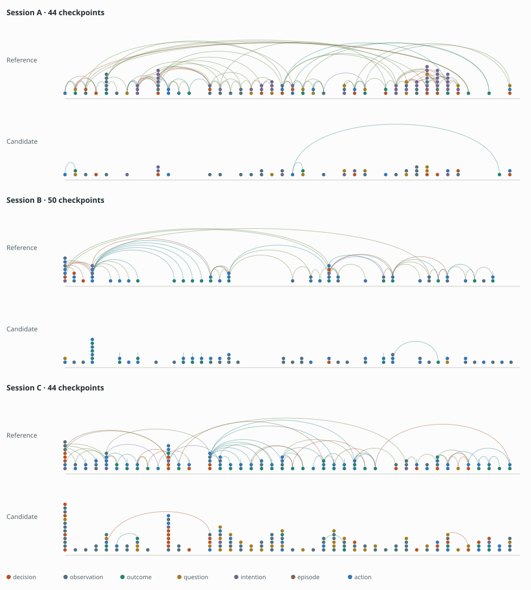

# Source Memory

Source Memory retains original conversation turns and makes them searchable, then lets callers attach decisions, outcomes and relationships to exact source spans. It uses Neo4j for storage and offers a JSON CLI and an experimental Pi integration.

Use it when an agent needs to find what was said **and** inspect evidence for how a decision changed. Unlike a summary-only memory, retained source remains searchable even when no interpretation is recorded. Callers supply interpretations; relationships are explicit, not inferred automatically.

## Quick start

Requires Docker and Compose. In the repository root create `.env` containing `NEO4J_PASSWORD=<a long random password>`; never commit it.

```sh
docker compose up -d neo4j
docker compose run --rm memory init --scope default
docker compose run --rm -T memory ingest --scope default < examples/turn.json
echo '{"query":"dashboard"}' | docker compose run --rm -T memory recall --scope default
```

[Host Node.js setup and next steps](docs/guides/getting-started.md) · [Documentation](docs/README.md)

## Checkpoint comparison



**How to read:** each session shows the reference above the T1 candidate; columns are checkpoints, dots are records (colors indicate kind), and arcs are relationships. Dense stacks overlap, so this image is a structural overview, not a count chart. [Larger T1 chart](evaluations/assets/structure-t1.svg) · [Baseline chart](evaluations/assets/structure-baseline-v2.1.svg) · [Results and method](docs/evaluation/results.md). The record-kind color key is at the foot of the image; arc colors distinguish relation types.

These are provisional model annotations, not ground truth. The retained baseline and T1 runs used Haiku; T1 was rejected on retention and M2 remains incomplete. The three development sessions do not establish general performance.

## Boundaries

Scope grants are a local operator boundary, not isolation from other processes running as the same user; do not expose the CLI as a network service. There is no deletion command. Vector recall may be partial. Model endpoints receive memory text, so authorize and protect them accordingly. The Pi integration is experimental, not a qualified production deployment.

[Documentation index](docs/README.md) · [Qualification and error codes](QUALIFICATION.md) · [Apache-2.0 license](LICENSE)
