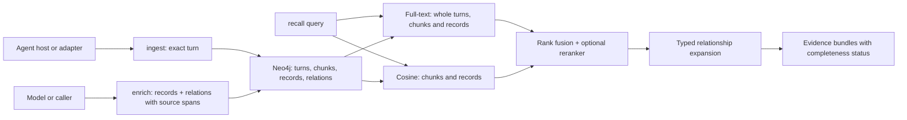

# Source Memory

**Agent memory that keeps the original conversation turns, then finds them again through full-text search, chunk embeddings, and explicit relationships between recorded decisions.** Interpretation (decisions, outcomes, corrections) is attached to exact source spans rather than replacing the source. A Neo4j server holds everything; a JSON CLI and an agent skill expose it.



Why source-first: compressed or extracted memories lose qualifications and the context needed for questions nobody anticipated. Recent benchmark work (Bao et al., [*Is Complex Agentic Memory Always Needed?*](https://arxiv.org/abs/2610.30755)) found plain retrieval over raw history competitive with complex agentic memory systems, largely because it retains more sufficient evidence. Source Memory keeps that raw retrieval path and adds explicit, evidence-backed relationships, so a matched old decision arrives with the decision that superseded it even when the successor scores poorly for the query.

## Quick start (Docker)

Requires Docker with Compose. Create a `.env` file beside `docker-compose.yml` containing one line, `NEO4J_PASSWORD=<a long random password>`. `.env` is git-ignored; never commit it.

```sh
docker compose up -d neo4j
docker compose run --rm memory init --scope default
docker compose run --rm -T memory ingest --scope default < examples/turn.json
echo '{"query":"dashboard"}' | docker compose run --rm -T memory recall --scope default
```

The container uses [`config/docker.json`](./config/docker.json), which reaches Neo4j by its Compose service name. Neo4j's Bolt port is also published on `127.0.0.1` only, so host-side tools can share the same database.

## Quick start (host Node.js)

Requires Node.js 22+ and a Neo4j 5.26+ server.

```sh
npm ci
export SOURCE_MEMORY_NEO4J_PASSWORD=...   # use your normal secret mechanism
node bin/memory.mjs init --config config/host.json --scope default
node bin/memory.mjs ingest --config config/host.json --scope default --input examples/turn.json
echo '{"query":"dashboard"}' | node bin/memory.mjs recall --config config/host.json --scope default
```

`--config` defaults to `$SOURCE_MEMORY_CONFIG`. The package executable is `source-memory`.

## Configuration

| Key | Meaning |
|---|---|
| `neo4j.uri` | `bolt://`, `neo4j://`, `bolt+s://`, or `neo4j+s://`. Loopback by default. |
| `neo4j.allow_remote` | `true` to permit a non-loopback server (another host, a Compose service name). Prefer `+s` schemes off-host. |
| `neo4j.database`, `neo4j.user` | Database name (default `neo4j`) and user (default `neo4j`). |
| `neo4j.password_env` | Name of the environment variable holding the password; the password never lives in the file. |
| `neo4j.auth` | `"none"` only for a disposable, isolated test database. |
| `scopes.read`, `scopes.write` | Allowlists. Every command names a scope; others are refused before storage is touched. |
| `chunking.words`, `chunking.overlap` | Word-window size and overlap for embedding chunks (default 256 / 32). |
| `index_on_write` | `false` makes `ingest`/`enrich` return without embedding; run `index` separately. Use it on latency-sensitive paths. |
| `embedding` | Optional `{url, model, dimensions, timeout_ms, allow_remote}`; OpenAI-compatible `/v1/embeddings`. |
| `reranker` | Optional `{url, model, timeout_ms, allow_remote}`; see the rerank protocol below. |
| `vector_scan_limit` | Maximum vectors scored per recall (default 10,000). |

To use a different Neo4j server, change `neo4j.uri` (plus `allow_remote` if it is not on loopback) and the credential variable. Nothing else in the code assumes the bundled server.

Model endpoints receive memory text. They are loopback-only unless that endpoint sets `allow_remote: true`. Redirects are refused. [`config/host.json`](./config/host.json) shows a local [Ollama](https://ollama.com) `embeddinggemma` endpoint (768 dimensions). No model is downloaded or contacted unless configured.

## Commands

Every command prints one JSON object on stdout. Failures print `{"ok":false,"error":"<code>"}` on stderr with a nonzero exit; database and model error text is not echoed. JSON input comes from `--input FILE` or stdin.

| Command | Input | Behavior |
|---|---|---|
| `init` | None | Create uniqueness constraints and this scope's full-text indexes |
| `ingest` | Turn envelope | Atomically retain exact source and its chunks; then embed unless `index_on_write` is false |
| `enrich` | Records and relations | Validate source spans and endpoints; commit the whole bundle atomically |
| `index` | Optional `{"limit":256}` | Embed missing or out-of-date chunks/records |
| `recall` | `{"query":"...", "limit":8}` plus bounds | Search turn/chunk/record lexical and chunk/record vector channels, fuse, rerank, expand relationships, return evidence bundles |
| `recall` | Optional `mode`, `group:"conversation"`, `per_conversation` | Echo a mode contract; opt into per-channel conversation admission and atomic conversation units (below) |
| `recall` | add `"exclude_conversations":[{"source":"...","conversation_id":"..."}]` (at most 16) | Rank without those conversations: their turns, chunks and records whose evidence lies only in them are dropped inside every channel before its limit, and their unindexed text does not make a channel partial. Records with other evidence stay. Turns stored before lineage properties existed are never excluded |
| `show` | `{"kind":"turn"\|"record","id":"..."}` | Full retained turn, or a record with its source evidence |
| `show` | `{"kind":"bundle","seed":{"kind":"turn"\|"record","id":"..."},"max_nodes":48,"max_hops":4}` | One seed's relationship-closed bundle (same shape as a recall bundle), rebuilt without a query; hash it to detect later relationship changes |
| `show` | `{"kind":"following","turn":"<turn id>","limit":2}` | Later turns of the same conversation by exact `parent_turn_id` links (see below) |
| `show` | `{"kind":"turn_by_key","source":"...","conversation_id":"...","turn_ids":["..."]}` | Which of up to 16 caller turn keys already name stored turns (`found`, in request order); for callers that must reuse an existing identity |
| `status` | None | Counts, unindexed items, configured models |

### Turn envelope

```json
{
  "source": "my-agent-host",
  "conversation_id": "stable-conversation-id",
  "turn_id": "stable-turn-id",
  "parent_turn_id": "previous-turn-id",
  "occurred_at": "2026-10-23T12:00:00Z",
  "entries": [
    {"id": "entry-1", "role": "user", "text": "Use blue for the demonstration dashboard."},
    {"id": "entry-2", "role": "assistant", "text": "I will use blue for this demonstration."}
  ]
}
```

Roles: `user`, `assistant`, `tool`, `system`, `derived`. A `derived` entry (for example a compaction summary) is searchable but cannot serve as original evidence. Text is stored exactly; total source per turn is capped at 2 MB.

`parent_turn_id` names the previous turn's `turn_id` in the same conversation and branch. Set `"lineage_root": true` only when the turn is known to be the first of its branch; otherwise a missing parent is treated as unknown. Neither field is inferred or backfilled.

Identity is scope + `source` + `conversation_id` + `turn_id`. Identical retries return the same ID with `replayed: true`; different content under the same identity is refused (`source_identity_conflict`). A turn is retained and lexically searchable whether or not anything is ever extracted from it, and an embedding outage never rolls it back.

Chunks are word windows inside a single entry, recorded with exact UTF-16 offsets. They are search handles; `show` returns the retained original rather than stitching chunks together.

### Records and relations

```json
{
  "records": [{
    "id": "decision-1",
    "kind": "decision",
    "status": "accepted",
    "text": "Use blue for the demonstration dashboard.",
    "attribution": "user statement in entry-1",
    "evidence": [{"turn": "<id returned by ingest>", "entry_id": "entry-1", "start": 0, "end": 41}]
  }],
  "relations": []
}
```

- Kinds: `decision`, `observation`, `outcome`, `question`, `intention`, `episode`, `action`. Status: `proposed` (default), `accepted`, `observed`. Status and attribution are caller assertions.
- Relation types: `supersedes` (new → old), `qualifies`, `contradicts`, `depends_on`, `outcome_of` (outcome → action). Each relation has its own `id`, `attribution`, and `evidence`.
- An `outcome` must have an `outcome_of` relation to an `action`, supplied in the same bundle or already stored.
- Evidence offsets are half-open UTF-16 offsets into an entry of a retained turn, may not split a surrogate pair, and are resolved from stored source; callers never supply quoted text.
- Records and relations are append-only by identity. Record a correction as a new record with a `supersedes` or `qualifies` relation. Chronology and similarity never create relations automatically.
- Limits: 128 records and 256 relations per call; 16 spans per item; 16,000 characters per span, 32,000 per item. Any invalid span, endpoint, or identity conflict rolls back the entire call.

## Following a conversation

`show {"kind":"following"}` walks exact parent links forward from one turn and returns up to `limit` later turns (default 2, at most 16) with their entries and roles.

| Field | Meaning |
|---|---|
| `has_more` | More linked turns exist beyond `limit` |
| `end` | `recorded_end` (last turn this store holds, not proof the conversation ended), `limit`, `branched`, or `cycle` |
| `lineage` | `linked`; `branched` (two children: the active branch cannot be chosen from storage); `cycle`; or `unknown` when a same-conversation turn has no recorded place (stored before lineage existed, a non-root missing parent, or a parent this store does not hold) |
| `unlinked_turns` | How many such turns make the lineage unknown |

Later turns are context, not supersession: a later statement does not by itself replace an earlier decision.

## Recall

Five independent channels run under the requested scope: `turn_lexical`, `chunk_lexical`, `record_lexical`, `chunk_vector`, `record_vector`. Query text is treated as literal terms, never as Lucene or Cypher syntax. Results merge by reciprocal rank fusion; an optional reranker then reorders them. Each scope has its own full-text indexes, and every vector, traversal, and evidence read filters by scope before ranking.

Chunk lexical hits identify the entry, role, UTF-16 span, and qualified `conversation` key (`scope`, `source`, `conversation_id`). Legacy roles resolve from the parent turn's stored entries; a missing or ambiguous entry yields `unknown` without dropping the hit. Body-derived conversation keys carry `legacy: true` and are informational only. The channel queries only an `ONLINE` chunk index: `POPULATING` reports `pending` without hits; missing or failed indexes report `unavailable`.

From each seed, expansion follows `supersedes` (both directions), `qualifies`, `contradicts`, `depends_on`, and `outcome_of`, with node, hop, and edge limits. Cycles terminate. Limits that cut context are reported as gaps, and a bundle that does not fit the output budget is omitted whole rather than trimmed of its successor.

```json
{"query": "why did the dashboard color change?", "limit": 8, "candidates": 64, "max_nodes": 48, "max_hops": 4, "max_chars": 24000}
```

| Field | Meaning |
|---|---|
| `status` | `ready`, `no_matches`, `budget_limited`, or `degraded` (a configured channel failed) |
| `channels` | Per-channel `ready` / `partial` / `pending` / `unconfigured` / `unavailable`, with reasons |
| `retrieval_complete` | All channels ran without known index or scan gaps. Not a guarantee every relevant memory was found. |
| `relationship_context_complete` | Expansion from the returned seeds hit no limit |
| `bundles[]` | Match provenance, source excerpts, records with supporting evidence, relations with evidence |

The cosine channels score a bounded, scope-filtered vector scan; this is not an approximate-nearest-neighbor index and is sized for personal and team histories, not web-scale corpora.

Recalled material is evidence, not authority. A proposal is not an accepted decision, a changed justification does not repeal a decision by itself, and several channels matching the same turn are one source, not corroboration.

### Modes and conversation units

With no new inputs, recall retains its original output byte-for-byte. Optional `mode` accepts only `evidence_advice` or `history_search` and adds `mode` plus its exact `mode_contract`; mode alone does not change admission or selection. These contracts describe intent and bounds, not assertion, authority, currentness, or completeness. Lane selection, carried-evidence collapse, following-read refusal, and adapter deadlines belong to the consumer, not this CLI.

```json
{"query":"backup window", "mode":"history_search", "group":"conversation", "per_conversation":2, "limit":12, "max_chars":24000}
```

Only `group:"conversation"` enables grouping. `per_conversation` must be an integer from 1 to 4 (default 2); it applies inside each channel's query before `candidates`. Exclusion precedes admission and all caps. Duplicate chunks count as one turn seed; shared records must fit every cited conversation's per-channel quota. Keys are qualified by `scope`, `source`, and `conversation_id`. Legacy keys are decoded read-only from stored turn bodies and marked `legacy: true`; they never affect exclusion or lineage.

The shared, eligible vector scan still obeys `vector_scan_limit` before ranking/admission; exceeding it still reports `partial` / `scan_truncated`. The grouped path ranks scanned vectors with Neo4j `vector.similarity.cosine`, breaking ties by node UID; float precision can make these ranks differ from the default JavaScript cosine. Grouped full-text channels search only `ONLINE` indexes; populating indexes remain `pending`, missing/failed indexes remain `unavailable`.

| Grouped output | Meaning |
|---|---|
| `channels[name].admitted_conversations` | Integer count of distinct qualified keys represented by returned seeds, on the five retrieval channels only (not the reranker) |
| `channels[name].exhausted` | Boolean: eligible matches before conversation admission exceeded that channel's `candidates` cap |
| `units[]` | `{key, legacy?, seeds, seeds_truncated, also_cites}`; `seeds` contains unchanged bundle objects in final seed rank order |
| `units[].seeds_truncated` | Integer count of unique turn/record identities omitted by admission for that conversation, excluding identities admitted by another channel |
| `units[].also_cites` | Other qualified conversation keys cited by the unit; a multi-conversation record is packaged once under the conversation with the best final seed rank, with qualified-key tie order |
| `pool_truncated` | Integer count of units beyond `limit`, or 0; `limit` counts units, not seeds |
| `budget_unit` | `utf8_bytes`: grouped `max_chars` measures UTF-8 JSON unit bytes; the default path keeps character counting |
| `budget_omitted` | Number of whole units skipped for the rendering budget; placement continues with the next unit inside the pool |
| `bundles[]` | Flattened seeds from accepted units, retaining the existing bundle shape |

Units are ordered by their best final seed rank, after the optional reranker. Every admitted seed is rendered before budgeting: the CLI never drops a seed or trims a unit to make it fit. A byte-budget omission still means `budget_limited` and `relationship_context_complete:false`; pending/unavailable channels and bundle relationship gaps keep their own meanings and are never relabeled as omissions.

## Local model protocols

Embedding: `POST {"model": "...", "input": ["text", ...]}` returning `{"data": [{"index": 0, "embedding": [...]}]}`; vectors must match `dimensions`, be finite, and be nonzero.

Rerank: `POST {"model": "...", "query": "...", "documents": ["...", ...], "top_n": N}` returning `{"results": [{"index": 0, "relevance_score": 0.9}]}` covering every document exactly once. Candidate text sent for reranking is capped at 16,000 characters each.

If a response names a `model`, it must equal the configured one. Changing the endpoint, model, or dimensions changes the embedding identity; `index` rebuilds affected vectors and recall never mixes identities. Without models, lexical recall works and vector channels report `unconfigured`.

## Agent skill

[`skills/source-memory/SKILL.md`](./skills/source-memory/SKILL.md) teaches an agent to recall, inspect, and record source-backed memory with this CLI. Automatic capture belongs in a host adapter: the host knows when a turn completes and holds the original text, and it should copy that text into `ingest` before any asynchronous interpretation runs. A model should cite source entries, never retype them as evidence.

## Development

```sh
npm ci
npm test                 # unit and HTTP-boundary tests
npm run check            # syntax and JSON checks
npm run test:integration # disposable loopback Neo4j container; needs Docker
```

`npm run test:integration` starts a throwaway `neo4j:5.26.14-community` container with no published credentials, runs transaction, search, scope, graph, outage, and CLI checks with fictional data and deterministic model fixtures, and stops the container. Set `SOURCE_MEMORY_REAL_EMBEDDING_URL` (and optionally `SOURCE_MEMORY_REAL_EMBEDDING_MODEL`, default `embeddinggemma`) to additionally exercise a real local embedding endpoint. Fixture results test plumbing, not retrieval quality.

## Limitations

- Scope allowlists come from a local configuration file. They are an operator boundary, not isolation from other processes running as the same user. Do not expose the CLI as a network service.
- No deletion or erasure command yet.
- Vector search is a bounded scan, not an ANN index.
- No built-in extraction model: interpretation is supplied by the caller.

## License

[Apache-2.0](./LICENSE). A Token Smelter project.
