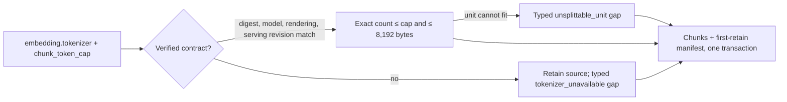

# Token-capped chunks for new turns

**New turns can be chunked so that no chunk exceeds the embedder's context, counted exactly by the served model's own tokenizer.** It is off unless `embedding.tokenizer` is set. Existing turns, chunks and vectors are never rewritten, and a replay keeps its first layout.

## Configuration

| Key | Meaning |
|---|---|
| `embedding.tokenizer` | `{gguf, sha256}`: absolute path to the served model's GGUF and the tokenizer digest `readGgufTokenizer` reports. Unset means the legacy byte chunker and no token claim. |
| `embedding.chunk_token_cap` | Positive integer, at most the verified context. Default 1920 when `embedding.tokenizer` is set. A cap without a tokenizer, or out of range, is refused (`invalid_chunk_token_cap`) before any write. |
| `embedding.ollama_context_revision` | Must equal the verified contract's serving revision. The default is `ollama-0.21.0-embeddinggemma-0800cbac-ctx2048`. |

A tokenizer is trusted only through `VERIFIED_TOKENIZERS` in `src/chunk-policy.mjs`. An entry binds the digest to the served model, the rendering contract (`ollama-spm-raw-input/1`: raw input plus BOS and EOS, with special-token strings split first), the serving revision and the effective context. Only a reviewed parity qualification (`scripts/tokenizer-parity.mjs`) adds one. Any other contract yields `tokenizer_unavailable` gaps with reason `unverified`. The configured GGUF must hash to the entry's `served_blob`. That proves the local file only; that the running endpoint serves that blob and transport is the owner's attestation through `ollama_context_revision`.

Only a policy whose descriptor digest is listed in `QUALIFIED_TREATMENTS` is `qualified`, and only a reviewed evaluation of exactly that descriptor adds it. Every other valid policy is stamped `unqualified` on its turns and chunks. The descriptor includes cap, chunker settings, tokenizer, served blob, rendering, serving revision, endpoint path, transport and dimensions.

| Table | Entry | Evidence |
|---|---|---|
| `VERIFIED_TOKENIZERS` | `2e942f0e…b698`: embeddinggemma, blob `sha256:0800cbac…c515`, Ollama 0.21.0, context 2048 | Parity report `dd421cb8…0de2`: 185 exact counts and 3 exact native refusals on 188 fictional strings |
| `QUALIFIED_TREATMENTS` | `07d6ab7d…d1a0` (`DEFAULT_TREATMENT`: cap 1920, `/v1/embeddings`, `openai_compat`, 768 dimensions) | Sealed `default-v1` run against `legacy-reference-v1`, comparison `8621f250…f8e1`: embedded recall@5 13/13 against 4/13, every gold span fully represented, no query lost |

To use the qualified default, set `embedding.tokenizer` to that blob and digest and `embedding.ollama_context_revision` to `ollama-0.21.0-embeddinggemma-0800cbac-ctx2048`, and leave `chunk_token_cap` unset. The native no-truncate transport, any other cap and any other model are unqualified until they have their own evaluated row.

## What is stored

On a first retain, in the same transaction as the turn:

| On | Properties |
|---|---|
| `SMTurn` | `chunk_policy` (canonical descriptor), `chunk_policy_digest`, `chunk_qualification`, `chunk_count`, `chunk_gap_count`, `chunk_manifest` and its `chunk_manifest_digest`, `chunk_manifest_status` (`complete` or `over_bound`) |
| `SMChunk` (token policy only) | `token_count`, `chunk_token_cap`, `tokenizer_sha256`, `chunk_qualification` |

`chunk_manifest` is `source-memory.chunk-manifest/1`. It contains the scope, turn UID and stored hash, the policy, and per chunk the UID, ordinal, entry, UTF-16 `[start,end)` and text digest. Gaps are listed with their cause. No source text is copied into it. Unconfigured new turns get a `legacy-bytes/1` manifest with a null token count. Turns retained before manifests have none.

## Readers

A gap is source that no chunk represents, not a missing vector row. `status` reports `derived_gaps`. `index` returns `unavailable` with reason `derived_chunk_gaps` rather than `ready`, and the recall `chunk_vector` channel is `partial` with `derived_gaps`.

## Counting stored chunks over the context

`scripts/over-context-count.mjs` is an owner-only, read-only count of one exact scope's stored chunks under today's verified contract. It needs the owner's grant to read that scope's text. It reports `within_cap`, `over_cap_within_context` and over-context chunks split into `with_current_vector` and `without_current_vector`, plus a histogram and excess tokens. It reports no identifiers, spans or text.

Every cap is required: rows, fetched text bytes, pages, page size of at most 500, seconds and the transaction timeout. Any cap, failure or changed total gives `incomplete` with no totals. Pages are separate snapshots, not one cut. An over-context chunk with a current vector has *unknown fidelity*: the count does not establish what an earlier writer sent, nor that its vector was truncated.

## Evaluation

`scripts/eval-chunking.mjs` runs one sealed row of a star matrix: the default `default-v1` and the frozen `legacy-reference-v1` reference, plus explicit, unqualified `--experiment` rows. It scores against gold source spans in a fictional corpus and reports two things separately: that the stored chunk was hit, and that the needle was actually embedded. `--compare` applies the predeclared gates.
