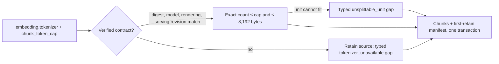

# Token-capped chunks for new turns

**New turns can be chunked so that no chunk exceeds the embedder's context, counted exactly by the served model's own tokenizer.** It is off unless `embedding.tokenizer` is set. Existing turns, chunks and vectors are never rewritten, and a replay keeps its first layout.

## Configuration

| Key | Meaning |
|---|---|
| `embedding.tokenizer` | `{gguf, sha256}`: absolute path to the served model's GGUF and the tokenizer digest `readGgufTokenizer` reports. Unset means the legacy byte chunker and no token claim. |
| `embedding.chunk_token_cap` | Positive integer, at most the verified context. Default 1920 when `embedding.tokenizer` is set. A cap without a tokenizer, or out of range, is refused (`invalid_chunk_token_cap`) before any write. |
| `embedding.ollama_context_revision` | Must equal the verified contract's serving revision. The default is `ollama-0.21.0-embeddinggemma-0800cbac-ctx2048`. |

A tokenizer is trusted only through `VERIFIED_TOKENIZERS` in `src/chunk-policy.mjs`. An entry binds the digest to the served model, the rendering contract (`ollama-spm-raw-input/1`: raw input plus BOS and EOS, with special-token strings split first), the serving revision and the effective context. Only a reviewed parity qualification (`scripts/tokenizer-parity.mjs`) adds one. Until then a configured contract yields `tokenizer_unavailable` gaps with reason `unverified`.

Only a policy whose descriptor digest is listed in `QUALIFIED_TREATMENTS` is `qualified`, and only a reviewed evaluation of exactly that descriptor adds it. Every other valid policy is stamped `unqualified` on its turns and chunks.

## What is stored

On a first retain, in the same transaction as the turn:

| On | Properties |
|---|---|
| `SMTurn` | `chunk_policy` (canonical descriptor), `chunk_policy_digest`, `chunk_qualification`, `chunk_count`, `chunk_gap_count`, `chunk_manifest` and its `chunk_manifest_digest`, `chunk_manifest_status` (`complete` or `over_bound`) |
| `SMChunk` (token policy only) | `token_count`, `chunk_token_cap`, `tokenizer_sha256`, `chunk_qualification` |

`chunk_manifest` is `source-memory.chunk-manifest/1`. It contains the scope, turn UID and stored hash, the policy, and per chunk the UID, ordinal, entry, UTF-16 `[start,end)` and text digest. Gaps are listed with their cause. No source text is copied into it. Unconfigured new turns get a `legacy-bytes/1` manifest with a null token count. Turns retained before manifests have none.

## Readers

A gap is source that no chunk represents, not a missing vector row. `status` reports `derived_gaps`. `index` returns `unavailable` with reason `derived_chunk_gaps` rather than `ready`, and the recall `chunk_vector` channel is `partial` with `derived_gaps`.

## Evaluation

`scripts/eval-chunking.mjs` runs one sealed row of a star matrix: the default `default-v1` and the frozen `legacy-reference-v1` reference, plus explicit, unqualified `--experiment` rows. It scores against gold source spans in a fictional corpus and reports two things separately: that the stored chunk was hit, and that the needle was actually embedded. `--compare` applies the predeclared gates.
