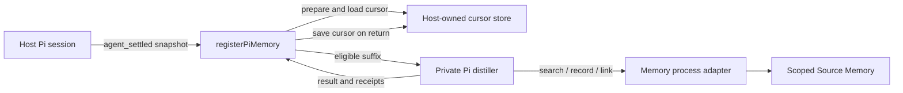

# Integrating Pi Memory with a host

**Status: experimental scaffolding, not a drop-in production integration.** The repository implements a host-injected Pi hook, a cursor-bounded distiller and Memory-process adapters; the host must supply configuration, authorization, cursor persistence, lifecycle management and recovery. An external development pilot was declared **invalid: search truncation fault** after whole recall bundles were omitted under a budget. Compact record search replaces those distiller bundles, but does not retroactively validate that pilot.



## Package and loading

| Surface | Current behavior |
|---|---|
| Package | `source-memory`, private package, Node.js 22 or later, ES modules. The root `exports` entry is `src/memory.mjs`; it does **not** export the Pi integration as a package subpath. |
| Host entry | Import the named `registerPiMemory` export from the checked-out `pi-extension/index.mjs` using a host-controlled file path. It is not a default-export Pi extension and this repository does not install or automatically register it in a host. |
| Registration | Call `registerPiMemory(pi, { prepare, onError })` from a host-owned adapter. The host must verify that its Pi runtime emits the expected `agent_settled` event with the `sessionManager` methods described below. |
| Status | The hook and injected adapters have fictional tests. A complete live bootstrap, supported installation contract and production lifecycle have not been established. |

Illustrative wiring, **not a complete or production-ready bootstrap**:

```js
import { registerPiMemory } from './vendor/source-memory/pi-extension/index.mjs';

export default function attachMemory(pi) {
  return registerPiMemory(pi, {
    async prepare(snapshot) {
      // Host-owned code resolves authorization, cursor, Memory, distiller and storage.
      return prepareAuthorizedSession(snapshot);
    },
    onError(error) {
      handleMemoryFailure(error);
    },
  });
}
```

`prepareAuthorizedSession` and `handleMemoryFailure` are host responsibilities, not exports from this package. The example's default export is the shape a host can load as a Pi extension. The isolated distiller sub-session loads no host extensions, avoiding recursive registration. Do not load the example until those functions, private storage and a spend policy are implemented.

`prepare` receives only `{ sessionId, leafId, entries }`, not `ctx`, a session-file path or a working directory. It must return `{ conversation_id, scopes: [scope], memory, distiller, cursor, saveCursor }`; `memory.ingest`, `distiller.run` and `saveCursor(cursor, result)` must be callable. Optional inputs include `imageArchive` and `ensureIndexed`. The hook overwrites any returned `entries` with its snapshot. The host must resolve the session file separately, ensure it contains the leaf, and verify it matches the in-memory entries: the current adapter does not cross-check the two.

## Host configuration and responsibilities

| Input | Requirement and current boundary |
|---|---|
| Session | Provide a stable conversation/session identity, a readable Pi session file where the SDK distiller is used, and consistent entries with `id` and `parentId`. The event adapter reads `ctx.sessionManager.getSessionId()`, `getLeafId()` and `getEntries()`. |
| Scope and permissions | Resolve one nonempty scope from trusted host policy, not from model-supplied arguments. Configure Memory read and write grants explicitly; links and outcomes require both grants on that scope. The process's single `--scope` must match those grants and its ingest/enrich path accepts `pi-memory` source turns only. Cross-scope policy is not implemented. |
| Memory process | Supply a Memory-compatible client to `prepare`. `pi-extension/serve.mjs` exposes the scoped protocol and requires a private intent directory; `memory-client.mjs` provides its facade. The optional `docker-memory.mjs` adapter expects a container ID and fixed `/memory` and `/scratch` layout; it is not an automatic production launcher. A write-method timeout can leave an unknown effect. The host owns process startup, health, shutdown, credentials and transport isolation. |
| Configuration | Memory configuration supplies Neo4j connection and credential source, `scopes.read`, `scopes.write`, chunking, embedding endpoint/model/dimensions and indexing policy. `config/host.json` is an example, not a secure production default. Do not pass credentials or broad scope authority through the model. |
| Model and reviewer | Supply an authorized Pi SDK, model route/runtime and reviewer as required by the selected adapter. `resolvePiModels` defaults the candidate to `anthropic/claude-haiku-5-5`; a reviewer ID is required but may be the same model. “Separate” review means a separate Pi session, not an independently enforced model or family. The host must authorize inference, select routes and protect source, output and credentials. |
| Budget | Supply a metered runtime and spend policy appropriate to the host. `createInputBudget` is a between-call input-token guard, not a hard dollar reservation. The pilot soft ledger is an API-equivalent estimate, can overshoot a soft cap, and cannot correlate every gateway retry; it is not a provider charge or a production spending guarantee. Stop on unknown usage or write outcome according to the host's policy. |
| Images | If image-bearing entries are accepted, provide the private image archive expected by the core. Image blobs are not text-citable; placeholders are not evidence of visual content. |

`createSliceSession` in `pi-extension/slice-runtime.mjs` illustrates assembling a private incremental session, a selected route and reviewer, a metered wrapper and optionally a coverage journal. Its pilot-oriented defaults and a metering marker do not prove live authorization, provider bounds or production readiness.

## Hook, cursor and restart boundary

`registerPiMemory` snapshots the session ID, current leaf ID and entries when `agent_settled` fires. It finds an eligible message leaf without crossing a compaction or branch-summary boundary, then queues work per session without blocking the event handler. The queue is in memory; an error is sent to `onError` rather than advancing the cursor. The adapter calls `prepare(snapshot)`, passes `prepared.cursor ?? null` and the snapshot entries to `distillThrough`, then invokes `prepared.saveCursor(result.cursor, result)` only after that call returns.

The cursor is the last covered **source entry ID**, not a message count. Processing walks the active ancestry and consumes the suffix after that cursor through the settled assistant leaf. Missing or mismatched ancestry, unsupported content and incomplete turns must not be treated as successful coverage. `incremental.mjs` creates a private Pi session copy and preserves source IDs in a work directory with no group/other permissions; `pi-runtime.mjs` branches the distiller at each source leaf.

**The live hook is not restart-safe.** The repository does not provide a durable live cursor store or automatic restart recovery. The host must implement `saveCursor` and durable cursor loading and bind them to the correct session and branch. A `createSliceSession` result built with `coverageJournal` cannot be used directly with `registerPiMemory`: the hook does not begin an interval and tracked ingest fails with `interval_not_started`. Use the journal through `runCoveredInterval` or `replay`, not by passing it to the live hook. The cursor save is not atomic with the journal.

**Failure may duplicate source.** Ingest and derived writes happen before cursor saving. If the distiller or `saveCursor` fails, the next settle can ingest a wider interval under a different turn ID, overlapping earlier source and records. The live hook has no same-interval retry or reconciliation. It also does not check budget before ingestion; the host must check in `prepare` and refuse before returning when budget or usage is unavailable.

**Compacted sessions are not covered.** A compaction or branch summary anywhere in active ancestry, including before the saved cursor, causes `source_boundary_unresolved` on later intervals. No automatic policy resolves it. After a crash an orphan journal lock requires operator inspection; an unfinished interval reloads as `uncertain` and blocks progress until reconciliation. An existing link-intent file indicates unknown outcome, never permission to retry. In-memory queues and incremental-copy state do not survive restart.

A no-op re-settle may produce `cursor_unresolved`; a user, tool-result or unfinished assistant leaf produces `turn_incomplete`. A branch switch can leave the saved cursor outside the new ancestry and needs host action. Missing `saveCursor` can throw after ingestion; synchronous handler errors can propagate to Pi instead of `onError`. Treat per-branch cursor custody and partial writes explicitly rather than blindly retrying.

## Distiller tools

The Pi distiller registers its own sequential tools; these are **sub-session tools**, not automatically exposed to the host's main assistant.

| Tool | Current contract |
|---|---|
| `memory_search` | Searches only the configured scope and returns up to 64 ranked record cards under a 24,000-byte budget. Cards contain IDs, kinds, scores, at most 80 UTF-8 bytes of text, and turn-scoped handles; original-source evidence and relationship context are not loaded. Both record lexical and vector channels must be ready. Budget omissions, known top-k omissions, channel caps and potentially incomplete post-ranking kind filters are disclosed. Partial or unavailable retrieval fails. The evaluation runner invalidates a budget omission, known top-k omission or potentially incomplete kind filter. Bounded retrieval never establishes global absence. |
| `memory_fetch` | Resolves one previously offered handle in the same scope and trigger, returning the selected record, its evidence and up to 64 immediate relations. Missing or limited relationship context makes evaluation search incomplete; neighboring record evidence is not fetched. |
| `memory_link_offer` | After a write, accepts selected same-trigger search handles and offers record and source handles for a possible link. Only selected prior records are hydrated; retrieval explicitly reports selected, bounded context and any packet omissions. |
| `memory_record` | Requires a successful search and refuses subsequent writes for the rest of the interval after any search failure, even if a later search succeeds. Proposes a typed record backed by offered current-turn source labels. Status remains `proposed`, not operator acceptance. An `outcome` requires exactly one action referent: an offered prior-action handle or a newly supplied action; the outcome and relation are committed atomically, with a separate Pi review session for a prior action. |
| `memory_link` | Proposes a typed relation using only record and evidence handles from the current `memory_link_offer`. Handles are offer-local, not durable authority. A proposal is separately reviewed before the Memory process applies a supported relation. |
| `memory_submit` | Ends the distiller's evaluation with `done_with_writes` or `done_nothing_qualifies` and a reason. The model does not decide whether a transport write was confirmed or uncertain. |

The current tool contracts and the distinction between proposed and accepted knowledge are exercised by fictional tests. They do not establish that every returned item is relevant, authoritative or complete.

## Dispositions and receipts

The journal accepts `committed`, `abstained`, `ineligible_by_policy`, `failed`, `uncertain` or `unresolved_scope`. The current distiller produces `committed` or `abstained`; the coverage runner maps errors to `failed`, `uncertain` or `unresolved_scope`. `ineligible_by_policy` is written explicitly by the pilot's tail-handling path, not inferred by the distiller. Confirmed effects have receipt hashes; a possible write without a confirmed outcome is `uncertain`, and dependent work is blocked until explicit reconciliation. A failure after confirmed derived writes remains failed but requires reconciliation before retry. A successful evaluation with no derived write may abstain; a failed/degraded search is not an abstention. The external owner-approved Interpretation 02 permits abstention after a successful `budget_limited` search while recording incompleteness; it does not make the invalid truncated pilot valid.

The coverage journal is private, append-only and hash-chained. Its lock, effect records and reconciliations are implemented for the replay path. A caller-supplied `saveCursor` is a separate operation, not an atomic transaction with that journal. Hosts must retain appropriate Memory receipts, protect their content and avoid treating a locally returned result or model statement as proof of an external side effect.

## Distiller sub-session, cache and cost

The SDK distiller reopens a private copy of the source Pi session, branches at the selected source leaf and constructs a side-branch task without adding future source context. It uses the supplied model/runtime and a bounded reviewer; source content is untrusted data, not instructions. The host is responsible for authorizing the distiller and review calls, their scope, and their maximum spend.

Distiller and reviewer sub-sessions disable Pi retries and compaction and do not load host extensions, skills or context files. The reviewer is limited to two calls per turn; a separate session is not necessarily an independent model. For Anthropic-compatible requests, the adapter attempts to copy an existing cache-control marker to an eligible final history block, subject to the provider breakpoint limit. A marker is not evidence of a cache hit, cache lifetime, prefix equivalence or saved cost. Track reported input, cache-read, cache-write and output usage separately; actual provider charges, retries and failovers may be unknown. Do not infer a hard reservation from the soft pilot ledger.

## Identity and coexistence

Turns created by this adapter use source `pi-memory`. Their `turn_id` is derived from the cursor interval; the stored identity also combines scope, source and conversation ID. Later turns do not currently set `parent_turn_id`. Sourcerer's existing `sourcerer` capture source is a host-level convention outside this repository. Equal-looking conversations across those sources are not automatically the same identity, and this adapter does not prove cross-source deduplication, lineage equivalence or migration. The host must choose its capture policy and avoid assuming that enabling both paths merges or replaces prior records.

## Implemented versus planned

| Area | Implemented and exercised | Still required or planned |
|---|---|---|
| Event adapter | Injectable `agent_settled` hook and per-session in-memory queue; nonblocking registration has a fictional test | Real host bootstrap, queue ordering/error/cursor-save tests, lifecycle and operational authorization |
| Cursor and effects | Cursor-bounded core; replay coverage journal and explicit uncertain-write reconciliation | Durable host cursor, atomic journal/cursor handoff, non-overlapping failure recovery, budget-before-ingest and compacted-session handling |
| Retrieval | Scoped Memory search and proposal handles; bounded-state disclosure | Compact per-record results and chosen-handle evidence fetch; eliminate the observed truncation fault |
| Distiller | Private incremental Pi copy, sequential memory tools, metering interfaces and fictional/offline SDK tests | Production route qualification, bounded provider costs and host-level access controls |
| Evidence and identity | Current-turn evidence labels, private image blobs, explicit `pi-memory` source | Cross-source deduplication and visual-content citation |
