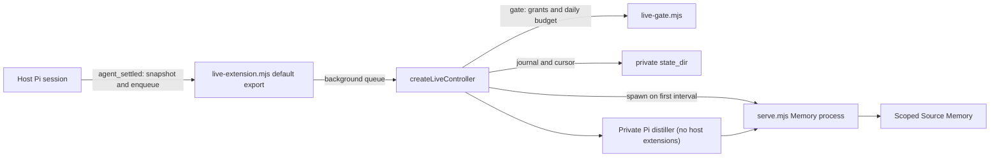
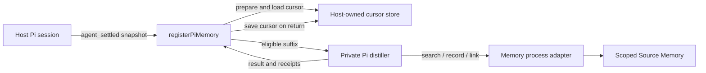
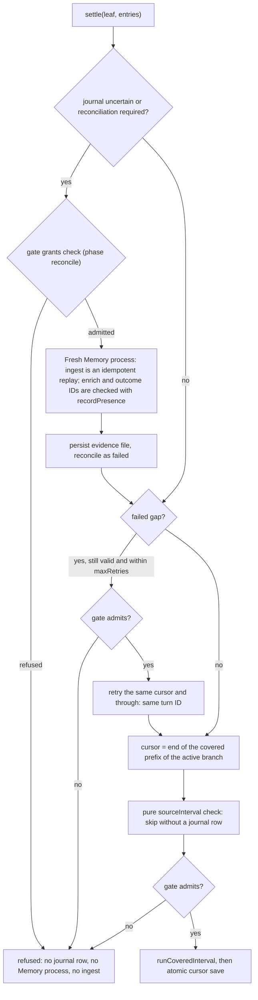

# Integrating Pi Memory with a host

**Status: a configurable live Pi extension (`pi-extension/live-extension.mjs`) with durable cursor custody, restart recovery, compaction handling and a pre-ingest budget and permission gate; still experimental, and not a qualified production deployment.** The lower-level `registerPiMemory` hook remains for host-owned adapters. The operator still owns the Memory database, credentials, model routes and spend. An external development pilot was declared **invalid: search truncation fault** after whole recall bundles were omitted under a budget. Compact record search replaces those distiller bundles, but does not retroactively validate that pilot.

## Live bootstrap (implemented)



Load `pi-extension/live-extension.mjs` in place from a checkout, with `pi -e /path/to/source-memory/pi-extension/live-extension.mjs` or a path in Pi's settings `extensions` list. Copying the file elsewhere breaks its relative imports. It reads `SOURCE_MEMORY_PI_LIVE_CONFIG` or `~/.config/source-memory/pi-live.json`. That file, and the Memory configuration it names, must be owned by the user and not group- or world-writable (`live_config_unsafe`, `memory_config_unsafe`). **Without that file it does nothing.** `examples/pi-live.json` shows the shape; unknown keys and out-of-range values refuse the whole file:

| Key | Meaning |
|---|---|
| `scope` | The one Memory scope written; the Memory configuration must grant both read and write on it, or the gate refuses. |
| `state_dir` | Absolute private directory (created `0700`) for per-session journals, cursors, intents, private session copies, `usage.jsonl` and `live.log`. |
| `memory.config` | Absolute path to the Memory configuration that `serve.mjs` uses (Neo4j, scopes, embedding). `memory.node`, `timeout_ms` and `index_timeout_ms` are optional. |
| `distiller.model`, `distiller.reviewer`, `thinking`, `reviewer_thinking` | Pi `provider/model` routes resolved through Pi's own `ModelRuntime` and auth; the reviewer defaults to the distiller model. |
| `budget.input_tokens_per_day`, `max_intervals_per_day`, `min_remaining_tokens` | Daily gate before ingest, counted across every process sharing `state_dir`. The token budget is required. |
| `modes` | Pi run modes processed, default `["tui"]`; add `"rpc"`, `"json"` or `"print"` explicitly. One-shot `pi -p` runs are not processed by default. |
| `backfill` | Default `false`: a session first seen with history (resume, `/fork`, `/clone`), meaning one this extension never opened a controller for (no journal rows and no cursor file; a controller marks the session seen when it is created, even if every interval is then refused), records that history as an `ineligible_by_policy` baseline and starts after it. `true` distills the whole history as one first interval. A history over 1,024 entries or 2 MB then fails the turn limits and is skipped at every settle, so that session is never distilled; leave `backfill` off for long sessions. |
| `max_retries`, `shutdown_grace_ms`, `pi_sdk`, `enabled` | Retry cap per interval (at most 10), drain time at `session_shutdown` (at most 30,000 ms), an explicit Pi SDK path (otherwise `PI_SDK_MODULE` or the running Pi package's bundle), and a boolean off switch. |

Runtime contract:

- **Does not await distillation.** The `agent_settled` handler only snapshots and enqueues; the next prompt does not wait for distillation. While the extension is active, the snapshot copy and the private session sync run on the host's event loop and cost O(session size), and the first interval also loads the SDK. When it is inactive (no configuration file, closed, no session file, or disabled or in an excluded mode after its first settle), the handler returns before copying anything; `enabled: false` and an excluded mode are only detected at that first settle, which still copies the session once. A missing `memory.config` reports `memory_config_missing`.
- **Fails safe.** An invalid configuration, an unavailable SDK, a failed Memory process (with its exit code where `serve.mjs` reported one) or any interval error goes to the `source-memory` footer status and to `onError` when the host constructs the extension with `createLiveExtension`. It is also written to `live.log` (codes only, no source text) once the configuration and `state_dir` are valid. A missing or disabled configuration is silent. Nothing is thrown into Pi. A startup failure disables the extension for that Pi session.
- **Lifecycle.** Nothing starts in the factory. The Memory process is spawned on the first admitted interval. `session_shutdown` marks the instance closed, so queued settles are dropped and a runtime that finishes starting late is closed. It then stops the budget and the Memory session for good: every later model dispatch is refused before it is sent, and every later Memory write is refused before it is sent and journaled as refused, never unknown. Then it aborts the running distiller and any link review in flight, and waits up to `shutdown_grace_ms`, stops the Memory process and waits again (bounded) for the settle to end, closes the journals (releasing their locks) and finally the ledger. Quit, `/new`, `/resume`, `/fork` and `/reload` can therefore wait up to four grace periods plus two Memory process exits of up to 3 s each, about 126 s at the 30 s cap. An interval cut off by shutdown finishes with code `interrupted`, which does not count toward `max_retries`, and is retried or reconciled on the next start. `max_retries` counts only finished failures: an interval cut off by a host crash or kill, or one still running past the shutdown bound, leaves no failure row, so it is retried at every start. After shutdown, late results go only to `live.log`, never to the footer or the host callbacks.
- **Isolation.** Distiller and reviewer sub-sessions load no host extensions, skills or context files. Private session copies are removed when the Memory session closes, and copies left by a crash are removed when the next one opens. Sessions without a session file (`--no-session`) are not processed and load nothing.

The extension holds one Memory process and one controller per Pi session. Two Pi processes on the same session are refused by the journal lock. Pi processes on different sessions with the same `state_dir` share `usage.jsonl`, so the daily total and interval cap are counted across them.

## Host-owned hook (`registerPiMemory`)



## Package and loading

| Surface | Current behavior |
|---|---|
| Package | `source-memory`, private package, Node.js 22 or later, ES modules. The root `exports` entry is `src/memory.mjs`; it does **not** export the Pi integration as a package subpath. |
| Host entry | `pi-extension/live-extension.mjs` is a default-export Pi extension (above). For a custom host adapter, import the named `registerPiMemory` export from `pi-extension/index.mjs`, or `registerLiveMemory` and `createLiveController` from `pi-extension/live.mjs`. This repository installs nothing into a host automatically. |
| Registration | Call `registerPiMemory(pi, { prepare, onError })` from a host-owned adapter. The host must verify that its Pi runtime emits the expected `agent_settled` event with the `sessionManager` methods described below. |
| Status | The live extension is exercised by fictional tests in a real Pi SDK session, and by an end-to-end check against the disposable Neo4j of `npm run test:integration`. Both run only when `PI_SDK_MODULE` names the Pi SDK; otherwise those tests skip. Set `SOURCE_MEMORY_REQUIRE_PI_SDK=1` to make a missing SDK fail. The end-to-end check injects scripted models, so live provider routes, `resolvePiModels` against real auth, and spend in a production deployment have not been qualified. |

Illustrative wiring, **not a complete or production-ready bootstrap**:

```js
import { registerPiMemory } from './vendor/source-memory/pi-extension/index.mjs';

export default function attachMemory(pi) {
  return registerPiMemory(pi, {
    async prepare(snapshot) {
      // Host-owned code resolves authorization, cursor, Memory, distiller and storage.
      return prepareAuthorizedSession(snapshot);
    },
    onError(error) {
      handleMemoryFailure(error);
    },
  });
}
```

`prepareAuthorizedSession` and `handleMemoryFailure` are host responsibilities, not exports from this package. The example's default export is the shape a host can load as a Pi extension. The isolated distiller sub-session loads no host extensions, avoiding recursive registration. Do not load the example until those functions, private storage and a spend policy are implemented.

`prepare` receives only `{ sessionId, leafId, entries }`, not `ctx`, a session-file path or a working directory. It must return `{ conversation_id, scopes: [scope], memory, distiller, cursor, saveCursor }`; `memory.ingest`, `distiller.run` and `saveCursor(cursor, result)` must be callable. Optional inputs include `imageArchive` and `ensureIndexed`. The hook overwrites any returned `entries` with its snapshot. The host must resolve the session file separately, ensure it contains the leaf, and verify it matches the in-memory entries: the current adapter does not cross-check the two.

## Host configuration and responsibilities

| Input | Requirement and current boundary |
|---|---|
| Session | Provide a stable conversation/session identity, a readable Pi session file where the SDK distiller is used, and consistent entries with `id` and `parentId`. The event adapter reads `ctx.sessionManager.getSessionId()`, `getLeafId()` and `getEntries()`. |
| Scope and permissions | Resolve one nonempty scope from trusted host policy, not from model-supplied arguments. Configure Memory read and write grants explicitly; links and outcomes require both grants on that scope. The process's single `--scope` must match those grants and its ingest/enrich path accepts `pi-memory` source turns only. Cross-scope policy is not implemented. |
| Memory process | Supply a Memory-compatible client to `prepare`. `pi-extension/serve.mjs` exposes the scoped protocol and requires a private intent directory; `memory-client.mjs` provides its facade. The optional `docker-memory.mjs` adapter expects a container ID and fixed `/memory` and `/scratch` layout; it is not an automatic production launcher. A write-method timeout can leave an unknown effect. The host owns process startup, health, shutdown, credentials and transport isolation. |
| Configuration | Memory configuration supplies Neo4j connection and credential source, `scopes.read`, `scopes.write`, chunking, embedding endpoint/model/dimensions and indexing policy. `config/host.json` is an example, not a secure production default. Do not pass credentials or broad scope authority through the model. |
| Model and reviewer | Supply an authorized Pi SDK, model route/runtime and reviewer as required by the selected adapter. `resolvePiModels` defaults the candidate to `anthropic/claude-haiku-5-5`; a reviewer ID is required but may be the same model. “Separate” review means a separate Pi session, not an independently enforced model or family. The host must authorize inference, select routes and protect source, output and credentials. |
| Budget | Supply a metered runtime and spend policy appropriate to the host. `createInputBudget` is a between-call input-token guard, not a hard dollar reservation. The pilot soft ledger is an API-equivalent estimate, can overshoot a soft cap, and cannot correlate every gateway retry; it is not a provider charge or a production spending guarantee. Stop on unknown usage or write outcome according to the host's policy. |
| Images | If image-bearing entries are accepted, provide the private image archive expected by the core. Image blobs are not text-citable; placeholders are not evidence of visual content. |

`createSliceSession` in `pi-extension/slice-runtime.mjs` illustrates assembling a private incremental session, a selected route and reviewer, a metered wrapper and optionally a coverage journal. Its pilot-oriented defaults and a metering marker do not prove live authorization, provider bounds or production readiness.

## Hook, cursor and restart boundary

`registerPiMemory` snapshots the session ID, current leaf ID and entries when `agent_settled` fires. It finds an eligible message leaf without crossing a compaction or branch-summary boundary, then queues work per session without blocking the event handler. The queue is in memory; an error is sent to `onError` rather than advancing the cursor. The adapter calls `prepare(snapshot)`, passes `prepared.cursor ?? null` and the snapshot entries to `distillThrough`, then invokes `prepared.saveCursor(result.cursor, result)` only after that call returns.

The cursor is the last covered **source entry ID**, not a message count. Processing walks the active ancestry and consumes the suffix after that cursor through the settled assistant leaf. Missing or mismatched ancestry, unsupported content and incomplete turns must not be treated as successful coverage. `incremental.mjs` creates a private Pi session copy and preserves source IDs in a work directory with no group/other permissions; `pi-runtime.mjs` branches the distiller at each source leaf.

### Live controller: durable cursor and restart recovery (implemented)

`pi-extension/live.mjs` adds a journal-backed alternative to `registerPiMemory`: `registerLiveMemory(pi, { controllerFor, onResult, onError })` snapshots each `agent_settled` event and queues it for a per-session `createLiveController`. That controller uses the same coverage journal as the replay harness (`createCoverageJournal` with `effectIds` and `pidLock`) plus a durable cursor file (`pi-extension/cursor-store.mjs`).



Wiring for a custom host, with one journal, cursor and controller per Pi session (`live-extension.mjs` follows the same shape):

```js
const controllers = new Map();
let closed = false;
const hook = registerLiveMemory(pi, { onError, active: () => !closed, controllerFor: snapshot => {
  if (closed) return null;
  if (!controllers.has(snapshot.sessionId)) {
    const journal = createCoverageJournal({ directory, sessionKey: snapshot.sessionId, effectIds: true, pidLock: true });
    controllers.set(snapshot.sessionId, { journal, controller: createLiveController({ journal, gate,
      open: () => openTrackedSession(journal, snapshot.sessionId), // tracked by this journal; conversation_id === sessionId
      cursorStore: createCursorStore({ directory, sessionKey: snapshot.sessionId }), conversationId: snapshot.sessionId, sessionId: snapshot.sessionId }) });
  }
  return controllers.get(snapshot.sessionId).controller;
} });
pi.on('session_shutdown', async () => {
  closed = true; // Pi awaits this handler with no timeout, so never wait for queued settles first
  for (const { controller, journal } of controllers.values()) { await controller.close({ graceMs }); journal.close(); } // releases the lock
  await Promise.race([hook.drain(), new Promise(resolve => setTimeout(resolve, graceMs))]);
});
```

`entries` must be the whole session tree (`sessionManager.getEntries()`), never one branch. If a covered interval's end is missing from the entries, the settle is `blocked: source_incomplete`. That happens when an OS crash loses Pi's unsynced session-file tail after the journal row was fsynced, when Pi drops a malformed line on load, or when two session files share one session ID. It is an operator condition: to start that session's coverage over from its current history, remove its directory under `state_dir/sessions/`. A controller given `sessionId` skips other sessions' snapshots with `session_mismatch`.

`open()` must return `{ conversation_id, scopes: [scope], memory: journal.track(client), distiller, budget, close }` (`budget` is required when the gate exposes one), with the distiller using that same tracked `memory`, and must start a new Memory process each time it is called. The controller closes its own session before reconciling, but it cannot stop a process another host left running.

| Behavior | Contract |
|---|---|
| Cursor file | One private `cursor-<sha>.json` per session key. Each save writes a private temp file, fsyncs it, renames it and fsyncs the directory, so a crash leaves the old or the new cursor. Temp files left by a crash are removed when the store opens. The embedded unkeyed SHA-256 detects corruption, not deliberate tampering; a mismatch is refused with `cursor_store_invalid`. |
| Authority | The journal decides what is covered. Each settle computes the cursor as the end of the active branch's covered prefix, counting every entry on a covered interval's chain, not only its endpoints. A saved cursor that is not the end of a covered interval is refused with `cursor_journal_mismatch`. |
| Failed cursor save | The journal already holds the covered interval, so the next settle starts after it. The interval is never widened over covered source; the next successful save rewrites the file. |
| Crash or unknown write | An unfinished or uncertain interval is reconciled before any new work. Unknown `ingest` is settled by replaying it under the same deterministic turn ID: `replayed: true` if the first attempt landed, a first write otherwise. Unknown `enrich` and `applyOutcome` are settled by reading their content-addressed record IDs (`recordPresence`, read grant required) through a newly opened Memory session. A split outcome, any non-refused `applyLinks`, or an effect without recorded IDs returns `blocked: reconciliation_required` and needs an operator. |
| Confirmed partial writes | A failed interval with confirmed `enrich` or `applyOutcome` writes is also reconciled automatically and retried. The retry may add further proposed records for the same turn; identical records deduplicate by ID. |
| Evidence | Every automatic reconciliation writes `reconcile-<sha>.json` (canonical JSON: interval, confirmed IDs, present and absent IDs, ingest settlement) next to the journal before the journal `reconcile` row, whose `evidence_ref` names that SHA-256. The file is written as a fsynced temp file hard-linked into place, so it is never partial. An existing file with the same bytes is accepted; one that does not hash to its name (for example a partial file from an earlier writer) is renamed aside as `.corrupt-<uuid>` and replaced. Temp files older than a minute are swept. The ingest settlement is `idempotent_replay_by_turn_id`, `confirmed`, `refused` or `not_started`. Presence never changes the decision: the interval is always reconciled as `failed` and then retried. |
| Retry | A failed gap is retried with the same cursor and through wherever it still validates in the session's entries, including on an abandoned branch, up to `maxRetries` (default 3, counted from journal `begin` rows). After that it is `blocked: retry_limit`. A gap whose source no longer validates is `blocked: coverage_gap_unreachable`. Nothing new begins while a gap is open. |
| Validation | A leaf inside the covered prefix returns `current`. A leaf that fails the pure `sourceInterval` check (for example `turn_incomplete`, or an unknown leaf) is `skipped` without a journal row, and is skipped again on each later settle while that condition holds. |
| Branches | A fork anywhere, including inside one covered interval, starts at the last covered entry it shares with the covered prefix, so only its own suffix is ingested. |
| Lock | `pidLock` writes an owner record (host, machine ID, boot ID, PID namespace, PID, process start time) atomically with a hard link. A lock is taken over only when it names this host and either names this boot and PID namespace with an owner PID that is gone or has a different start time, or names an earlier boot of this machine (matching machine ID). Without `/proc` (for example macOS) nothing is taken over; without a machine ID, a lock from an earlier boot is never taken over. Either case needs an operator to remove the stale lock. Cloned VMs and baked images can share a machine ID, so a shared state directory across such clones is unsupported. Takeover runs under an `O_EXCL` break guard and re-checks the owner, so concurrent openers end with one holder. An empty, foreign or live-owner lock refuses with `journal_locked`, as does a lock written by the harness's default journal. A guard left by a crash during takeover needs an operator. |

Presence is read after the writing session is closed. It cannot cover a Neo4j commit that the server accepted but had not applied at read time. The default `createCoverageJournal` options leave harness journal rows and locks byte-identical to the pre-live format; a golden test pins the SHA-256 that `test/helpers/default-journal-script.mjs` produced at a3d65aa and 16c5a9d. One deliberate difference: a `reconcile()` call that `apply()` would reject is now refused without writing, where it previously wrote a row that made the journal unreadable.

### Compaction and branch summaries (implemented for the live controller)

The live controller passes `summaryPolicy: 'dependency_closure'` to the core. That applies the frozen `memory-retention/r2-v1` availability invariant: "Use only material proven available and eligible on the selected active branch at the checkpoint. A summary is admissible only when its full dependency closure is permitted." This implementation reads "permitted" as "on the active path". Summaries are derived, never source. Each interval still retains only the original message entries after its cursor, so a compaction no longer blocks later intervals.

| Summary on the active path | Verdict |
|---|---|
| Pi compaction with `firstKeptEntryId` earlier on the path, `fromHook` absent or `false`, whose summarized span (previous kept boundary up to `firstKeptEntryId`) and previous compaction are admissible | `admissible`; it is not withheld; Pi's own context keeps it only while it is the latest compaction or inside the latest one's kept region |
| Compaction without a resolvable earlier `firstKeptEntryId`, or extension-provided (`fromHook` present with any value other than `false`) | `gap`, `summary_closure_unproved` |
| `branch_summary` (it describes an abandoned branch) | `gap`, `summary_source_off_branch` |
| Compaction whose span or previous summary includes a gap | `gap`, `summary_dependency_inadmissible`. A gap is permanent: every later compaction inherits it through Pi's previous-summary input. |

Trust assumption: Pi does not record `/compact <instructions>` or a `session_before_compact` handler that changes the preparation without returning its own compaction. A standard compaction is taken to summarize exactly its recorded span. The verdicts are checked against Pi's own `prepareCompaction` for repeated compactions, cuts inside a previous kept region, branch summaries in a span or kept region, split turns, and hook compactions.

Summaries inside the interval are returned in `omissions.summaries`. The finish row of an interval whose distillation completed records them as `boundaries`, also when the journal downgrades it to uncertain or failed; an interval whose distillation threw records none. Every inadmissible summary on the path is passed to the distiller as `excludedSummaryIds`. `createPiDistiller` replaces each of these summaries in its Pi context with a fixed user-role placeholder that carries no derived text (`contextMessages`), so the context stays user-first. It refuses with `summary_exclusion_unavailable` if compaction could run in the distiller session and re-admit them. Any other distiller must honor the list itself. `registerLiveMemory` steps from a summary leaf (for example Pi's end-of-run compaction) to the message before it, so that turn is covered at the same settle. Later intervals continue normally. Without the option, the core keeps the sealed `coverage-r2-v1` behavior, so replay and the harness still raise `source_boundary_unresolved`.

### Budget and permission gate before ingest (implemented)

`createLiveController({ gate })` requires a gate and runs it before each interval, including a retry. It runs before the journal `begin`, before the Memory process opens, and before `ingest`. Only a returned `{ admitted: true }` admits. A refusal returns `status: 'refused'` with no journal row, no source write and no model call. A thrown error without a typed refusal is `gate_unavailable`. Any other return value is a refusal with its own safe `code` when it carries one (`/^[a-z_]{1,80}$/`), otherwise `gate_refused`. None of these is ever permission. Before reconciling an uncertain interval, which reads Memory but makes no model call, the controller asks the gate with `phase: 'reconcile'`, and only the grants are checked. The gate's `scope` and `budget` must be the opened session's `scopes[0]` and `budget`, or the settle fails with `gate_binding_mismatch`; the same budget must also be bound into the distiller's runtime (`boundPiRuntime`) and passed to the distiller and reviewer. `admitAll` is the explicit ungated opt-out for replay and tests; its results carry `ungated: true`.

`pi-extension/live-gate.mjs` provides the standard gate:

| Part | Contract |
|---|---|
| `createUsageLedger({ directory })` | A private, append-only, fsynced `usage.jsonl` (directory fsynced at creation) holding model call starts, reported usage and admitted intervals per UTC day. Every ledger on the directory, in any process, appends to the same file and re-reads it before each decision. A call start with no usage row is in flight only while its owner is provably alive: this process (recognized by a per-process instance ID, on any platform), or a running, non-zombie process on the same host, boot and PID namespace whose PID still has the recorded start time. Otherwise it is unknown usage on the day the call started. Without `/proc` (for example macOS) and across containers, another process's call cannot be proven alive: while it is open, other processes sharing the ledger refuse admission and fail intervals in progress with `usage_unavailable`, and each such failure counts toward `max_retries`. Do not share one `state_dir` between concurrent processes on such hosts. A reviewer call nested inside the distiller's tool call is admitted, and each usage report settles the most recent open call. A call that the budget refused before dispatch, and that Pi then reports with empty usage, is not lost spend. This process's own unknown flag ends with its UTC day. A torn, unreadable or malformed line is acknowledged once and counts as unknown usage on the day it is found. A failed write closes the ledger (`ledger_write_uncertain`); a closed ledger never writes (`ledger_closed`). |
| `createDailyInputBudget({ ledger, limit })` | The distiller's budget interface over the ledger. `limit` is required. Each call start is written before dispatch. Reported input, cache-read and cache-write tokens count against the day's durable total, as in the harness. Unknown usage on a day refuses that day (`input_budget_unknown`). Use one budget per live session. |
| `createLiveGate({ scope, grants, budget, ledger, maxIntervalsPerDay, minRemaining })` | `grants` is the `{ read, write }` arrays the host passes, normally the Memory configuration's `scopes`. It refuses `scope_permission_denied` unless both arrays name the scope. It also refuses `input_budget_unknown`, `input_budget_exhausted`, `input_budget_reserve` (fewer than `minRemaining` tokens left, failing closed), and `interval_limit` at the durable daily cap. That cap counts admissions, including retries and intervals that later fail to open. |

The budget is a between-call token guard over reported usage. A single admitted call can overshoot it, and concurrent processes can each admit one call before seeing the other's usage. Admission (budget check, reserve, interval cap and the interval row) runs under a short `usage.lock`, so the daily interval cap is exact across processes. The wait is asynchronous; a lock held for about 2 s refuses with `ledger_busy`, and any other lock error with `ledger_lock_unavailable`. A `usage.lock` left by a crash is taken over under the journal lock rules above; otherwise an operator removes it. The gate requires a `createDailyInputBudget` on the same ledger. It is not a dollar reservation or a provider bill. The ledger is read in full at open and grows without bound; rotate it only while no live session uses the directory.

### Legacy `registerPiMemory` boundary

**`registerPiMemory` is not restart-safe.** Use the live controller instead. The host must implement `saveCursor` and durable cursor loading and bind them to the correct session and branch. A `createSliceSession` result built with `coverageJournal` cannot be used directly with `registerPiMemory`: the hook does not begin an interval and tracked ingest fails with `interval_not_started`. Use the journal through `runCoveredInterval` or `replay`, not by passing it to the live hook. The cursor save is not atomic with the journal.

**Failure may duplicate source.** Ingest and derived writes happen before cursor saving. If the distiller or `saveCursor` fails, the next settle can ingest a wider interval under a different turn ID, overlapping earlier source and records. The live hook has no same-interval retry or reconciliation. It also does not check budget before ingestion; the host must check in `prepare` and refuse before returning when budget or usage is unavailable.

**Compacted sessions are not covered by `registerPiMemory` or replay.** Without `summaryPolicy`, a compaction or branch summary anywhere in active ancestry, including before the saved cursor, causes `source_boundary_unresolved` on later intervals. After a crash an orphan journal lock requires operator inspection; an unfinished interval reloads as `uncertain` and blocks progress until reconciliation. An existing link-intent file indicates unknown outcome, never permission to retry. In-memory queues and incremental-copy state do not survive restart.

A no-op re-settle may produce `cursor_unresolved`; a user, tool-result or unfinished assistant leaf produces `turn_incomplete`. A branch switch can leave the saved cursor outside the new ancestry and needs host action. Missing `saveCursor` can throw after ingestion; synchronous handler errors can propagate to Pi instead of `onError`. Treat per-branch cursor custody and partial writes explicitly rather than blindly retrying.

## Distiller tools

The Pi distiller registers its own sequential tools; these are **sub-session tools**, not automatically exposed to the host's main assistant.

| Tool | Current contract |
|---|---|
| `memory_search` | Uses the normal lexical, vector and configured reranker ranking over a 64-candidate pool, then expands the top 48 seeds into compact record cards and untyped relation summaries within 24,000 UTF-8 bytes. Each card's `id` is a short, opaque scope-and-trigger-bound handle, not its durable store ID; its kind, score and a preview of at most 80 JSON-encoded bytes are shown. Relation endpoints are unordered zero-based positions in that response's card array; multiple edges between the same pair collapse with a disclosed count. A relation-only card has a null score. Original-source evidence is not loaded. Each seed expands up to 48 nodes, 192 edges and four hops; aggregate summaries are capped at 256 cards and 512 edges. Related cards can have kinds outside the requested filter to preserve graph context. Budget omissions and graph-limit gaps invalidate evaluation coverage; the declared top-48 seed bound and channel candidate caps are not budget omissions. Partial or unavailable required retrieval fails. No bounded search proves global absence. |
| `memory_fetch` | Resolves one offered id in the same scope and trigger, returning the selected record's full text and evidence plus up to 64 untyped immediate relation summaries with endpoint ids. Each result is capped at 120,000 bytes, with at most 32 fetches per turn. A fetch-budget refusal or limited immediate-relation context makes evaluation search incomplete; neighboring record evidence is not fetched. |
| `memory_link_offer` | After a write, accepts selected same-trigger search handles and offers record and source handles for a possible link. Only selected prior records are hydrated; retrieval explicitly reports selected, bounded context and any packet omissions. Evidence cited by new records must fit; omitted prior records or spans make evaluation search incomplete, while uncited current-turn spans dropped for packet size are disclosed as `trigger_context_omitted` without invalidating coverage. |
| `memory_record` | Requires a successful search and refuses subsequent writes for the rest of the interval after any search failure, even if a later search succeeds. Proposes a typed record backed by offered current-turn source labels. Status remains `proposed`, not operator acceptance. An `outcome` requires exactly one action referent: an offered prior-action handle or a newly supplied action; the outcome and relation are committed atomically, with a separate Pi review session for a prior action. |
| `memory_link` | Proposes a typed relation using only record and evidence handles from the current `memory_link_offer`. Handles are offer-local, not durable authority. A proposal is separately reviewed before the Memory process applies a supported relation. |
| `memory_submit` | Ends the distiller's evaluation with `done_with_writes` or `done_nothing_qualifies` and a reason. The model does not decide whether a transport write was confirmed or uncertain. |

The current tool contracts and the distinction between proposed and accepted knowledge are exercised by fictional tests. They do not establish that every returned item is relevant, authoritative or complete.

## Dispositions and receipts

The journal accepts `committed`, `abstained`, `ineligible_by_policy`, `failed`, `uncertain` or `unresolved_scope`. The current distiller produces `committed` or `abstained`; the coverage runner maps errors to `failed`, `uncertain` or `unresolved_scope`. `ineligible_by_policy` is written explicitly by the pilot's tail-handling path, not inferred by the distiller. Confirmed effects have receipt hashes; a possible write without a confirmed outcome is `uncertain`, and dependent work is blocked until explicit reconciliation. A failure after confirmed derived writes remains failed but requires reconciliation before retry. A successful evaluation with no derived write may abstain; a failed/degraded search is not an abstention. The external owner-approved Interpretation 02 permits abstention after a successful `budget_limited` search while recording incompleteness; it does not make the invalid truncated pilot valid.

The coverage journal is private, append-only and hash-chained. Its lock, effect records and reconciliations are implemented for the replay path. A caller-supplied `saveCursor` is a separate operation, not an atomic transaction with that journal. Hosts must retain appropriate Memory receipts, protect their content and avoid treating a locally returned result or model statement as proof of an external side effect.

## Distiller sub-session, cache and cost

The SDK distiller reopens a private copy of the source Pi session, branches at the selected source leaf and constructs a side-branch task without adding future source context. It uses the supplied model/runtime and a bounded reviewer; source content is untrusted data, not instructions. The host is responsible for authorizing the distiller and review calls, their scope, and their maximum spend.

Distiller and reviewer sub-sessions disable Pi retries and compaction and do not load host extensions, skills or context files. The reviewer is limited to two calls per turn; a separate session is not necessarily an independent model. For Anthropic-compatible requests, the adapter attempts to copy an existing cache-control marker to an eligible final history block, subject to the provider breakpoint limit. A marker is not evidence of a cache hit, cache lifetime, prefix equivalence or saved cost. Track reported input, cache-read, cache-write and output usage separately; actual provider charges, retries and failovers may be unknown. Do not infer a hard reservation from the soft pilot ledger.

## Identity and coexistence

Turns created by this adapter use source `pi-memory`. Their `turn_id` is derived from the cursor interval; the stored identity also combines scope, source and conversation ID. Later turns do not currently set `parent_turn_id`. Sourcerer's existing `sourcerer` capture source is a host-level convention outside this repository. Equal-looking conversations across those sources are not automatically the same identity, and this adapter does not prove cross-source deduplication, lineage equivalence or migration. The host must choose its capture policy and avoid assuming that enabling both paths merges or replaces prior records.

## Implemented versus planned

| Area | Implemented and exercised | Still required or planned |
|---|---|---|
| Event adapter | Injectable `agent_settled` hook and per-session in-memory queue; nonblocking registration has a fictional test | Real host bootstrap, queue ordering/error/cursor-save tests, lifecycle and operational authorization |
| Cursor and effects | Cursor-bounded core; replay coverage journal and explicit uncertain-write reconciliation; **live controller with durable atomic cursor, journal-authoritative restart recovery, deterministic-ID reconciliation and non-overlapping retry after a failed save, and dependency-closure handling of compaction and branch summaries, a durable budget and permission gate before ingest, and a default-export live extension with configuration, background distillation and fail-safe lifecycle** | Operator tooling for `applyLinks` reconciliation and for gaps whose source no longer validates (`coverage_gap_unreachable`) |
| Retrieval | Scoped Memory search and proposal handles; bounded-state disclosure | Compact per-record results and chosen-handle evidence fetch; eliminate the observed truncation fault |
| Distiller | Private incremental Pi copy, sequential memory tools, metering interfaces and fictional/offline SDK tests | Production route qualification, bounded provider costs and host-level access controls |
| Evidence and identity | Current-turn evidence labels, private image blobs, explicit `pi-memory` source | Cross-source deduplication and visual-content citation |
