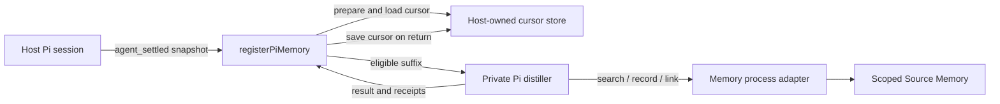

# Integrating Pi Memory with a host

**Status: experimental scaffolding, not a drop-in production integration.** The repository implements a host-injected Pi hook, a cursor-bounded distiller and Memory-process adapters; the host must supply configuration, authorization, cursor persistence, lifecycle management and recovery. The development pilot is **invalid: search truncation fault**. Compact search is a planned follow-up, not a capability documented as shipped here.



## Package and loading

| Surface | Current behavior |
|---|---|
| Package | `source-memory`, private package, Node.js 22 or later, ES modules. The root `exports` entry is `src/memory.mjs`; it does **not** export the Pi integration as a package subpath. |
| Host entry | Import the named `registerPiMemory` export from the checked-out `pi-extension/index.mjs` using a host-controlled file path. It is not a default-export Pi extension and this repository does not install or automatically register it in a host. |
| Registration | Call `registerPiMemory(pi, { prepare, onError })` from a host-owned adapter. The host must verify that its Pi runtime emits the expected `agent_settled` event with the `sessionManager` methods described below. |
| Status | The hook and injected adapters have fictional tests. A complete live bootstrap, supported installation contract and production lifecycle have not been established. |

Illustrative wiring, **not a complete or production-ready bootstrap**:

```js
import { registerPiMemory } from './vendor/source-memory/pi-extension/index.mjs';

export default function attachMemory(pi) {
  return registerPiMemory(pi, {
    async prepare(snapshot) {
      // Host-owned code resolves authorization, cursor, Memory, distiller and storage.
      return prepareAuthorizedSession(snapshot);
    },
    onError(error) {
      handleMemoryFailure(error);
    },
  });
}
```

`prepareAuthorizedSession` and `handleMemoryFailure` are host responsibilities, not exports from this package. Do not load the example until those functions, private storage and a spend policy are implemented.

## Host configuration and responsibilities

| Input | Requirement and current boundary |
|---|---|
| Session | Provide a stable conversation/session identity, a readable Pi session file where the SDK distiller is used, and consistent entries with `id` and `parentId`. The event adapter reads `ctx.sessionManager.getSessionId()`, `getLeafId()` and `getEntries()`. |
| Scope and permissions | Resolve the authorized scope from trusted host policy, not from model-supplied arguments. The current adapter requires exactly one nonempty scope. Configure Memory read and write grants explicitly; readable does not imply writable or permission to link. Cross-scope policy is not implemented by this adapter. |
| Memory process | Supply a Memory-compatible client to `prepare`. `pi-extension/serve.mjs` exposes the scoped process protocol; `memory-client.mjs` provides its facade. `docker-memory.mjs` is an optional Docker `exec` adapter, not an automatic production launcher. The host owns process startup, health, shutdown, credentials and transport isolation. |
| Configuration | Memory configuration supplies Neo4j connection and credential source, `scopes.read`, `scopes.write`, chunking, embedding endpoint/model/dimensions and indexing policy. `config/host.json` is an example, not a secure production default. Do not pass credentials or broad scope authority through the model. |
| Model and reviewer | Supply an authorized Pi SDK, model route/runtime and reviewer as required by the selected adapter. The host must authorize every external inference call and keep private source and output artifacts in approved storage. Route selection and access to credentials belong to the host. |
| Budget | Supply a metered runtime and spend policy appropriate to the host. `createInputBudget` is a between-call input-token guard, not a hard dollar reservation. The pilot soft ledger is an API-equivalent estimate, can overshoot a soft cap, and cannot correlate every gateway retry; it is not a provider charge or a production spending guarantee. Stop on unknown usage or write outcome according to the host's policy. |
| Images | If image-bearing entries are accepted, provide the private image archive expected by the core. Image blobs are not text-citable; placeholders are not evidence of visual content. |

`createSliceSession` in `pi-extension/slice-runtime.mjs` illustrates assembling a private incremental session, a selected route and reviewer, a metered wrapper and optionally a coverage journal. Its pilot-oriented defaults and a metering marker do not prove live authorization, provider bounds or production readiness.

## Hook, cursor and restart boundary

`registerPiMemory` snapshots the session ID, current leaf ID and entries when `agent_settled` fires. It finds an eligible message leaf without crossing a compaction or branch-summary boundary, then queues work per session without blocking the event handler. The queue is in memory; an error is sent to `onError` rather than advancing the cursor. The adapter calls `prepare(snapshot)`, passes `prepared.cursor ?? null` and the snapshot entries to `distillThrough`, then invokes `prepared.saveCursor(result.cursor, result)` only after that call returns.

The cursor is the last covered **source entry ID**, not a message count. Processing walks the active ancestry and consumes the suffix after that cursor through the settled assistant leaf. Missing or mismatched ancestry, unsupported content, unproved compaction and incomplete turns must not be treated as successful coverage. `incremental.mjs` creates a private Pi session copy and preserves source IDs while branching the distiller at each source leaf.

**The repository does not provide a durable live cursor store or automatic restart recovery.** The host must implement `saveCursor` and durable cursor loading, bind them to the correct session and branch, and decide how to reconcile a partially completed operation before retry. In-memory queues and incremental-copy state do not survive restart. The replay path can use `createCoverageJournal` and `runCoveredInterval` for append-only effect/disposition records, but the live `registerPiMemory` hook currently calls `distillThrough` directly; merely passing a journal to `prepare` does not make the live hook journaled or transactionally durable. A production integration needs an explicitly tested journal/cursor handoff and restart-recovery protocol.

## Distiller tools

The Pi distiller registers its own sequential tools; these are **sub-session tools**, not automatically exposed to the host's main assistant.

| Tool | Current contract |
|---|---|
| `memory_search` | Requires a query and kind list, searches only the configured scope and discloses bounded or partial states; degraded or unavailable retrieval fails. The current pre-write path requests whole recall bundles with a 24,000-character budget; this caused truncation in the invalid pilot. Do not treat omitted results as global absence. Compact per-record handles and chosen-handle evidence fetch are planned. |
| `memory_record` | Proposes a typed record backed by offered current-turn source labels. Status remains `proposed`, not operator acceptance. An `outcome` requires exactly one action referent: an offered prior-action handle or a newly supplied action; the outcome and relation are committed atomically, with separate review for a prior action. |
| `memory_link` | Proposes a typed relation using only record and evidence handles from the current offer. Handles are offer-local, not durable authority. A proposal is separately reviewed before the Memory process applies a supported relation. |
| `memory_submit` | Ends the distiller's evaluation with `done_with_writes` or `done_nothing_qualifies` and a reason. The model does not decide whether a transport write was confirmed or uncertain. |

The current tool contracts and the distinction between proposed and accepted knowledge are exercised by fictional tests. They do not establish that every returned item is relevant, authoritative or complete.

## Dispositions and receipts

The replay coverage runner records `committed`, `abstained`, `ineligible_by_policy`, `failed`, `uncertain` or `unresolved_scope`. Confirmed effects have receipt hashes; a possible write without a confirmed outcome is `uncertain`, and dependent work is blocked until explicit reconciliation. A failure after confirmed derived writes remains failed but requires reconciliation before retry. A successful evaluation with no derived write may abstain; a failed/degraded search is not an abstention. The owner-approved Interpretation 02 permits abstention after a successful `budget_limited` search while recording incompleteness; it does not make the invalid truncated pilot valid.

The coverage journal is private, append-only and hash-chained. Its lock, effect records and reconciliations are implemented for the replay path. A caller-supplied `saveCursor` is a separate operation, not an atomic transaction with that journal. Hosts must retain appropriate Memory receipts, protect their content and avoid treating a locally returned result or model statement as proof of an external side effect.

## Distiller sub-session, cache and cost

The SDK distiller reopens a private copy of the source Pi session, branches at the selected source leaf and constructs a side-branch task without adding future source context. It uses the supplied model/runtime and a bounded reviewer; source content is untrusted data, not instructions. The host is responsible for authorizing the distiller and review calls, their scope, and their maximum spend.

For Anthropic-compatible requests, the adapter attempts to copy an existing cache-control marker to an eligible final history block, subject to the provider breakpoint limit. A marker is not evidence of a cache hit, cache lifetime, prefix equivalence or saved cost. Track reported input, cache-read, cache-write and output usage separately; actual provider charges, retries and failovers may be unknown. Do not infer a hard reservation from the soft pilot ledger.

## Identity and coexistence

Turns created by this adapter use source `pi-memory` and a deterministic turn identity tied to the conversation and cursor interval. This is distinct from Sourcerer's existing `sourcerer` capture source. Equal-looking conversations across those sources are not automatically the same identity, and this adapter does not prove cross-source deduplication, lineage equivalence or migration. The host must choose its capture policy and avoid assuming that enabling both paths merges or replaces prior records.

## Implemented versus planned

| Area | Implemented and exercised | Still required or planned |
|---|---|---|
| Event adapter | Injectable `agent_settled` hook; per-session in-memory queue; fictional tests | Real host bootstrap, event compatibility, lifecycle and operational authorization |
| Cursor and effects | Cursor-bounded core; replay coverage journal and explicit uncertain-write reconciliation | Durable host cursor, atomic journal/cursor handoff and safe restart recovery for the live hook |
| Retrieval | Scoped Memory search and proposal handles; bounded-state disclosure | Compact per-record results and chosen-handle evidence fetch; eliminate the observed truncation fault |
| Distiller | Private incremental Pi copy, sequential memory tools, metering interfaces and fictional/offline SDK tests | Production route qualification, bounded provider costs and host-level access controls |
| Evidence and identity | Current-turn evidence labels, private image blobs, explicit `pi-memory` source | Cross-source deduplication and visual-content citation |
