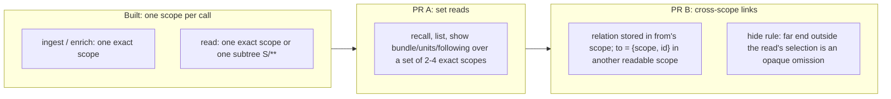
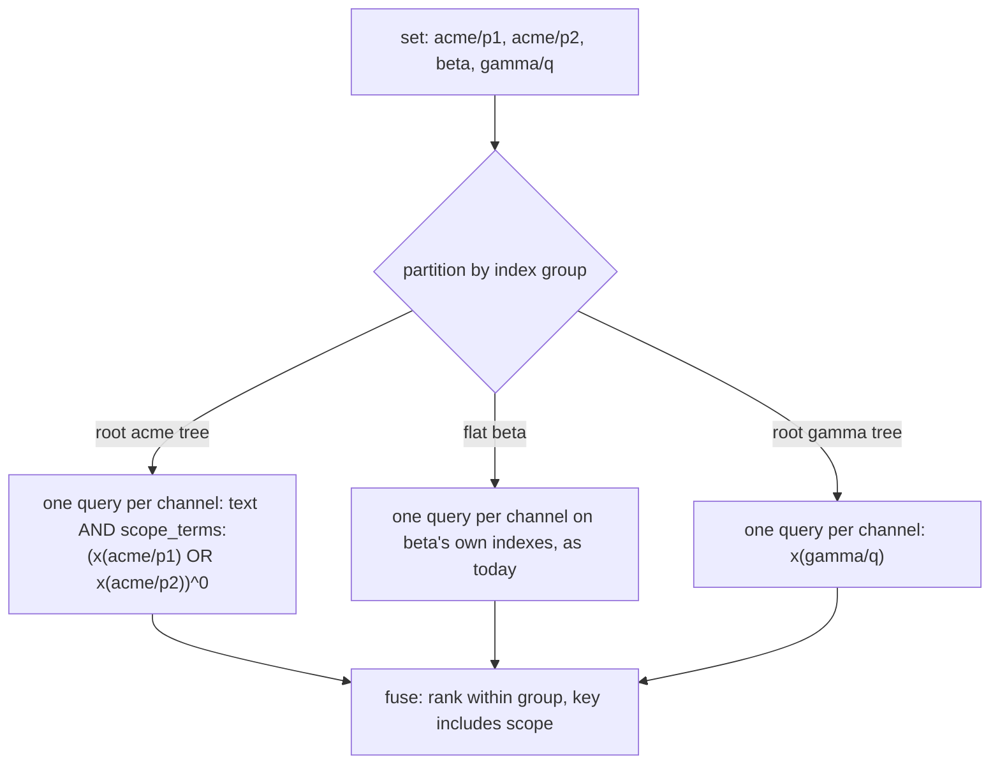
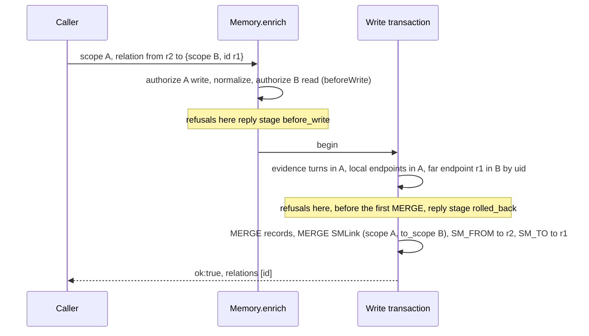
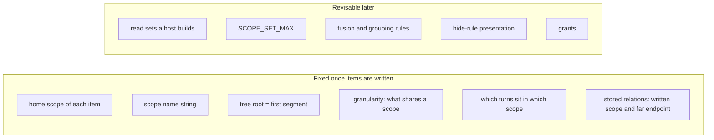
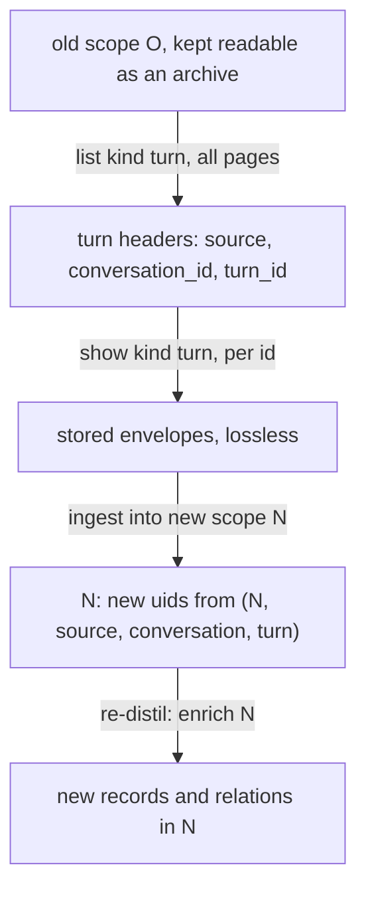

# Source Memory namespacing: home scopes, set reads, cross-scope links

**Bottom line:** Every turn, record and relation keeps exactly one permanent *home scope*. Two planned features are added on top, in this order: (1) **set reads**, where `recall`, `list` and `show` (`bundle`, `units`, `following`) cover up to 4 exact scopes the caller names and is granted; (2) **cross-scope links**, where a relation is written in the scope of its later record (`from`) and names an earlier record in another readable scope as `to: {scope, id}`. Links are stored under their own label, so builds without PR B never see them. A reader that did not select the far scope sees the link with its far end hidden. Both features are additive. No stored byte, uid or hash changes, `RECORD_CONTRACT` stays `source-memory.record/1`, and every single-scope read stays byte-identical. A host can write and read one exact scope per call today without either feature. The only decisions that cannot be revised later are where each item lives (home scope, scope name, tree root, granularity). If those turn out wrong, the supported fix is to re-ingest the lossless source turns into a new scope scheme and re-distil them.

Status: design r1 (revised after independent review), planned work. No code in this PR. Delivery order: PR A set reads, then PR B cross-scope links, each with its own independent review. The surface reference is [TOOL-SURFACE.md](TOOL-SURFACE.md) (r2 links here).

## Terms

| Term | Meaning |
|---|---|
| home scope | The one scope a turn, chunk, record or relation is stored in. It is part of the item's uid (`identity(kind, scope, …)`, `src/core.mjs:41`) and never changes |
| selection | What one read covers: one exact scope, one subtree `S/**` (built), or one **set** of 2–4 exact scopes (PR A). A selection is always a subset of the caller's read grants |
| index group | Where one element of a selection is searched. A nested scope (depth 2–8) belongs to its root's tree group (one per root segment). A flat scope (depth 1 or opaque) is its own group with its own per-scope indexes, which is how it is read on its own today |
| written scope | The scope `enrich` writes to: the scope of every record, every evidence span and every relation in the call |
| far scope | The scope of a cross-scope relation's `to` endpoint (PR B) |

## 1. Set reads (PR A)

### Request and authorization

| Rule | Definition |
|---|---|
| form | API: the scope argument is a string (as today) or an array of exact scope strings. CLI: `--scope` repeated 2–4 times. Today a repeated `--scope` is refused `invalid_arguments` and an array is refused `invalid_input` (`text()`), so no existing call changes meaning, and a build without PR A refuses a set rather than misreading it |
| size | `SCOPE_SET_MAX = 4`. Above that, or an empty array: `invalid_input`. A one-element array is normalized to that exact scope, and its reply is byte-identical to the exact-scope read |
| elements | exact scopes only. A selector `S/**` in a set is refused `scope_denied`, matching the existing rule for selectors where they are not accepted. A duplicate element is `invalid_input` |
| order | The set is canonicalized by sorting in UTF-16 code-unit order. Replies, cursor bindings and query parameters use that order |
| grants | Every element must pass `authorize(config, element, 'read')`: listed exactly, or covered by an `A/**` pattern. If any element fails, the whole read is refused `scope_denied` inside `authorize`, before any storage call. No element is ever dropped silently. A set is closed and enumerated. It never acts as a subtree, so exact grants never add up to an open set, and a set never grants anything an element's own grant does not |
| operations | `recall` (all modes, `group:"conversation"`, `seedsOnly`), `list` (with `relations`), and `show` kinds `bundle`, `units`, `following`. `show` `record`, `turn` and `turn_by_key`, `status`, `init`, every write, `sourceChunks` and the vector-status reads stay exact or selector-only and refuse a set with `scope_denied`. The extension transport (`pi-extension/memory-process.mjs`) keeps serving one exact scope |
| capability | `status` with input `{"capabilities": true}` adds `capabilities: {scope_set_max: 4}`, and after PR B also `cross_scope_relations: true`. Without that input the `status` reply is unchanged. A build without the feature ignores the input and returns no `capabilities`, so its absence means unsupported. A two-element set `list` over granted scopes is an equivalent probe: older builds refuse it `invalid_input` (API) or `invalid_arguments` (CLI) |

### Fan-out: one query per index group per channel

| Element | Definition |
|---|---|
| grouping | Nested elements under one root form one group and share one query per channel. The full-text filter is `scope_terms:(x<e1> OR x<e2> …)^0` over exact-scope terms only. PR A probes that grouped, zero-boost clause on Neo4j 5.26.14, as r1 probed the single-term form. The `where` predicate is `n.scope IN $scopes` and `owns` is set membership. Each flat element is its own group and runs exactly the query an exact read of it runs. A depth-1 root stays its own flat group even when opted in and named together with its nested scopes. Its per-scope index is the one its exact read uses, so its hits and scores match that read. This is the one deviation from "one query per root per channel": such a root and its nested scopes cost two groups |
| channels | `turn_lexical`, `chunk_lexical`, `record_lexical`, `chunk_vector`, `record_vector`, each run per group. The status, census and `treePending` reads an exact read makes are made once per group, with the group's elements |
| query count | `groups × channels`, plus each group's own status and census reads. Four flat scopes cost 4 queries per channel, while four nested scopes under one root cost 1. This is the main cost of the root choice (section 3) |
| lexical scores | Boost 0 on the scope clause leaves the text score unchanged. Within a tree group, an item's score equals its score in an exact read of its own scope, because both use the root's statistics. Scores from different groups are never compared |
| fusion | Each item belongs to exactly one group, given by its scope. Its rank in a channel is its rank in its own group's result for that channel. RRF (`1/(60+rank)`) then fuses across channels as today. The fusion key, `seedToken` and the tie-break include `scope`, the existing subtree behaviour (`fuse`, `src/core.mjs:258`). Each group returns up to `candidates` per channel, and the fused ungrouped list is cut to `candidates` as today |
| grouped recall | Admission runs per group and channel. Conversation keys already include `scope`, so per-conversation caps never span groups. `admitted_conversations` is summed and `exhausted` is true if any group is exhausted. Omitted seeds carry `scope` |
| exclusions | `exclude_conversations` keys `(source, conversation_id)` exclude that conversation in every element, as in a subtree read |

### Vector fallback

| Group | Behaviour |
|---|---|
| rule | Each group runs the full branch logic of an exact read (`recall`, `src/memory.mjs:432-469`), with the group's element set as its selection. Nothing is special-cased for sets |
| flat | Unchanged from today: the per-scope ANN index with the widening loop (`indexedVectors`), the missing-index scan up to `vector_scan_limit`, and the `vector_overfetch_cap`, `vector_query_budget` and `unindexed` reasons |
| tree, index online | The census counts eligible nodes whose scope is in the group's elements. If there are at most `min(TREE_SCAN_LIMIT, vector_scan_limit)` (4,096 by default), the group gets an exact in-database cosine scan (`treeVectorScan`): `ready`, or `partial` when `unindexed > 0`. Above that, the root's ANN index is used with `n.scope IN $scopes` applied inside the existing widening loop, which yields `partial` with `vector_overfetch_cap` or `vector_query_budget` when unresolved. About (group share of root) × 4,096 candidates survive per query |
| tree, index not online | as an exact read: `populating` gives `partial`, `vector_index_populating`; `failed` gives `unavailable`, `vector_index_failed`; an incompatible index gives `unavailable` with its `vector_index_*` reason; a missing index gives the scan fallback up to `vector_scan_limit`, `partial` when `scan_truncated` |
| budget | Each group gets the vector query budget of an exact read (14 queries across both kinds), so a set of g groups makes at most 14·g vector queries |

### Reply

| Field | Set read |
|---|---|
| `scopes` | The canonical set. It replaces `scope`, which only exact and subtree replies carry |
| hits, bundles, units | Every ranked seed, bundle (`bundle.scope`), unit key, omitted seed and `list` item names its scope. Records and turns already carry `scope` |
| `by_scope` | `{<element>: {group, channels: {<channel>: state}, scope_tree?: {pending}}}` for every element, including elements with no hits. `group` is the root segment for a nested element and the scope itself for a flat one. An element's channel state is its group's state for that channel. `scope_tree_pending` counts are the element's own |
| `channels` | One aggregate per channel, `{status, scopes?}` only: the worst element status in the order `unavailable`, `pending`, `partial`, `unconfigured`, `not_needed`, `ready` (`unconfigured` is configuration, so it is the same for every element), with `scopes` listing the elements at that status when they are not all of them. Every other field (`reason`, `unindexed`, `scan_truncated`, `embedding_key`, `admitted_conversations`, `exhausted`, `candidate_limit_reached`, `scope_tree_pending`) is reported only per element in `by_scope`. `reranker` remains a single top-level entry (one rerank call) |
| completeness | `retrieval_complete` is true only if every element's every channel is `ready` (or `not_needed`). `relationship_context_complete` and `budget_omitted` keep their meaning over the whole reply |
| not reported | Nothing outside the selection: no other scope's names, counts or existence |

### `list` over a set

There is one query per page, regardless of roots. `list` selects by `n.scope` and never by tree labels (TOOL-SURFACE "`list`"), so a set uses `n.scope IN $scopes`, seeking the scope range index once per element when it exists and scanning otherwise, like a flat `list`. The order, keyset exactness, filters, byte bounds and stubs are those of a single-scope `list`. The cursor binding is `digest(['source-memory.list/1', <canonical array>, kind, status, source, conversation])`. An array never canonicalizes like a string, so a single-scope cursor never resumes a set walk and a set cursor never resumes a single-scope walk, and single-scope cursors keep their bytes.

### `show` over a set

| Kind | Rule |
|---|---|
| `bundle` | `seed` must carry `scope`, an element of the set. Expansion follows relations whose own scope is in the set (section 2, "Reads") |
| `units` | Each `unit.key.scope` must be an element. Today it must equal the one scope, and `scope_denied` stays the refusal code. Each unit is bundled in its own scope |
| `following` | Takes `scope`, an element. The walk follows parent links inside that one scope, because lineage never crosses scopes. The set adds nothing to the walk itself. It lets a host make one call per unit regardless of scope |
| `follow` inside `units` and grouped recall | The roots a unit follows are its bundles' source turns and evidence turns. Each root is walked in the scope of the span that names it, not in `unit.key.scope` (today `followingForBundles` walks every root in the unit's scope, `src/memory.mjs:283-290`). With PR B a visible far record's evidence is in the far scope. A `following` entry, an evidence span and an `also_cites` key carry their own `scope`. `following` entries and evidence spans add a `scope` field only when it differs from the bundle's scope, so single-scope bytes are unchanged |

### Single-scope reads stay byte-identical

An exact or subtree read never enters the set path. A one-element set is rewritten to the exact form before any query. No index, label, term or stored property is added. PR A adds no error code: refusals reuse `scope_denied` and `invalid_input`, and the QUALIFICATION.md tables do not change.

## 2. Cross-scope links (PR B)

### Write rule

| Rule | Definition |
|---|---|
| one scope | A relation is always written to exactly one scope: the written scope, which is the scope of its `from` record, the later record. Its evidence spans must be turns of the written scope (unchanged `evidence_unavailable`) |
| far endpoint | Only `to` may be in another scope. It is spelled `to: {scope, id}` with exactly those keys: `scope` an exact scope of ≤256 characters, `id` ≤256 characters. `from` stays a string id in the written scope. The natural direction of all five types puts the earlier record at `to`: `supersedes` (replacement → replaced), `qualifies`, `contradicts`, `depends_on` (dependent → prerequisite) and `outcome_of` (outcome → action, decision or intention) |
| one spelling | A same-scope relation keeps `to` as a string. `to.scope` equal to the written scope is `invalid_relation`. A relation's far endpoint cannot be another record of the same call: payload records are in the written scope, and the far record must already exist |
| identity keys | Endpoints are keyed by `(scope, id)` everywhere: the enrich endpoint map, the outcome kind checks and bundle maps (by uid). A payload record whose id equals a far `to.id` is a different record and never satisfies the far lookup. `self_relation` stays `from === to` for a string `to`. With an object `to` it cannot occur, because `to.scope` differs from the written scope |
| authority | The writer needs WRITE on the written scope (the existing `authorize`) and READ on every far scope (`authorize(config, to.scope, 'read')`). Both are checked in `beforeWrite`, before the transaction, against the same configuration object. A missing read grant, or a selector as `to.scope`, is refused `cross_scope_denied` |
| id uniqueness | Inside the write transaction, before its first `MERGE` (†), the relation uid is looked up under the other label (`SMLink` for a same-scope relation, `SMRelation` for a link). A hit is `relation_identity_conflict`: one id names one relation per written scope, whatever its form. PR B takes the `from` record's write lock before this check, so two concurrent first writes of one id in two forms serialize, and a concurrency test confirms the lock leaves the record's stored bytes unchanged |
| existence | Inside the write transaction, before its first `MERGE`, the far record is matched by uid: `MATCH (r:SMRecord {uid: identity('record', to.scope, to.id), scope: to.scope})`. If it is absent the call is refused `relation_endpoint_unavailable`, the existing code, because the writer may read the far scope. Records are never deleted, so the check cannot go stale after commit |
| kind checks | `invalid_outcome_relation` uses the far record's kind. The stored-referent lookup for `outcome_referent_required` resolves an `outcome_of` target by `e.to_uid` in `coalesce(e.to_scope, $scope)` instead of `$scope`. Both stay † (before the first `MERGE`) |
| no existence oracle | The read-grant check runs before any storage call. A writer without read on the far scope gets `cross_scope_denied` whether or not the far record exists, so it cannot probe the far scope |
| link proposals | `src/link-proposals.mjs` proposes links only among records it was offered, all in one scope. Whether to link across scopes is the caller's decision |

A note on "inside the transaction": the grant check is static configuration, so PR B runs it once in `beforeWrite`, which replies `before_write`. Repeating it inside the transaction could not change the outcome, and a refusal raised there after a driver retry would reply `stage:unknown`. That is the post-commit `scope_denied` that Q-SM-6 removed. What does depend on stored state, whether the far record exists and what kind it is, is checked inside the transaction.

### Stored form

| Element | Same-scope relation (unchanged) | Cross-scope relation |
|---|---|---|
| label | `SMRelation` | `SMLink`, a separate label, so no query of a build without PR B matches it (`neighbors`, `listRelations`, `status`, `outcome_referent_required` and `export-scope` all match `SMRelation`). `init` (flat and tree) also creates the `smlink_uid` uniqueness constraint, and tree `init` also creates the `SMLink(scope)` range index. The `init` reply is unchanged |
| uid | `identity('relation', written, id)` | the same. The far endpoint is not in the uid, so a relation id names one relation per written scope whatever its target or label |
| body (`JSON.stringify`, key order) | `{id,type,from,to,attribution,evidence}` | `{id,type,from,to,to_scope,attribution,evidence}`, with `to` the far id string |
| hash | `digest(body)` | `digest(body)`, which includes `to_scope` |
| node properties | `scope, hash, body, type, from_uid, to_uid, created_at` | the same, plus `to_scope` (query aid). `to_uid = identity('record', to_scope, to)` |
| graph edges | `SM_FROM` and `SM_TO` to records in `scope` | `SM_FROM` to the written-scope record. `SM_TO` points to the far record and lets the far record's readers find incoming links by degree. Neither the far record nor its labels or properties change |

In this document "relation" covers both labels and "link" means a cross-scope relation. `to_scope` is absent unless used, like a turn's `lineage_root`, so every existing relation and record keeps its bytes. Records are unchanged.

| Build without PR B, on a store with links | Behaviour |
|---|---|
| reads of any scope | links are invisible, because no query matches `SMLink`. Nothing leaks, but a bundle or `list` page omits them without reporting it |
| `status` | `relations` excludes links. A PR B build adds `cross_scope_relations: n` only when n > 0 |
| enrich replay of an outcome whose only `outcome_of` is a link | refused `outcome_referent_required`, `rolled_back` (fail closed) |
| `export-scope` of the written scope | exports the link's `SM_FROM` edge but not the link node, so `restore-scope` refuses the snapshot (`snapshot_invalid`). The far scope's snapshot is unchanged. These tools stay single-scope and flat-only, as for tree-labelled data |

Rollout guidance follows from that: upgrade every reader before relying on links being reported. A mixed fleet is safe but incomplete.

### Record contract: stays `source-memory.record/1`

| Input class | record/1 today | After PR B |
|---|---|---|
| every relation with string `to` (all inputs record/1 accepts) | normalized, stored, hashed | identical uid, body and digest |
| relation with object `to` | refused `invalid_input` (`text(edge.to, 256)`, `src/core.mjs:227`) | accepted as a cross-scope relation |
| relation with a top-level `to_scope` key | key dropped as unknown | key still dropped as unknown. It is not the spelling of a far endpoint |

Every input that record/1 accepts yields the same uid, normalized output and replay digest, so under its own definition (`src/core.mjs:194`) the contract does not change. The new form is one that record/1 refused. A build without PR B therefore fails closed (`invalid_input`, `before_write`) instead of writing a same-scope relation by mistake. PR B tightens the comment on `RECORD_CONTRACT` to state this: the contract covers every input the version accepts, and a form it refused may be added later with an optional stored field that is absent unless used.

Pins in `test/qualification.test.mjs`: (1) the version-1 record and relation pins stay byte-for-byte; (2) a new pin for a fixed cross-scope relation's uid, body and digest under record/1; (3) a pin that a relation with a top-level `to_scope` key normalizes to the same output as the same input without it. A later change that moves any of these is a contract bump.

### Replay and conflict

| Case | Result |
|---|---|
| same written scope, id and normalized body | replay: `ok:true`, one relation, no new edge |
| same id, different `to_scope` | `relation_identity_conflict` after the `MERGE`, `rolled_back` (unchanged rule: same id, other bytes) |
| same id, same-scope versus cross-scope | `relation_identity_conflict` from the † cross-label check, `rolled_back` |
| replay after the writer lost read on the far scope | `cross_scope_denied`, `before_write`, even though the link is stored. Authority is checked for each call |
| settling an unknown outcome | `list` with `relations` on the written scope shows the link (its id, type, `from`, attribution, evidence and `stored_at`) with the far end hidden when the far scope is not selected. That proves presence. Comparing the full body, `to_scope` included, needs a read whose selection includes the far scope (a set) |
| replay after a driver retry | as today: a refusal on a later attempt is `stage:unknown` |

### Reads: expansion and the hide rule

**Hide rule:** a link's far endpoint is an opaque omission in any read whose selection does not include the far scope. The link itself is data of the written scope and is shown: its scope, id, type, `from`, attribution, evidence and `stored_at`. The far end is rendered as `to: null, to_hidden: true`, with no `to_scope`, and the reply never contains the far record's text, id, uid or scope. Visibility depends on the selection, not on grants. A caller granted the far scope who did not name it in this read sees the same omission. A link is visible only if its own scope is in the selection, so a reader of only the far scope never sees, or counts, links that point into it. Every selection rule runs inside the Cypher query, so nothing is filtered after a limit and no cap or budget is spent on rows the reply drops.

| Read | Rule |
|---|---|
| exact read (flat or nested) | Today's `neighbors` query (relations stored in the scope, by `from_uid`/`to_uid`) is extended to match `SMRelation` or `SMLink`, with the same order and limit. Endpoints are resolved by stored uid, never re-derived from id plus the bundle's scope, so a same-id record in the written scope is never joined by mistake. With no links, the query returns exactly today's rows |
| subtree or set | Expansion matches relations whose own scope is in the selection (`selection.where(e)` over the `SMRelation(scope)` and `SMLink(scope)` range indexes), with `from_uid` or `to_uid` in the frontier. That covers outgoing links and incoming links from other selected scopes. Order: `supersedes` first, then `e.uid`, as today. The far record is read in its own scope, and its evidence in its own scope |
| bundle output | Records keep `scope`. A relation carries `scope` only when it differs from the bundle's scope, and `to_scope` (from its body) only when its far end is selected. A link with a hidden far end is included as an edge with `to: null, to_hidden: true`. It adds the gap `cross_scope_hidden` and sets `relationship_context_complete:false`, and expansion does not continue past it |
| `list` with `relations` | A relation is listed when its own scope is in the selection and an endpoint is a page record (today's `e.scope = r.scope` becomes `selection.where(e)`, which is the same predicate for an exact scope). A link item adds `to_scope` when the far end is selected, and `to: null, to_hidden: true` otherwise. Every listed link counts in `relations_total` and in the caps as today |
| `following` | A walk never crosses scopes. Roots in units and grouped recall are walked in their own span's scope (section 1, "`show` over a set") |
| recall ranking | Unchanged: ranking scores node text. A hidden relation affects only bundle completeness |

On data without links, the subtree expansion selects the same relations in the same order as today's per-seed-scope query, because every relation and both endpoints share one scope. The byte-identity tests pin this.

### Staged failure rules (QUALIFICATION.md, PR B)

| Code | Class | Raised at |
|---|---|---|
| `cross_scope_denied` (new) | pre-commit-only (`before_write`) | `Memory.enrich` `beforeWrite`: no read grant on `to.scope`, or `to.scope` is a selector |
| `invalid_input` | pre-commit-only | malformed `to` object (wrong keys, non-string or oversized `scope` or `id`) |
| `invalid_relation` | pre-commit-only | `to.scope` equal to the written scope |
| `relation_endpoint_unavailable` | in-transaction-rolled-back † | the far record lookup, inside the existing endpoint loop before the first `MERGE` |
| `invalid_outcome_relation`, `outcome_referent_required` | in-transaction-rolled-back † | unchanged codes, with far-aware lookups |
| `relation_identity_conflict` | in-transaction-rolled-back | unchanged after the relation `MERGE`; new † site: the cross-label uid check before the first `MERGE` |

Q-SM-3 adds `cross_scope_denied` to its exercised codes (the run fails if a listed code goes unexercised), plus a far-endpoint `relation_endpoint_unavailable` case. The source-order pin keeps every † check before the first `MERGE` in `Neo4jStore.enrich`. PR A adds no codes.

## 3. What stays changeable

| Choice | Changeable? | Why |
|---|---|---|
| home scope of a turn, record or relation | **permanent** | in the uid; no move, no delete |
| scope name | **permanent** | the name is the hashed identity input. A name that encodes a hierarchy keeps encoding it after the thing it names moves, so path segments should be stable identifiers that carry no meaning, and the mapping from a host's key to a scope should stay in the host. They should still be paths, not opaque names in the TOOL-SURFACE sense, so that they keep subtrees and share a root's indexes |
| tree root | **permanent** | it is the name's first segment and fixes the item's index group |
| granularity | **permanent** | scopes can be combined at read time (sets, subtrees) but never split. When in doubt, choose finer |
| turn placement | **permanent** | a record cites only turns in its own scope. A transcript needed in two scopes is ingested twice |
| stored relations | **permanent** | append-only. Change is a new relation |
| which scopes a host reads together | changeable | host-side; Memory sees only the request |
| `SCOPE_SET_MAX` (4) | changeable | a bound on fan-out, not stored data |
| fusion across groups (per-group rank) | changeable | ranking is not stored. A later version may merge vector channels by cosine, which is comparable across groups |
| grouping a depth-1 opted-in root into its tree group | changeable | a query-plan choice. It would change that element's lexical scores |
| selectors inside a set; `status` over a set | changeable | additive request forms |
| a far `from` endpoint | changeable | additive. The `from: {scope, id}` form is refused today, so it can be introduced the same way as object `to` |
| how the hide rule is presented (counts, gap names) | changeable, toward less disclosure only | widening it to reveal far ids would disclose data |
| grants | changeable | configuration |

**Cost of the root choice:** a set read costs one query per index group per channel. Scopes that are read together cost least under one root: one query per channel for the whole set. Each flat scope and each separate root adds a query per channel, five per read, plus its status and census reads. A shared root has costs of its own: its scopes share BM25 statistics, and a vector read whose selection has more than 4,096 eligible nodes uses the root's ANN index and keeps only its share of the 4,096 candidates, so on a very large root it often goes `partial`. Group by read pattern, not by organization chart.

## 4. Re-home path

If a scope scheme proves wrong, the supported fix is to build the new scheme beside the old one, never to rewrite the old one.

| Step | Existing read or write | Notes |
|---|---|---|
| enumerate turns | `list {kind:"turn"}` over O or `O/**`, walked to `next_cursor:null` | exact keyset walk: every turn committed before the first page, once. Headers only |
| read each turn | `show {kind:"turn", id}` | returns the stored envelope `{id, scope, source, conversation_id, turn_id, parent_turn_id, lineage_root?, occurred_at, entries}`. Without `id` and `scope` it is a valid `ingest` input, so the copy is lossless. `stored_at` is not carried over: the new scope records its own write time |
| write | `ingest` into N | the uid is deterministic in (N, source, conversation, turn), so a re-run replays and the migration can resume |
| derive | re-distil into N with the host's distiller | the only step with model cost |
| optional copy instead of re-distil | `list {relations:true}` gives every record body and relation; rewrite evidence `turn` uids old → new (deterministic) and `enrich` into N | no model cost, but only for records whose evidence all lands in one new scope, and every relation must fit `list`'s per-page cap (256 relations / 128 KiB). One record with more than 256 relations cannot be enumerated completely today |

**`pi-extension/export-scope.mjs` and `restore-scope.mjs` do not re-home.** Export snapshots one scope's raw nodes, tree labels and `scope_terms` included, into `/scratch`. Restore requires `snapshot.scope` to equal its target, the flat label set (anything tree-labelled is `snapshot_invalid`) and an empty database, and it recreates the same uids. It is a same-name, same-uid copy into an empty store. After PR B, a snapshot of a scope that holds links is refused at restore (section 2, "Stored form").

**Incoming links:** links stored in other scopes keep pointing at O's records after a re-home, because they are append-only. They resolve only while O stays readable, which is one more reason to keep it. New links can target N.

**Missing reads:** none for turns. `list` plus `show turn` covers them. The one gap affects only the optional record copy: relations beyond `list`'s per-page cap. If that path is ever chosen, add `list {kind:"relation"}`, a keyset walk over relations by `(stored_at, uid)`. No export command is proposed (YAGNI). The generic reads are enough, and a host-side script owns the mapping from old scopes to new ones.

| Cost driver | Scale |
|---|---|
| distillation | model tokens ∝ source text. Dominant cost; avoided only by the record copy |
| embedding | every chunk and record of N is embedded again: chunks ∝ words / (256−32) |
| index population | full-text and vector population for N (or for its root's tree) |
| storage | O is kept, so turns, chunks and vectors are stored twice |
| reads | one `list` page per 64 turns plus one `show` per turn. Negligible next to the above if run in one process through the API, not one CLI process per call |

**What a host must retain from day one:**

| Keep | Why |
|---|---|
| the old scope readable (grant and data) as an archive | there is no delete. Old records stay evidence of what was known |
| record ids and uids never used as durable external keys | uids embed the scope, and re-distilled records get new ids. Refer to source by `(source, conversation_id, turn_id)` |
| the mapping from the host's readable key to the scope, versioned | segments carry no meaning. Only the host can say which old and new scopes hold one entity |
| deterministic turn keys `(source, conversation_id, turn_id)`, never derived from the scope | they are what makes re-ingest idempotent and lets old and new copies be matched |
| the distiller version and settings used | so that a re-distil can be compared with the original |

## 5. Migration and tests

**Migration:** none. Existing stores, scopes, records, relations, indexes and cursors are untouched. Both features act only on new request forms and new inputs.

### Byte identity (PR A and PR B)

| Test | Pin |
|---|---|
| flat golden | the existing pinned `export-scope` and read digests (`test/flat-golden.mjs`, `test/nested-scopes.mjs`) are unchanged |
| nested exact and subtree golden | new: the base commit (`f5b49e3`, from a worktree as `nested-scopes.mjs` does) writes and reads a corpus under `golden/team` and `golden/team/ops`. This build must produce identical digests for exact nested reads and `golden/**` reads: recall ungrouped, grouped with `follow`, `history_search` with exclusion, `seedsOnly`, `show` (`bundle`, `units`, `following`, `record`), `list` with and without `relations`, cursors included |
| one-element set | each read above with `[scope]` gives the bytes of `scope` |
| far-scope isolation (PR B) | after A writes cross-scope relations into B, every read of B alone, `status` of B and B's `export-scope` snapshot are byte-identical to the same store before the links |
| contract | the `qualification.test.mjs` pins in section 2 |

### Leak tests for the hide rule (PR B)

Fixture: scopes A (writer), B (far), C (unrelated), a nested pair under one root, and a link A → B. Canaries come in two sets. **B-canaries** are B's record text, id and uid, B's scope name and the link's `to_uid`. **A-canaries** are the link's id, type marker, evidence text and `from` id.

| Reader selection | Expected |
|---|---|
| exact A (granted A only) | no B-canary; the link is shown with `to: null, to_hidden: true`, plus the gap `cross_scope_hidden` |
| exact A (granted A and B) | same as above: selection, not grants, decides |
| set {A, B} | link and far record visible from A's bundle and, as incoming, from B's |
| set {A, C} | no B-canary; link shown with its far end hidden |
| exact B, or set {B, C} | no A-canary and no count. Bytes are those of the same read before the link was written |
| subtree containing A only, or both | far end hidden, or visible, accordingly |
| base build `f5b49e3` reading exact A and exact B | no B-canary and no A-canary for the link: `SMLink` is invisible to it |

Every reply of `recall` (ungrouped, grouped, `seedsOnly`), `show` (`bundle`, `units`, `following`, `record`) and `list` (with `relations`), and every error reply, is serialized and searched for each canary. Write-side: a writer without read on B gets `cross_scope_denied` both when the far record exists and when it is absent, and makes no storage call.

### Integration on a disposable Neo4j

A new `npm run test:integration -- --suite namespacing` runs in the repository's own disposable container (`scripts/integration.mjs`, private loopback port, owned-resource receipt, 2048m cap). It never uses an existing store, a fixed host port or a shared database. Checks:

| Area | Checks |
|---|---|
| fan-out | a counting store wrapper confirms one query per group per channel: 4 nested scopes under one root use 1; 2 roots use 2; 4 flat scopes use 4 |
| vector | with `treeScanLimit` lowered: exact scan at or below the limit (`ready`); ANN above it, giving `partial` with `vector_overfetch_cap`; per-group budget |
| reporting | `by_scope` names every element. An unlabelled nested element reports `scope_tree_pending` while its siblings stay `ready`. The aggregate `channels` and `retrieval_complete` follow |
| authorization | a set with one ungranted element is `scope_denied` with no storage call; a selector in a set is `scope_denied`; a set of 5 is `invalid_input` |
| `list` | a set walk returns the union of the elements' walks exactly once, in `(stored_at, uid)` order; a cursor is bound to its set |
| writes (PR B) | Q-SM-3 cases for `cross_scope_denied` (`before_write`) and a missing far endpoint (`rolled_back`), far `outcome_of` kind checks, `outcome_referent_required` with a stored far referent, replay, conflict on a changed `to_scope`, the cross-label conflict (same id written as a relation and as a link, sequentially and concurrently), a grant revoked between replays and the presence settlement through `list` on A, and a refusal after a real driver retry (`stage:unknown`) |
| following | grouped recall and `show units` with `follow` over {A, B}, where a bundle holds B's record: each root is walked in its own scope, and `also_cites` keys carry their own scope |
| capabilities | `status {capabilities:true}` reports them; plain `status` bytes are unchanged |
