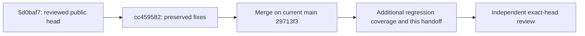

# PR70 review-fix handoff

Preserved fixes are adopted without changing the link contract; independent approval of the reported candidate is still required. This is a producer disposition record, not an independent verdict.

## Provenance and review boundary

- Opening base: `fe1418047da698ddf7f1196ba7bf9969b5e84ec4`. Landing base: `29713f393fa94c4699b0672d13d8557ce13b0d5a`, verified against fetched `origin/main` before adoption. No rebase, push or merge to main.
- Adopted `cc4595828d549a80c208362d429df612104796ee` by merge, retaining `d74b3c9` (compact retrieval) and `cc45958` (Map keys, matrix and capability fixes); these fixes were not recreated.
- Required independent review range: `5d0baf7272a4362acb8e1aa0669523fd5bdf1198` through the full SHA in the producer report, including the landing-base merge. The T1c question-cap changes in this range come solely from main's PR #71; they are not new PR70 scope. Review their interaction with compact retrieval as well.
- Retained `SOURCE-MEMORY-PR70-REVIEW-5d0baf7.md` (SHA256 `430cc67bf67ae80ebb9f78ab2b659532b6f007c8666a3c0f637ea7faaa27bc0e`) is a verbatim copy of reviewer rpc:6699cf4e's final assistant message under a provenance header. That reviewer wrote no file. Its REQUEST_CHANGES verdict concerns 5d0baf7, not this candidate; its counts are not current proof.
- Retained `SOURCE-MEMORY-NAMESPACING-RULINGS.md` (SHA256 `fe755e049339ac3177c2c82ca771d927d2b07779c855dfe700809d51e785afff`) records owner messages. The resume supplied these as inputs, not approval or new authority.

## Finding dispositions

| Finding | Disposition and evidence to review |
|---|---|
| B1 | `Memory.enrich` and `Neo4jStore.enrich` use Map preconditions; only links carrying their own precondition are checked. Qualification tests cover prototype-member relation IDs, normalized bytes, absent options and mismatching digests. Real integration writes and replays `toString`, `constructor`, `__proto__`. |
| Scope keys | Set recall uses Map for state and an own-property check for pending counts. Added real integration writes/replays/reads prototype-key records and relations in `__proto__`, `constructor`, `toString` and `lnest/__proto__`, with exact, set and subtree selections. |
| S1 | `runLinks.reads` covers ungrouped/grouped/seeds-only recall and list for every subtree row, plus status and refused show; subtree show remains unsupported. Exact/base rows also cover bundle, units, following, record and error replies. Both nested subtrees and their common ancestor are checked; far-only canaries include source scope, uid, ID, text and link ID. Set `show units` pins following B's evidence in B. |
| S2 | Catalog/search disclose `cross_scope_hidden`; fetch omits hidden relations, counts omissions and reports incomplete relations. Null far endpoints are not hydrated or offered. Unit regressions cover all three helpers; existing host incompleteness gates remain in force. Link-free shapes are unchanged. |
| S3 | Capability inspects uniqueness/node-key type, SMLink label and uid property, not name; forbidden inspection yields unknown (`null`), other failures propagate. Integration drops/re-inits the constraint and now tests both a misleading name on the wrong schema and a correct schema under another name. Unit test pins forbidden versus transport failure. |
| N1 | QUALIFICATION Q-SM-6 says 44 staged failures, distinguishing the earlier 41. |
| N2 | NAMESPACING describes flat status's label disjunction and removes stale line numbers. |
| N3 | QUALIFICATION explicitly allows only the placeholder MERGE before relations-only cross-label conflicts; refusal classification is unchanged. |
| N4 | The race fixture polls Neo4j SHOW TRANSACTIONS for the blocked id-lock query instead of assuming a 500 ms delay suffices. It tests both winner orders and zero surviving placeholders. |
| N5 | Deferred performance-only changes: no new flat scope index or lock strategy. Missing uniqueness still leaves the documented rollout race, exposed by capability; same-ID replays serialize by design. Upgrade every writer and re-init before using links. |

## Validation boundary

Run stock `npm test`, `npm run check`, and `npm run test:integration` against the candidate; server proof receipts bind declared checks to the committed SHA. `bench-grouped` is not in the required project battery. Do not substitute the earlier review's counts or mocks for real integration.

Integration uses only the stock runner's labelled disposable Neo4j `5.26.14-community` resources: 2048 MiB / 2 CPUs, 512 MiB heap, 128 MiB page cache, ephemeral loopback Bolt, fictional data and deterministic local model fixtures. Its receipt records removal of the owned container and volumes. No live/pilot store or model provider is used. The final producer evidence summary is retained under `.wc-material/` rather than committed test output.
