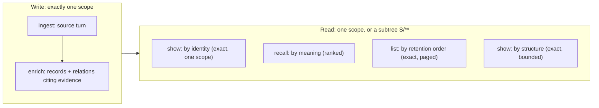
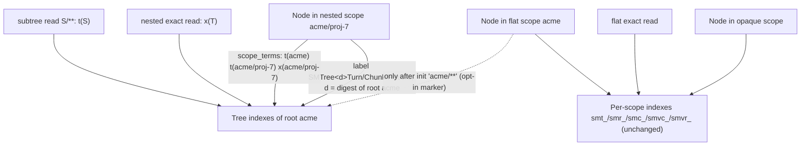

# Source Memory tool surface

**Bottom line:** Source Memory answers five kinds of question, and each has exactly one operation: *store this*, *derive from it*, *get this exact thing*, *find what's relevant*, *enumerate what's there*. Every read is complete or names what it left out. Scopes become hierarchical paths (`org/project/thread`): a content write lands in exactly one scope, a read covers one scope or a whole subtree, and grants are exact or subtree patterns. A flat scope keeps its own indexes and its stored data, so its reads are byte-identical to today's. Memory's only concepts are its own: **scope**, **source turns**, **records** (7 kinds), **relations** (5 types), **evidence** and **time**. Callers map theirs (users, projects, people, tasks) onto those.

Status: r2. r1 (nested scopes, `list`) is built. r2 adds two planned features, designed in [NAMESPACING.md](NAMESPACING.md) and delivered in this order: (A) set reads over up to 4 exact scopes, (B) cross-scope links. Until they ship, every statement below describes the built surface, and "cross-scope relations do not exist" still holds. Host integration (capture, distillation, context injection, session tools) is not part of this surface; any host calls the operations below.

## Concepts Memory owns

| Concept | Meaning | Not |
|---|---|---|
| scope | a partition and the unit of authorization; a path scope also names a subtree | a user or tenant model |
| source turn | caller-copied original text, immutable, keyed by (scope, source, conversation, turn) | a summary |
| chunk | a word window inside one entry of a turn; a search handle that resolves to its turn | a separate memory |
| record | one derived claim of a fixed kind, citing source spans | a mutable row or task |
| relation | a directed claim between two records of one scope, citing evidence (planned: its `to` may be in another readable scope, [NAMESPACING.md](NAMESPACING.md)) | a foreign key to caller data |
| time | `occurred_at` (caller-supplied, optional) and `stored_at` (the store's `created_at`, set by Neo4j's statement clock at write) | a state machine |

A caller concept that needs state transitions (open/closed, assigned, due) stays with the caller. Memory may record *that* something happened, as an outcome or a supersedes relation, but never answers "what is its state now".

## Operations

| Question | Operation | State | Scope argument |
|---|---|---|---|
| Store this original text | `ingest` | built | one exact scope; staged failure replies |
| Derive knowledge from it | `enrich` | built | one exact scope; evidence and endpoints in that scope |
| Embed what is not yet embedded | `index` | built | one exact scope (a write without `stage`) |
| Get this exact thing | `show` (`record`, `turn`, `turn_by_key`) | built | one exact scope; exact or `not_found` |
| What's connected to this | `show` (`units`, `following`, `bundle`) | built | one exact scope; bounded walk that reports where it stopped |
| What's relevant to this query | `recall` | built, with subtrees | exact scope or `S/**`; ranked over records/relations **and** chunked turns; reports omissions and incomplete channels |
| What's there, in order | `list` | built | exact scope or `S/**` |
| Is the store healthy and the same store | `status` | built, with subtrees | exact scope or `S/**` |
| Prepare a scope or subtree | `init` | built, with subtrees | exact scope or `S/**` (write grant) |
| Keep the embedding model resident; warm the database read paths | `warm`; `warm --db v1` | built | exact scope |

Only `recall`, `list`, `status` and `init` accept a selector; every other operation, including `sourceChunks`, `turnVectorStatus`, `recordVectorStatus` and `recordPresence`, refuses it `scope_denied` inside `authorize`, before any storage call. The extension transport (`pi-extension/memory-process.mjs`) serves one exact scope and refuses a selector at startup with `scope_unresolved`.

## Scopes (PR 1)

### Names

| Class | Grammar | Example | Layout |
|---|---|---|---|
| path | 1–8 segments joined by `/`; segment `[A-Za-z0-9_-]{1,64}`; whole name ≤ 256 characters | `acme`, `acme/proj-7/thread-3` | by depth, below |
| flat | a path of depth 1, or any name that is not a path (*opaque*, e.g. `my scope`, `acme/x y`, `acme/`) | `default`, `demo` | unchanged: per-scope labels and indexes (`src/core.mjs:42-44`) |
| nested | a path of depth 2–8 | `acme/proj-7` | its root's tree indexes; no per-scope label or index |
| selector | a path `S` of at most 253 characters followed by `/**` | `'acme/**'` | names the subtree of `S` for reads and `init`; never a write target |

One membership rule, used everywhere (Cypher selection, JS exactness check, pending counts, migration, `list`): **`T` is in `S/**` iff `T` is a path and (`T = S` or `T` starts with `S/`)**. In Cypher that is a prefix seek on `n.scope` plus a regex post-filter, so an opaque name that merely starts with `S/` (such as `acme/x y`) is never in a subtree, never labelled and never given terms.

The segment charset is the one `pi-extension/live-extension.mjs` already enforces, so every scope that adapter wrote is a depth-1 path. **Compatibility exception (owner ruling of 2026-11-09):** before r1 the CLI accepted any name. A stored name that is now nested (contains `/` and parses as a path) would move from its per-scope index to its root's tree, reported `scope_tree_pending` until `init` migrates it and then ranked over the tree; a stored name ending in `/**` becomes a selector and its data becomes unreachable by exact reads. No supported writer produced such names. `init` and `status` of a nested scope report `legacy_flat_index: true` when a pre-r1 per-scope full-text index exists for that name. Evidence for the ruling: the only deployed store grants a single depth-1 scope in its `scopes.read`/`scopes.write`, and no supported writer emits `/`. The rejected alternative kept any scope with a pre-r1 per-scope index flat, at the cost of a store lookup per nested operation.

### Grants

`scopes.read` and `scopes.write` stay arrays of strings (`authorize`, `src/core.mjs:46`).

| Entry | Grants |
|---|---|
| `"S"` | exact scope `S`, as today |
| `"S/**"` (S a path) | `S` and every descendant, including ones created later |

A target `T` is granted when the array contains `T`, or contains `A/**` with `T` in `A/**`. A selector `T/**` is granted only by such a pattern; exact grants on every current child never add up to a subtree grant, because the subtree is open-ended. Opaque names are granted only exactly. Every existing entry keeps granting what it granted, except an entry literally spelled `S/**` with `S` a path, which now grants `S`'s subtree (the compatibility exception above).

### Writes: exactly one scope

`ingest`, `enrich` and `index` take one exact scope; a selector is refused `scope_denied` by `authorize` inside `beforeWrite`, so it replies `stage:"before_write"` and adds no write-path code. The marker read and conditional labelling inside the ingest/enrich transactions raise nothing, so Q-SM-3/6 and the enrich source-order pin hold. Evidence spans and relation endpoints must be in the written scope (unchanged `Neo4jStore.enrich` checks). Cross-scope relations do not exist yet; [NAMESPACING.md](NAMESPACING.md) plans them (PR B) without changing this rule for evidence or for `from`. Identity is unchanged: `identity(kind, scope, ...)` (`src/core.mjs:41`) hashes the full scope string, so the same record id in two scopes is two records.

### Reads: one scope or a subtree

| Read | Exact scope | Subtree `S/**` |
|---|---|---|
| `recall` | flat: as today; nested: its root's tree with the exact term | all five channels (`turn_lexical`, `chunk_lexical`, `record_lexical`, `chunk_vector`, `record_vector`) over the subtree; each bundle expands relations and follows lineage inside its seed's own scope. `seedsOnly` (the extension's ranking-only call) works the same way |
| `list` | yes | yes |
| `status` | flat: as today; nested: counts plus its root's tree index states and `scope_tree.pending` | subtree counts, tree index states and `scope_tree.pending` |

Subtree replies name scopes where an id alone is ambiguous: each ranked seed, each bundle (`bundle.scope`) and each unit key; records and turns already carry `scope`. Flat and nested-exact replies gain no field. The fusion key, `seedToken` and the fusion tie-break append `scope` last, only when present. `exclude_conversations` keys stay `(source, conversation_id)` and exclude that conversation in every scope of the subtree.

### Index layout: one tree per root, no fan-out

Per-scope indexes cannot serve a subtree: `acme/**` over 500 member scopes would be 500 queries per channel, and every scope would add five Lucene/HNSW indexes. Nested scopes therefore share one set of tree indexes **per root segment**, filtered inside the query by a scope term. A selector never spans roots, so a read is one query per channel.

| Element | Definition |
|---|---|
| labels | `SMTree<d>Turn`, `SMTree<d>Chunk`, `SMTree<d>Record`, `d = sha256(['source-memory.tree/1', root])`. Set at write on every node of a nested scope. A depth-1 root's own nodes get them only once the root has opted in (below), so flat data is unchanged by default |
| `scope_terms` | space-joined `t<sha256(['source-memory.scope/1', A])>` for each ancestor-or-self `A`, plus `x<…>` of the exact scope, computed in JS. Alphanumeric, so the standard analyzer keeps each whole |
| full-text | per root: `smtree_t_<d>`, `smtree_r_<d>`, `smtree_c_<d>` `ON EACH [n.text, n.scope_terms]`. Query: `text:(<existing literal terms>) AND scope_terms:<term>^0`; the filter runs inside Lucene before top-k, and boost 0 leaves the score unchanged (probed on 5.26.14) |
| vector | per root: `smtree_vc_<d>`, `smtree_vr_<d>`, cosine, quantization off, the root's own dimension. 5.26 has no pre-filtered ANN, so a read censuses its eligible nodes: at most 4,096 → exact cosine over them (`ready`); more → the root's ANN index with the selection filter inside the existing widening loop (`partial` / `vector_overfetch_cap` when unresolved; survivors ≈ subtree share × 4,096) |
| range indexes | `SMTurn(scope)`, `SMChunk(scope)`, `SMRecord(scope)`, `SMRelation(scope)`, created by tree `init`, so subtree selection and counts seek rather than scan |
| opt-in marker | `(:SMScopeTree {root})`, written by `init 'S/**'` for a depth-1 `S`. A write to `S` reads it inside its transaction and labels and terms its nodes only when present |
| exactness check | every returned node satisfies the membership rule for `S/**`, or equals `T` for an exact scope, and every parent has the node's own scope; otherwise `index_scope_mismatch` |
| visibility checks | `turnVectorStatus`/`recordVectorStatus` of a nested scope query its root's vector index with the same 4,096 window as a flat scope; more than 4,096 identical vectors can keep a node unconfirmed in either layout |

Cost: an opted-in root's own data is indexed twice (per-scope for flat reads, tree for subtree reads). Within a root, nested rankings depend on that root's whole tree, and a reader of `S/**` shares BM25 statistics with the rest of `S`'s root. Roots are isolated from each other.

### Flat reads stay byte-identical

A flat exact read uses the same labels, index names, Lucene query text, vector index and widening as today and never reads tree labels or `scope_terms`. Without opt-in, a flat scope's stored nodes are byte-identical too, so `pi-extension/export-scope.mjs` snapshots and `restore-scope.mjs` restores keep working; an opted-in root, and every nested scope, carries extra labels that restore refuses (`snapshot_invalid`), so that tooling stays flat-only. The new range indexes can change planner choice only; every flat query either orders its rows or is consumed order-insensitively (`getRecords` feeds sets and identity checks). The flat `init` reply and side effects are unchanged.

Test (pinned digest): the corpus written by r1 into a fresh, non-opted-in flat scope has the same `export-scope` snapshot as `589658d`'s, excluding `created_at`. The corpus is written by `589658d` and read by it; then, in the same database, r1 runs `init 'golden/**'` (opt-in, labelling the corpus), writes nested data under `golden/`, and reads the corpus again. Both reads must hash to the pinned value. Reads covered, with embedding and reranker fixtures: ungrouped recall, grouped `evidence_advice` with `follow`, `history_search` with exclusion, `seedsOnly`, `show` (`bundle`, `units`, `record`), and `status` without `store.database_id`. Nested and subtree reads (new) are ranked over their root's tree and are not compared with flat reads.

Recall fuses its concurrently run lexical channels in completion order, and `589658d` already does so: fusion keeps the text, match and conversation fields of whichever channel found an item first, which is also the text a reranker scores. Fused scores are exact (an item gets at most two lexical terms, then the vector terms in fixed order). The comparison normalizes only the ranking-only reply's key and trace order and first-channel fields, and uses a fixture reranker that scores the entry sentence every representation shares. This is a property of the base commit, not of r1, and a reranker-configured flat recall is not byte-reproducible across runs on either.

### Completeness and omission reporting

| Gap | Reported as |
|---|---|
| root tree index missing, populating or failed | channel `unavailable` / `pending` / `partial` with the existing reasons |
| selection nodes without the tree label (a root not opted in, pre-r1 nested names, pre-r1 writers) | each affected channel `partial`, reason `scope_tree_pending`, with `scope_tree_pending` counts; reply `scope_tree.pending` by kind; `retrieval_complete:false`. A returned reason, never an error code |
| vector census above 4,096 and ANN window unresolved | `partial`, `vector_overfetch_cap` or `vector_query_budget`, as today |
| unembedded nodes | `unindexed`, as today |
| scopes enumerated | never: a subtree read does not list its scopes; items name theirs |

### Migration

| Data | Action |
|---|---|
| flat scopes | none |
| nested scopes written by r1+ | labelled and termed at write. `init T` (nested; write grant on `T`) creates its root's tree and the range indexes without waiting for population, writes no marker, and labels only `T`'s own unlabelled nodes |
| a depth-1 root's own data, pre-r1 nested names | `init 'S/**'` (write grant on `S/**`): creates the root's tree and the range indexes without waiting for them to populate, writes the marker when `S` is depth 1, and labels and terms the selection's unlabelled path-scope nodes in bounded batches. Reply `{initialized, scope:"S/**", scope_tree:{labelled, pending, indexes}}`; rerun until `pending` is zero. No body, hash or uid changes |
| writers on a pre-r1 build | their writes are unlabelled and surface as `scope_tree_pending` until the next `init 'S/**'` |

### Record contract

`RECORD_CONTRACT` stays `source-memory.record/1`: uid derivation, `normalizeEnrichment` output and the replay digest are unchanged for every input, and the pinned values in `test/qualification.test.mjs` do not move. Labels, `scope_terms` and the marker are index metadata, like `embedding`.

### Error codes

None added by PR 1: selectors refused where they are not accepted reuse `scope_denied`; malformed selectors are not selectors and fall through to exact authorization. The QUALIFICATION.md code lists and their pins stay unchanged.

## `list`

`list {kind?, status?, source?, conversation_id?, limit?, max_bytes?, cursor?, relations?}` over an exact scope or `S/**` → `{kind:"list", scope, order:"stored_desc", items, next_cursor}`, plus `relations`, `relations_truncated` and `relations_total` with `relations: true`; `next_cursor: null` means the walk is complete.

| Rule | Definition |
|---|---|
| order | newest first by `(stored_at, uid)`. Every item carries `stored_at`, its per-item freshness; it is a node property outside the body and hash, so record identity and digest do not change. `stored_at` is the store's `created_at` on turns and records, written since the first release and compared exactly as a Neo4j `datetime`; each write statement stamps its own time, in milliseconds on Neo4j 5.26, so equal times are common and are ordered by uid. A `created_at` that is not a datetime is treated as missing. A node without `created_at` (a direct writer) sorts as the oldest instant and is reported with `stored_at: null` |
| exactness | keyset paging on that immutable, unique key: a full walk returns every item committed before its first page exactly once; an item committed during the walk appears at most once. Assumes every page reads the same up-to-date store, as a single Neo4j instance does |
| selection | from the request, by the membership rule on `n.scope`, not by tree labels, so `list` is exact before migration. One query per page applies the filters before its limit and sorts the matching selection; selection is a seek with the range indexes; a store that never ran a tree `init` has none, and a flat `list` then scans every turn or record in the database (flat `init` stays unchanged) |
| filters | `kind`: `turn` or a record kind; `status` (records); `source` and `conversation_id` (turns; records by any evidence turn). Memory's own fields only |
| filters in the query | record kind and status, and a legacy turn's source keys, are matched as anchored patterns in the stored JSON body: this store writes those keys in a fixed order and escapes every quote inside a value, so a pattern can match only the top-level key |
| items | turn: bounded header `{kind:"turn", scope, id, source, conversation_id, turn_id, parent_turn_id, occurred_at, stored_at, entry_count}`, cut from the stored envelope inside the database, so entry text is never returned; text via `show`. r1's draft `bytes` is not offered: Cypher can measure a string only in UTF-16 units, not UTF-8 bytes, so an exact byte size would mean returning the entries, and `entry_count` takes its place. record: `{kind:"record", scope, id, record_kind, status, text, attribution, evidence, stored_at}` with span coordinates, not excerpts |
| bounds | `limit` 1–64 (default 16); `max_bytes` 4,096–1,000,000 serialized UTF-8 bytes of `items` (default 65,536). A page stops before the first item that would exceed it. An item that cannot fit in `items` alone (`bytes + 2 > max_bytes`) is returned as a stub `{kind, scope, id, stored_at, bytes, content_omitted:"max_bytes"}`, admitted alone if need be, and the walk advances; it is never cut |
| relations | `relations: true` (a boolean; refused with `kind:"turn"`) returns every relation whose `from` or `to` is a record of the page, stubs included, so a consumer can fold a replaced record under its replacement and show other relations on the record: `{scope, id, type, from, to, attribution, evidence, stored_at}`, evidence as span coordinates. Both endpoints share the relation's `scope` (cross-scope relations do not exist), so `from`/`to` are record ids in it; an endpoint off the page is that id only, never a body. `stored_at` is the relation's own `created_at`, written by `enrich` from this release on, outside its body and hash (`RECORD_CONTRACT` unchanged); a relation without a datetime `created_at` (written before this release, or by another writer) reports `null`. Order: `supersedes` first, then newest first by `(stored_at, uid)`. A relation touching records on two pages appears on both; a consumer dedupes by `(scope, id)` |
| relation bounds | at most `LIST_RELATIONS_MAX` (256) relations and `LIST_RELATIONS_MAX_BYTES` (131,072) serialized UTF-8 bytes of `relations`, a cap any single relation fits (its largest form is under 48 KiB). A cut sets `relations_truncated: true`; `relations_total` always counts every touching relation. Never silent |
| relation exactness | `items` and `next_cursor` are those of the same request without `relations`: the option is applied after the page is cut and is not part of the cursor binding. Relations are read by a second query after the page's, so one committed in between can appear; none is ever drawn from outside the selection, because each is matched in its endpoint record's own scope |
| relation cost | one query per page, none for a page without records: each page record is a seek on the `SMRecord(uid)` constraint index that every `init` (flat or tree) creates, then its `SM_FROM`/`SM_TO` edges. Cost is the page's records and their degree, with or without the scope range indexes, so a flat scope that never ran a tree `init` pays the same (its page query still scans, as above). A store that never ran `init` has no uid constraint; Neo4j then ignores the index hint (its default `dbms.cypher.hints_error=false`) and the read scans records, returning the same relations |
| cursor | opaque; binds the selection and filters; a cursor from another request is `invalid_input` |
| not offered | `since`/`until`: `created_at` follows the statement clock, not commit order, so a time window can miss an earlier-stamped item that commits later; a cursor walk cannot |

No new error code. It serves "the last N episodes", "every decision in this conversation", and a host's boot context, without knowing who the caller is.

## Invariants every operation keeps

1. **Exact or explicit:** a read returns everything asked for, or names what it omitted and why.
2. **Append-only content:** nothing is rewritten. Change is a new record plus a relation. Index metadata (embeddings, tree labels and terms, the opt-in marker) is not content.
3. **Evidence first:** no record or relation without cited source in its own scope.
4. **Staged failures:** a write failure says whether it wrote nothing or is unknown; success is on stdout, failure on stderr.
5. **One scope per content write:** `ingest`, `enrich` and `index` name exactly one exact scope. `init 'S/**'` writes only index metadata across the subtree.
6. **Standalone:** usable from the CLI with only a config file. No dependency on any host.

## Not in the surface

Deletion, retention policy, task or obligation state, per-caller schemas, caller identity fields, model calls inside reads, and host integration: when to capture, how to distill, what to inject and which tools a host's sessions see belong to the host. Set reads and cross-scope relations are planned ([NAMESPACING.md](NAMESPACING.md)), not excluded.
