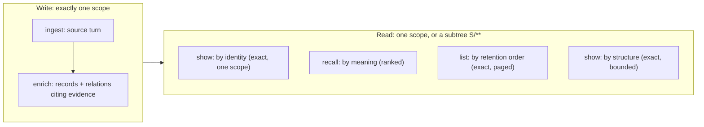
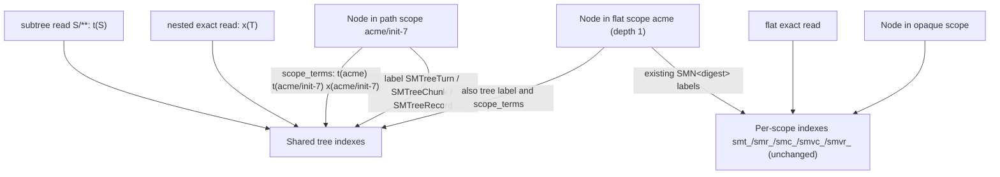

# Source Memory tool surface

**Bottom line:** Source Memory answers five kinds of question, and each has exactly one operation: *store this*, *derive from it*, *get this exact thing*, *find what's relevant*, *enumerate what's there*. Every read is complete or names what it left out. Scopes become hierarchical paths (`project/initiative/actor`): a write lands in exactly one scope, a read covers one scope or a whole subtree, and grants are exact or subtree patterns. Flat scopes keep their per-scope indexes, so a flat-scope read is byte-identical to today's. Memory's only concepts are its own: **scope**, **source turns**, **records** (7 kinds), **relations** (5 types), **evidence** and **time**. Callers map theirs (actors, projects, people, tasks) onto those.

Status: proposal r1. Delivery order: (1) nested scopes, (2) `list`. Host integration (capture, distillation, context injection, session tools) is not part of this surface; any host, Sourcerer included, calls the operations below.

## Concepts Memory owns

| Concept | Meaning | Not |
|---|---|---|
| scope | a partition and the unit of authorization; a path scope also names a subtree | a user, actor or tenant model |
| source turn | caller-copied original text, immutable, keyed by (scope, source, conversation, turn) | a summary |
| chunk | a word window inside one entry of a turn; a search handle that resolves to its turn | a separate memory |
| record | one derived claim of a fixed kind, citing source spans | a mutable row or task |
| relation | a directed claim between two records of one scope, citing evidence | a foreign key to caller data |
| time | `occurred_at` (caller-supplied, optional) and `retained_at` (store commit clock, always present) | a state machine |

A caller concept that needs state transitions (open/closed, assigned, due) stays with the caller. Memory may record *that* something happened, as an outcome or a supersedes relation, but never answers "what is its state now".

## Operations

| Question | Operation | State | Contract |
|---|---|---|---|
| Store this original text | `ingest` | built | one exact scope; idempotent on key; same bytes replay, different bytes conflict; staged failure replies |
| Derive knowledge from it | `enrich` | built | one exact scope; records and relations whose evidence and endpoints are in that scope |
| Get this exact thing | `show` (`record`, `turn`, `turn_by_key`) | built | one exact scope; exact or `not_found` |
| What's relevant to this query | `recall` | built; subtree in PR 1 | ranked over records/relations **and** chunked turns; bounded by hits and bytes; reports omissions and incomplete channels |
| What's connected to this | `show` (`units`, `following`, `bundle`) | built | one exact scope; walk bounded by nodes and hops; reports where it stopped |
| What's there, in order | `list` | PR 2 | below; scope or subtree |
| Is the store healthy and the same store | `status` | built; subtree in PR 1 | counts, index states, store identity, record contract |
| Prepare a scope or subtree | `init` | built; subtree in PR 1 | idempotent schema; `init S/**` also migrates the subtree |

Every item a subtree read returns carries its own exact `scope`. Follow-up `show` calls name that scope; `show` never takes a subtree.

## Scopes (PR 1)

### Names

| Class | Grammar | Example | Behaviour |
|---|---|---|---|
| path | 1–8 segments joined by `/`; segment `[A-Za-z0-9_-]{1,64}`; whole name ≤ 256 chars | `acme`, `acme/init-7/actor-3` | exact reads and writes; root of a subtree |
| flat | a path of depth 1, or any other `text(scope, 256)` that is not a path (an *opaque* legacy name such as `my scope`) | `default`, `demo` | unchanged: per-scope labels and indexes (`src/core.mjs:42-44`) |
| nested | a path of depth ≥ 2 | `acme/init-7` | stored in the shared tree index (below), no per-scope index |
| selector | a path followed by `/**` | `acme/**` | names a subtree for reads and `init`; never a write target |

The segment charset is the one `pi-extension/live-extension.mjs` already enforces, so every scope that adapter ever wrote is a valid depth-1 path. An opaque legacy name stays exact-only: it has no parent and no subtree. Names that were legal before r1 and are now selectors (ending in `/**`) or nested (containing `/`) change class; a pre-r1 slash name is migrated by `init` on its subtree (below).

### Grants

`scopes.read` and `scopes.write` stay arrays of strings (`authorize`, `src/core.mjs:46`).

| Entry | Grants |
|---|---|
| `"S"` | exact scope `S`, as today |
| `"S/**"` (S a path) | `S` and every descendant, including ones created later |

A target scope `T` is granted when the array contains `T`, or contains `A/**` with `A` equal to `T` or an ancestor of `T`. A selector `T/**` is granted only by such a pattern; exact grants on every current child never add up to a subtree grant, because the subtree is open-ended. Opaque names are granted only exactly. Patterns can only widen what an entry grants; every existing entry keeps granting exactly what it granted.

### Writes: exactly one scope

`ingest`, `enrich`, `index` take one exact scope; a selector is refused `scope_denied` with `stage:"before_write"`, so no new write-path code. Evidence spans and relation endpoints must be in the written scope (unchanged `Neo4jStore.enrich` checks). Cross-scope relations do not exist: a project-level record that cites an actor's turn needs that turn ingested in the project scope. Identity is unchanged: `identity(kind, scope, ...)` (`src/core.mjs:41`) hashes the full scope string, so the same record id in two scopes is two records.

### Reads: one scope or a subtree

| Read | Exact scope | Subtree `S/**` |
|---|---|---|
| `recall` | as today | all five channels (`turn_lexical`, `chunk_lexical`, `record_lexical`, `chunk_vector`, `record_vector`) over `S` and descendants; fusion key adds `scope`; each bundle expands relations and follows lineage inside its seed's own scope |
| `list` | yes | yes |
| `status` | as today | subtree counts plus `scope_tree.pending` |
| `show`, `index` | yes | refused `scope_denied` |

`exclude_conversations` keys stay `(source, conversation_id)` and exclude that conversation in every scope of the subtree. Grouped units already key on `(scope, source, conversation_id)`; in a subtree read the key's scope is the parent turn's own scope.

### Index layout: one shared tree index, no fan-out

Per-scope indexes cannot serve a subtree: a read of `acme/**` over 500 actor scopes would be 500 queries per channel, and every new scope would add five Lucene/HNSW indexes. Path scopes therefore also live in one shared index per kind, filtered inside the query by a scope term.

| Element | Definition |
|---|---|
| labels | `SMTreeTurn`, `SMTreeChunk`, `SMTreeRecord`, set at write on every node of a path scope (depth ≥ 1). Nested nodes get no per-scope `SMN<digest>` label, so label count does not grow with scopes |
| `scope_terms` | space-joined tokens: `t<sha256(['source-memory.scope/1', A])>` for each ancestor-or-self `A`, plus `x<…>` of the exact scope. Alphanumeric, so the standard analyzer keeps each one whole |
| full-text | `sm_tree_turns`, `sm_tree_records`, `sm_tree_chunks` on the tree labels `ON EACH [n.text, n.scope_terms]`. Query: `text:(<existing literal terms>) AND scope_terms:<term>^0`. The filter runs inside Lucene before top-k, and boost 0 keeps it out of the score |
| vector | `sm_tree_vchunks`, `sm_tree_vrecords` on the tree labels' `embedding`, cosine, quantization off, as the per-scope ones. Neo4j 5.26 has no pre-filtered ANN, so: census the eligible nodes of the selection; at most 4096 → exact cosine over them in Cypher (`ready`); more → shared ANN with the selection filter inside the existing widening loop (`partial` / `vector_overfetch_cap` when unresolved) |
| range indexes | `SMTurn(scope)`, `SMChunk(scope)`, `SMRecord(scope)`, so subtree filters `n.scope = $s OR n.scope STARTS WITH $s + '/'` seek, not scan |
| exactness check | every returned node and parent is checked against the selection, replacing the `node.scope === scope` checks (`index_scope_mismatch`) |

Cost: depth-1 path scopes are indexed twice once a tree index exists (per-scope for flat reads, tree for subtree reads). That is the price of leaving flat ranking untouched. Tree vectors share one dimension per database; a second dimension is refused `vector_index_dimension_mismatch`, as a mismatched per-scope index is today.

### Flat reads stay byte-identical

A flat (depth-1 or opaque) exact read uses the same per-scope labels, index names, Lucene query text, vector index and widening as today, and never reads `scope_terms` or the tree labels. BM25 statistics and ANN top-k are therefore computed over the same documents as before, and records and chunks, lexical, vector and rerank channels, result order and scores do not change. The extra label and property on depth-1 nodes are not part of any returned body. The flat `init` reply and side effects are unchanged: the tree indexes are created only by `init` of a nested scope or a selector.

Test: an integration check builds a fixed fictional corpus in a flat scope, together with nested and subtree data in the same database, runs ungrouped, grouped (`evidence_advice` with `follow`), `history_search` and excluding recalls, and pins the SHA-256 of their canonical replies to the value produced by `589658d` on the same corpus. Nested and subtree reads (new) use the shared index's statistics and ANN filtering; their ranking is not comparable to a flat read and is not promised to be.

### Completeness and omission reporting

| Gap | Reported as |
|---|---|
| tree index missing, populating or failed | channel `unavailable` / `pending` / `partial` with the existing reasons, as for per-scope indexes |
| subtree nodes not yet carrying the tree label (pre-r1 depth-1 data, pre-r1 slash names) | per channel `partial`, reason `scope_tree_pending`, `scope_tree.pending` counts by kind; `retrieval_complete:false` |
| vector census above 4096 and ANN window unresolved | `partial`, `vector_overfetch_cap` or `vector_query_budget`, as today |
| unembedded nodes in the selection | `unindexed`, as today |
| scopes enumerated | never: a subtree read does not list its scopes; items name theirs |

### Migration

| Data | Action |
|---|---|
| flat scopes | none |
| nodes written by r1+ into a path scope | labelled and termed at write |
| pre-r1 nodes of a depth-1 path scope, or of a pre-r1 slash name | `init S/**` (write grant on `S/**`) creates the tree and range indexes and adds label and terms in bounded batches; reply `{initialized, scope:"S/**", scope_tree:{labelled, pending}}`; rerun until `pending` is 0. It changes no body, hash or uid |
| writers still on a pre-r1 build | their writes into path scopes are unlabelled and surface as `scope_tree_pending` until the next `init S/**` |

### Record contract

`RECORD_CONTRACT` stays `source-memory.record/1`: uid derivation, `normalizeEnrichment` output and the replay digest are unchanged for every input, and the pinned values in `test/qualification.test.mjs` do not move. Labels and `scope_terms` are index metadata, like `embedding`.

## `list` (PR 2)

`list {kind?, status?, source?, conversation_id?, limit?, max_bytes?, cursor?}` over a scope or `S/**` → `{kind:"list", scope, order:"retained_desc", items, next_cursor, complete}`.

| Rule | Definition |
|---|---|
| order | newest first by `(retained_at, uid)`, where `retained_at` is the store's existing `created_at` on turns and records, present since the first release. It is total and immutable; `occurred_at` is optional and caller-supplied, so it cannot order every item |
| exactness | keyset paging on that key: a full walk returns every item committed before its first page exactly once; an item committed during the walk appears at most once |
| filters | `kind`: `turn` or a record kind; `status` (records); `source` and `conversation_id` (turns; records by any evidence turn). Memory's own fields only |
| items | turn: `{kind:"turn", scope, id, source, conversation_id, turn_id, parent_turn_id, occurred_at, retained_at, entries, bytes}` without entry text (use `show`); record: `{kind:"record", scope, id, record_kind, status, text, attribution, evidence, retained_at}` with span coordinates, not excerpts |
| bounds | `limit` 1–64 (default 16); `max_bytes` 1,024–1,000,000 UTF-8 bytes (default 65,536). A page stops before the first item that would exceed it and says so with `next_cursor`; an item that alone exceeds `max_bytes` is refused `list_item_exceeds_max_bytes`, never cut |
| cursor | opaque, bound to the selection and filters; reuse with another query is `invalid_input` |
| not offered | `since`/`until`: the commit clock is a transaction start time, so a window over it can miss a later-committing earlier transaction; a cursor walk cannot |

It serves "the last N episodes", "every decision in this conversation", and a host's boot context, without knowing who the caller is.

## Invariants every operation keeps

1. **Exact or explicit:** a read returns everything asked for, or names what it omitted and why.
2. **Append-only:** nothing is rewritten. Change is a new record plus a relation. Index metadata (embeddings, tree labels) is not content.
3. **Evidence first:** no record or relation without cited source in its own scope.
4. **Staged failures:** a write failure says whether it wrote nothing or is unknown; success is on stdout, failure on stderr.
5. **One write scope:** every write names exactly one exact scope.
6. **Standalone:** usable from the CLI with only a config file. No dependency on any host.

## Not in the surface

Deletion, retention policy, task or obligation state, per-caller schemas, caller identity fields, model calls inside reads, cross-scope relations, and host integration: when to capture, how to distill, what to inject and which tools a host's sessions see belong to the host.
