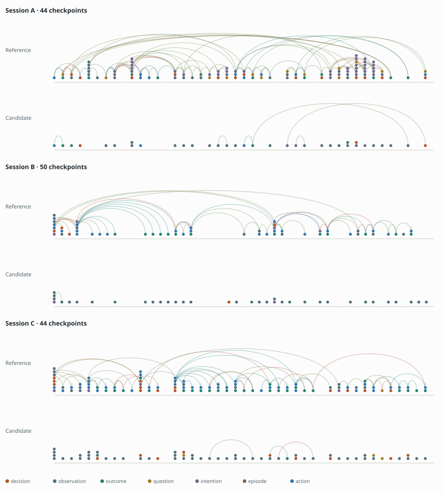
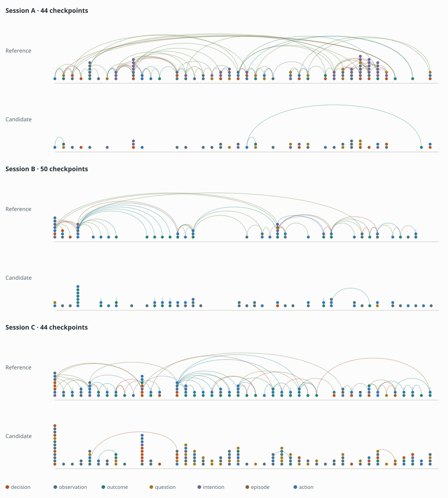

# Checkpoint comparison and results

## Evaluation progress

The retained baseline and T1 runs used Haiku. M2 is incomplete. A small distiller model writes records and relations for three development sessions; a frontier labeling panel produces reference graphs for the same checkpoints, and a fixed answerer and scorer test whether the stored memory answers blinded change-history questions (105 requirements in total). Baseline v2.1 is the untreated distiller and T1 a treatment that changes only the distiller instructions; their rows below are the memory-only arm (records and relations with their cited evidence; no source search), while the diagnostic rows answer from source text or product recall. Each chart shows, per session, the reference graph above the candidate graph: dots are records coloured by kind, arcs are relations coloured by type, columns are checkpoints; links within one checkpoint draw over the dot stack. The first chart is baseline v2.1, the second T1. Method: [evaluation methodology](../../evaluations/README.md).

| Candidate | Requirements met (of 105) | Unsupported-claim / authority / scope failing cases |
|---|---:|---:|
| baseline v2.1 | 47 | 26 / 14 / 16 |
| T1 (typed records & links) | 59 | 20 / 9 / 13 |
| raw text search (diagnostic) | 71 | 9 / 7 / 7 |
| combined recall (diagnostic) | 72 | 8 / 3 / 5 (T1 stores) |

| Session | Reference records / relations | T1 records / relations |
|---|---:|---:|
| Session A | 105 / 126 | 48 / 3 |
| Session B | 57 / 57 | 62 / 10 |
| Session C | 103 / 92 | 138 / 9 |

- References are model-adjudicated, not human ground truth and not yet spot-audited.
- T1 was not accepted under its pre-registered rule (over-retention flag).
- Combined recall rarely surfaced records (ranking imbalance), so it does not measure record value.
- Numbers are provisional and come from three development sessions.
