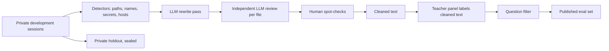

# Evaluation future work

**Next: publish an evaluation set built from our own development sessions, cleaned before labeling, keep a private holdout to catch overfitting, and let contributors prove non-regression with hosted runs against pinned models.** Methodology is in [README.md](./README.md).

## Published evaluation set

Clean first, then label: references and questions are produced on cleaned text, so no label points at removed content and evidence offsets stay valid.

| Stage | What it does |
|---|---|
| Detectors | Flag file paths, project and repository names, personal names, secrets and credentials, URLs and hostnames |
| LLM rewrite | Replace flagged spans with consistent fictional stand-ins that keep the technical meaning |
| Independent LLM review | A separate model reviews each rewritten file for residual identifying content and meaning loss |
| Human spot-checks | Sampled passages, not whole logs; a human cannot read every session end to end |
| Question filter | Drop any challenge question whose answer depends on content the rewrite removed or altered |

## Private holdout

A sealed set of sessions never used for tuning. A treatment that gains on the published set but not on the holdout is overfitting to it. Holdout results are not published; only whether a published-set gain held on the holdout is reported.

## Contributor rule

A change to any evaluated surface ships with an eval run that shows:

| Requirement | Detail |
|---|---|
| No drop larger than the noise band | Total and per session, against the current baseline, with pinned answerer and scorer models |
| Repeated seeds where needed | When a result sits near the band edge |
| Per-type non-regression | No existing record kind or relation type loses capture |
| A valid run | No faults; spend ledger attached |

## Hosted runs

Contributors should not need maintainers to fund every eval. Runs could execute on an evaluation platform (for example a Hugging Face or Databricks-style evaluation service), with the published set, pinned models and the scoring harness, billed to the contributor's account and reporting the same aggregate and per-type results the harness produces.

## Open questions

| Question | Why it matters |
|---|---|
| How many sessions make the noise band small enough to detect real gains? | Three development sessions give a wide band |
| How should label quality be weighed when references disagree with a plausible candidate? | Scores are agreement with a map, not truth |
| Which answerer and scorer models to pin, and how to rotate them? | Pinned models age; rotation breaks comparability |
| How to keep hosted runs from seeing the holdout? | The holdout only works if it stays sealed |
| Can a human audit sample be large enough to bound cleaning leaks? | Automated review is not proof of absence |
