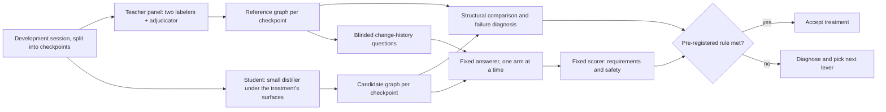
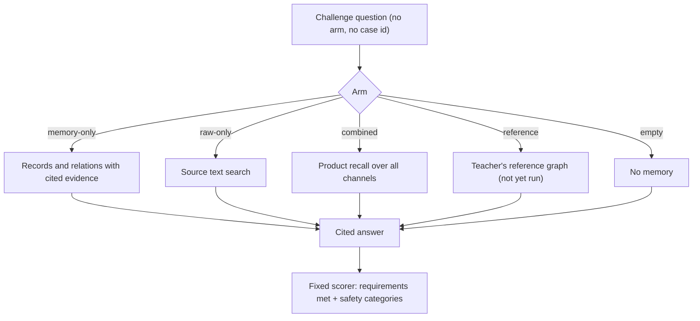
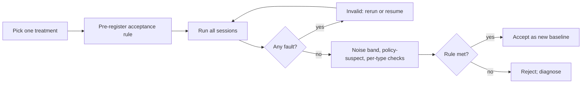

# Evaluation methodology

**A small distiller model (the student) is scored against reference memory graphs produced by a frontier multi-model labeling panel (the teacher), and by whether its records help a fixed answerer explain how things changed and why.** We optimise a program of surfaces around the student, not its weights, one pre-registered treatment at a time, and accept a change only when it beats a measured noise band without regressing any record or relation type. References are a model of the sessions, not the sessions themselves, so every score is agreement with a map, not with ground truth; label-quality figures for that map are not yet published. Current numbers are in the [README](../README.md#evaluation-progress); harness interfaces are in [`pi-extension/evaluation/README.md`](../pi-extension/evaluation/README.md); planned work is in [FUTURE-WORK.md](./FUTURE-WORK.md).

## Teacher and student

| Role | What it is | Fixed across a comparison? |
|---|---|---|
| Teacher panel | Two independent frontier labelers and one adjudicator, drawn from different models, each holding a persistent per-source session so labels stay consistent across checkpoints | Yes; references are produced once and frozen |
| Student (candidate) | A small distiller model that reads each new turn and writes records and relations through the memory tools | The model is one of the surfaces under test |
| Answerer | A fixed model that answers challenge questions using only the tools its arm allows | Yes, pinned |
| Scorer | A fixed model that grades answers against a scorer-only reference packet | Yes, pinned |

The teacher's output is a typed graph per checkpoint: the same seven record kinds and five relation types the store accepts (see [Records and relations](../README.md#records-and-relations)).

### What is optimised: surfaces, not weights

No model is fine-tuned. A treatment changes one or more of these surfaces and leaves the rest pinned:

| Surface | Examples of a change |
|---|---|
| Retention and typing instructions | When to record, which kind to use, when not to record |
| Tool schemas and descriptions | Field shapes, a sentence added to a tool description |
| Search, ranking and fusion | Channel weights, kind balance, reranker use |
| Link-offer and link-review step | Which earlier records are offered as link targets; how proposed links are reviewed |
| Presentation of context | What the distiller sees of earlier records and turns |
| Model choice and limits | Distiller model, output-token ceiling, thinking allowance |
| Capture boundaries | Per turn, across gaps, around context compaction |
| Caps | For example, at most one new question record per turn |

### Neuro-symbolic split

The neural part extracts meaning; the symbolic part constrains what can be stored. Constraints are enforced by the store, so no treatment of the surfaces above can relax them:

| Constraint | Effect |
|---|---|
| Fixed kinds and relation types | No invented categories; scores compare like with like |
| Evidence spans | Every record and relation cites exact source offsets resolved from stored turns |
| Immutability | Records are append-only; corrections are new records with `supersedes` or `qualifies` |
| Scope grants | Reads and writes are limited to configured scopes |

Adding a kind or relation type is a store-vocabulary change, judged by the same protocol.

## The map is not the territory

References are a model of what happened, as human labels would be. They can miss records, split or merge differently than a careful human, and inherit shared biases of the panel. Label quality is characterised by the measures below; the figures are not yet published and spot audits are pending:

| Label-quality measure | What it tells you |
|---|---|
| Labeler agreement | How often the two labelers produced matching records and relations before adjudication |
| Adjudication rate | Share of items the adjudicator had to resolve |
| Spot audits | Human review of sampled reference items against source |

A candidate score is agreement with this map. A low score can mean the candidate is wrong, the reference is wrong, or both chose defensible but different granularity; failure diagnosis (below) separates these where it can.

## Functional test: change-history questions

Structural agreement alone rewards copying the teacher's style. The functional test asks whether stored memory answers questions a later agent actually needs: blinded "how did X change and why" questions, each broken into requirements in a scorer-only packet.

| Arm | Answerer can see | Role |
|---|---|---|
| memory-only (harness arm `candidate`) | Candidate records and relations, plus the evidence spans they cite; no search over source text | Primary measure of what the student stored; it cannot fall back to full-text search |
| raw-only | Source text search | Diagnostic: how far plain retrieval gets |
| combined | Product `recall` over turns, chunks and records | Diagnostic: the shipped retrieval path |
| reference | The teacher's graph | Score of the teacher's graph: a target, not a hard ceiling (designed; not yet run) |
| empty | Nothing | Floor; detects answers from prior knowledge |

The harness also has a `baseline` arm (an empty derived store: the no-memory comparator, which returns no records) and a `recall-chunks` diagnostic; see the [harness README](../pi-extension/evaluation/README.md). Neither is the "baseline v2.1" candidate reported in the README.

The scorer counts requirements met and flags safety failures per case:

| Safety category | Failure |
|---|---|
| Unsupported claims | An assertion not supported by both the reference and a cited excerpt |
| Authority inflation | A proposal or opinion presented as an accepted decision |
| Scope violations | Content from outside the granted scope |
| Unsupported actions | Claiming something was done when the source does not show it |

### Known gaps

| Gap | Planned measure |
|---|---|
| Few questions require relational traversal, so relations are under-tested | Questions whose answer needs following `supersedes`, `outcome_of` or `depends_on` |
| No direct measure of what an edge is worth | A relation-ablation arm: the same records with relations removed |
| Combined recall rarely surfaces records, because turn and chunk channels outrank them | Kind-balanced fusion, so the combined arm measures record value |

## Hill-climb protocol

| Rule | Detail |
|---|---|
| One treatment at a time | A run changes one surface (or one named bundle) against the current baseline, so a result is attributable |
| Pre-registered acceptance | The acceptance rule is written and sealed before any treatment output is observed |
| Noise band | Measured from repeat runs with no change: about ±4 requirements per session, up to 10 in total. Gains inside the band are not gains |
| Policy-suspect checks | A gain that comes with large over-retention (many more records than the reference, many unmatched) is flagged, not accepted |
| Per-type non-regression | Adding a new kind or relation type, or changing guidance for one, must not reduce capture of existing types |
| Faulted output is invalid | Output produced under tool, provider or harness faults is never scored; the run is rerun or resumed from its last clean checkpoint |
| Spend ledgers | Every model call is metered against a sealed per-run budget |

## Per-loop failure diagnosis

After each run, structural differences are mapped to the surface most likely responsible. Matches between candidate and reference items are provisional, and an unmatched item does not prove its meaning is absent:

| Symptom | Likely lever |
|---|---|
| Reference edge missing, both endpoints provisionally matched by candidate records | Linking: link offer, link review or relation guidance |
| Reference edge missing because an endpoint is missing | Retention (or alignment and granularity): no candidate record matched it |
| Several candidate records match one reference record | Duplicates or over-splitting |
| Candidate records match nothing in the reference | Over-retention, unsupported records, or a reference miss |
| Links offered but not proposed, or proposed but not accepted | Link funnel: offered → proposed → accepted shows where links are lost |
| The earlier link target was never offered | Search and ranking, or link-offer selection: was the target reachable by search at that checkpoint? |

## Data handling

| Data | Where it lives |
|---|---|
| Development sessions | Used for public results; published only as structure and aggregates |
| Private holdout | Sealed; not used for tuning; detects overfitting to development sessions; results not published beyond whether a gain held |
| Real runs: transcripts, references, candidate stores, answers, scores | A private store outside this repository |
| Published here | Structure-only charts (dots, arcs, checkpoint columns; no session text, labels limited to Session A–C, checkpoint counts, row labels and the kind legend) and aggregate counts |
