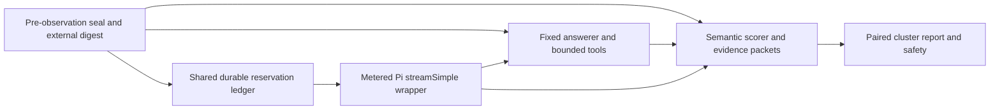

# Retention evaluation measurement surfaces

**Fictionally tested components, not pilot authorization or a live hard-cap guarantee.** Provider-specific bounds, trusted payload accounting, shared-runtime wiring, durable pre-observation seal custody, semantic calibration, and independent audit remain integration gates.



## Integration API

| Surface | Exports and contract |
|---|---|
| Freeze | `sealComparison(spec)`, `verifySeal(seal, expectedDigest)`, `hash(json)`, `modelFingerprint(model)` in `seal.mjs`. Persist the full seal and its digest independently **before** opening treatment observations. Every comparison case, scorer packet and ordered dependence-edge list is hashed in the seal. A seal created after observation is not a valid precommitment; a self-supplied hash alone cannot prove timing. |
| Answer | `createAnswerer({seal, expectedDigest, memory, archive, respond}).run({arm, case})` requires sealed `citationProtocol: returned-evidence-v1`. Arms: `candidate`, `baseline`, `empty`, `reference`, `raw-only`. `memory.search({storeId, query, actor, queryTime, readScopes, evidenceScopes, limit})` returns `{id,scope,text,evidence:[{id,scope}]}`; `memory.resolve({...access,storeId,itemId,evidenceId})` returns `{id,scope,text}`. Each citation `{item_id,evidence_id}` must name evidence actually returned by a successful resolve for that item; raw-only search results use their returned ID for both fields. The host requires a search and replaces any answer without citations with an explicit unknown, recording the intervention in the trace. `archive.search` is called only for the diagnostic `raw-only` arm. The responder receives only the request, frozen answerer settings, search/resolve tools and a submission validator—not a rubric, answer key, arm or case ID. Adapters must enforce storage permissions and snapshot/query-time constraints. A structurally valid citation does not prove its evidence semantically supports the answer. |
| Score | `createScorer({seal, expectedDigest, judge}).score({packet, answer, trace})` or `scoreCase({seal, expectedDigest, packet, judgment, trace})`, `disagreement(judgments)`, `auditAlternatives({seal, alternatives, audits})` in `scorer.mjs`. The grounded scorer receives the scorer-only reference packet plus the exact evidence excerpts the answerer cited. Each asserted clause is graded for support, authority, scope, time and uncertainty; support passes only if both the reference and at least one cited excerpt support it. A passing factual clause must name valid reference `sourceIds` and answerer-cited `citationIds`; a factual clause graded uncertain also needs a citation. The exact canonical unknown can satisfy an explicit uncertainty requirement as a nonfactual abstention only when the packet is unanswerable or uncertain. Citation identity and returned-text hashes are checked mechanically; semantic support is judged, not mechanically proven. A recoverable relation also needs returned `itemIds` in the answerer trace. The `raw-only` arm is diagnostic: its returned source IDs can satisfy that relation-trace check and must not be mixed into primary results. Alternatives require a source-linked rationale and independent blinded audit. |
| Report | `pairedReport({seal, expectedDigest, rows, dependencies})` in `report.mjs`. One row per case carries `caseId`, nonempty source `sessions`, `sealDigest`, `packetDigest`, and identically keyed `arms`. Each arm carries the same digests and `usefulness: {credited, uncertain, total}` from scoring; candidate also carries safety counts. The sealed comparison uses equal case weights and conservative primary credit. The report derives included, excluded and conservative sensitivity; paired percentile cluster-bootstrap draws are shared by all arms. Fewer than two connected clusters is descriptive only. Safety uses the fraction of cases with each violation, against independent frozen ceilings; uncertain safety makes a would-be pass unknown. |
| Spend | `openLedger({path,seal,expectedDigest})` in `ledger.mjs`; `wrapPiRuntime({runtime,ledger,planId,nextSlot,boundInput,usageEvidence,onLedgerError})` in `pi-wrapper.mjs`. `reservePlan`, `startSlot`, `recordResult`, `recordUnknown`, `reconcileAttempt`, `recordCharge`, `finishPlan`, `plan`, `attempt`, `summary`, `close` are synchronous. See below. |
| Pi calls | `createPiAnswererResponder` and `createPiScorerJudge` in `pi-calls.mjs` invoke the real Pi `ModelRuntime.streamSimple` shape through a marked metered wrapper. The answerer exposes only search and returned-item evidence resolution, and checks the sealed tool-schema hash. The marker does not prove provider-side limits. |
| Explicit soft pilot | `createSoftBudget` in `soft-budget.mjs` requires a separately approved soft cap, serializes calls, records context-byte estimates plus maximum output, and stops on unknown received usage or >2× estimate. Gateway-internal attempts remain uncorrelated; costs are API-equivalent estimates, not charges. It cannot guarantee the cap against one-call or hidden-retry overshoot. |

A fresh driver run seals the cited answerer as `answerer-r2-v5`. The earlier uncited pilot is not resumable through that driver. Budget refusals are retained in the answer trace, and unknown answers after a refusal have a distinct marker. A same-treatment v5 resume requires the exact code and unchanged policy, model, evaluator and budget configuration, plus the existing snapshot, journal, reconciliation and provenance checks; the remaining soft budget may decrease, not increase. This is not automatic crash recovery.

Development packets use `block-evidence/v1`: each requirement and correction-chain citation names exact zero-based indices into the original `entry.message.content` array. Only nonempty text blocks, and tool-call blocks approved by the pinned occurrence map and the case's `keep` semantic review, are citable. Messages whose content is a plain string, and thinking, image or unknown blocks, are not citable and fail closed. The driver takes the frozen development-v2 `MANIFEST.json` and the occurrence map; the map's SHA-256 is sealed, and every approval for the run's source must be used.

`fictional.mjs` defines complete **fictional** settings, cases, packets, model, bounds and plan. It is test data, not an experimental configuration or live rate card. `test/pi-eval-*.test.mjs` exercises the interfaces without opening real cases, sessions, answer files, or memory databases.

## Ledger and reservation semantics

All roles—distiller, reviewer, answerer, scorer, repairs and adjudication—must use the **same ledger file and cap**, the same independently anchored seal, and exclusively the wrapped runtime. The pilot driver wires the explicit soft ledger and a separate input counter; neither proves a provider-side hard bound. The older reservation ledger described below is conditional on externally verified bounds and is not the same as the pilot's soft ledger.

The seal fixes total cap, maximum plans and slots, route/model fingerprint, rate-card version, rates, input/output maxima, maximum billable provider attempts per SDK call, fixed per-attempt extras, and evidence references for the bounds. A deployed gateway that can fail over or retry invisibly requires separately verified bounds and per-attempt accounting; otherwise neither a hard-cap claim nor a complete ledger is justified. Currency is integer nanodollars; rates are integer nanodollars per unit, rounded upward before freezing. Each slot reserves, in nanodollars:

`maxProviderAttempts × (maxInput × (inputRate + cacheReadRate + cacheWriteRate) + maxOutput × outputRate + fixedExtras)`

This deliberately over-reserves overlapping cache classes. Each distinct SDK call, retry, repair, model call and parallel in-flight call needs its own slot; SDK-internal retries are included in each slot's provider-attempt bound. The wrapper records one SDK-call attempt, not each hidden provider retry; without lower-level telemetry the per-provider-attempt ledger is incomplete. All plan slots reserve atomically before any invocation, across processes using SQLite `BEGIN IMMEDIATE`, WAL and `synchronous=FULL`. A slot moves from `reserved` to durable `started` before dispatch. It cannot be dispatched twice. A crash, synchronous throw, failed/aborted or unrecognized outcome remains held as `started`/`unknown`, and a child retry is refused. `reconcileAttempt` requires an explicit quiescence/outcome reference; it retains the entire reservation and leaves unknown usage unknown. `finishPlan` releases only never-started slots; all used slots remain fully reserved even after a final charge. SQLite and filesystem durability must be established for the deployment; this module cannot protect against deletion, rollback, copies, bypass, or an untrusted storage administrator.

`boundInput` is a synchronous **trusted** adapter. It must return `{tokens, providerBound: true, proofRef, contextFingerprint}` plus optional `prefixFingerprint`, `cacheMarkers` and `cacheTtl`. The fingerprint is a 64-hex SHA-256; the estimator must cover the actual provider-bound payload, including system/tools, framing, images, caching and every other billable unit. A number or missing proof reference is refused; the assertion/reference is not independently verified by this generic component. `options.maxTokens` must be explicit. The wrapper passes the original `(model, context, options)` and original async-iterable/`.result()` stream unchanged, fingerprints model identity and compatibility settings, and does not set SDK compatibility flags. Other model dispatch APIs are refused through the proxy. A lost result observer or failed ledger write leaves the slot held. The raw runtime, another process or a provider's hidden retries cannot be policed by this proxy.

Ledger `inputSemantics` is explicitly `included` (cache-read and cache-write are disjoint classes contained in reported input) or `separate` (input excludes them). Missing/contradictory values produce an unknown estimate, never zero; providers with other or unproven semantics need an adapter rather than guessing. SDK usage units are `sdk_unverified` by default and excluded from complete provider totals; only a trusted `usageEvidence(message)` adapter that identifies a provider report and its reference may mark them `provider_reported`. The Pi `usage.cost` field is labeled `sdk_estimate`, not provider charge. Actual charges require a final `provider_reported` or `invoice` provenance and reference; latest records supersede earlier records for totals. An over-bound reported charge or usage poisons further admission and is retained for audit. A charge may exceed the cap if the external bound or provider guarantee was wrong; detecting this afterward is not prevention.

## Explicit blockers before any real pilot

1. Obtain provider/SDK evidence for enforced payload input and output maxima, all billable extras, cache inclusion, pricing and the maximum number of hidden retries; attest these in the sealed route bounds. A string reference is not proof. If any maximum cannot be established, do not call the provider; the reservation is only a conditional arithmetic bound.
2. Bind the trusted payload estimator to the **actual provider-bound payload**, including later SDK transformations and `onPayload` behavior. This generic wrapper cannot prove its caller's estimator, implicit extra charges, or that another API path will not dispatch. Validate the actual pinned SDK/provider version without overriding compatibility flags.
3. Qualify the pilot's ledger and wrapped runtime for **every** distiller, reviewer, answerer, scorer, retry and repair; prevent access to the raw runtime. Enforce per-case model-call/token/cost budgets in that integration. Existing wiring and fictional tests do not prove provider-side enforcement or complete gateway accounting.
4. Preserve the full seal and independently timestamp/anchor its digest before seeing compared outputs; verify the same external digest at every entry point. Frozen hashes detect change, not an honestly timed freeze or correct dependence inventory. Case and packet content must be produced independently of candidate output.
5. Validate scope isolation and pre-answer snapshots at the real memory adapter. The JavaScript respondent and judge are trusted injected adapters, not sandboxes; they must not use undeclared channels. Verify clause inventory and judgment quality with independent calibration/adjudication. The rubric and trace checks cannot themselves prove semantic equivalence, completeness of the clause list, retrievability, or audit independence.
6. Calibrate/freeze the actual rubric, baseline, source-history graph, safety ceilings and rate cards separately from treatment comparison. Investigate unresolved alternative audits and scorer disagreement; do not tune against development or holdout observations.

## Fiction-only checks

```sh
node --test test/pi-eval-*.test.mjs test/pi-budget.test.mjs
```

Node 22's built-in `node:sqlite` emits an experimental-feature warning. No production or pilot database is used by these tests.
