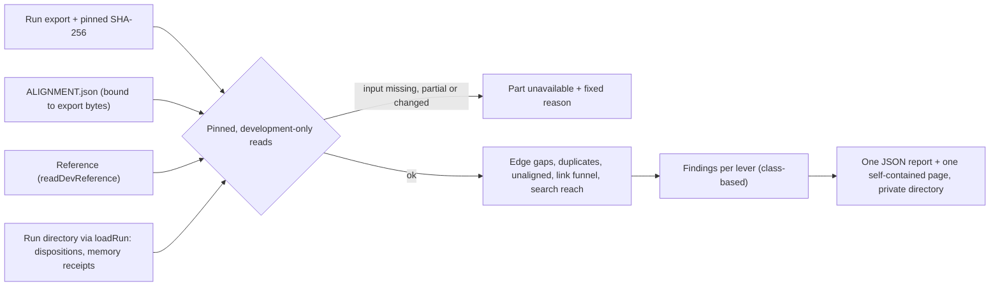

# Per-run retention diagnostics

**BLUF:** For one completed development climb run, `scripts/diagnose-climb-run.mjs` shows where the candidate memory graph falls short of the reference and files each finding under the lever table's levers. It reads only hash-pinned local artifacts, calls no model, network or database, and reports anything the recorded data cannot support as unavailable with a fixed reason, never as zero. Alignment is model-based and provisional; the reference is a target, not ground truth; the attribution is not source-verified and not causal; a candidate record counts as aligned only when a matched verdict names it.

## The five diagnostics

| # | Part | Definition | Lever class |
|---|---|---|---|
| 1 | `edge_gaps` | Each reference edge at or before the cutoff is `observed`; a `linking_failure` (both endpoints have a stored matched candidate, directed edge not observed); a `retention_failure` (an endpoint is `no_match` or `not_stored`); or `uncertain` (an endpoint is `alignment_uncertain` and none is unmatched). An unmatched endpoint outranks an uncertain one. | `linking_failure`, `retention_failure`; none for `uncertain` and `observed` |
| 2 | `duplicates` | (a) Reference records with two or more stored matched candidate records. (b) Duplicate clusters among candidate records no matched verdict names: always unavailable, `candidate_only_duplicate_clusters_not_inferable`. No text similarity is used. | `duplicate` |
| 3 | `unaligned_candidates` | Candidate records no matched verdict names. An uncertain verdict, or a changed candidate text, names nothing because `summarizeStage` drops those hints. | `unaligned` |
| 4 | `link_funnel` | Per checkpoint and in total: link candidates offered, links proposed, links not reviewable (`unresolved`), reviewer accepted, reviewer refused, applied. Findings are checkpoints where links died: `offered_not_proposed`, `not_reviewable`, `refused_by_reviewer`, `accepted_not_applied`. | `funnel` |
| 5 | `search_reach` | For each linking failure, for each pair of matched candidates, the furthest stage the earlier-written record reached at the checkpoint where the later one was written: `not_previewed`, `previewed_by_compact_search`, `fetched`, `offered_as_link_candidate`, `proposed`, `refused_by_reviewer`. The finding takes the furthest stage over its pairs. | `search_reach` |

## Levers

Verbatim from the evaluation owner. Levers attach by finding class; a finding on an uncertain edge or an unavailable part carries none, and a lever total lists the classes that were unavailable so a missing count is not read as no problem. A total counts findings (edges, reference records, candidate records, funnel checkpoints and stages, reach findings), not measured effect.

| Diagnostic | Classification | Candidate levers |
|---|---|---|
| Missing reference edge, both endpoints matched | pure linking failure | link-step guidance, link-offer search reach, reviewer refusals |
| Missing edge, an endpoint unmatched | retention failure upstream | retention guidance, kinds, context cut |
| Candidate records aligned to one reference record | duplicate / over-splitting | search-before-write reach, dedup guidance, question cap |
| Unaligned candidate records | over-retention or unsupported | retention test, evidence rules |
| Offered vs proposed vs reviewer-accepted links | where links die in the funnel | offers, guidance, reviewer |
| Prior record reachable by distiller search at write time | search reach | compact search, ranking (cf. fusion probe) |

## Inputs

| Input | Source of the fields | Boundary |
|---|---|---|
| Run export `climb-run-graph/v1` | `runExport` and `storeGraph` in `climb.mjs`: `graph.records[{id, kind, text, checkpoint_index, dated_by}]`, `run_dir`, `report_sha256` | Read with `readPinned` against the caller's SHA-256. Development source only (`assertDevelopmentSource`). |
| Alignment `climb-alignment/v1` | `align-climb-run.mjs` writes `status`, `run_export_sha256`, `summary` from `summarizeStage`: `items[{reference_id, status, candidate_ids}]`, `relations[{from, to, type, status}]` | Located by the export's basename. Not itself hash-pinned; bound to the export by `run_export_sha256`. Must be `complete_provisional`. |
| Reference | `readDevReference`, then `assertSameSchedule` against the run schedule | Pinned manifest and files; development sessions only. |
| Run directory | `loadRun(reportPath, reportSha)`; for a resumed run each prior run is opened through `loadRun` too | Every artifact is pinned by `REPORT.json`: no symlink, regular file, size limit, SHA-256. |
| Search statuses | `report.coverage.dispositions[].search_statuses`, written by `core.mjs`: `compact-records` with `previewed_ids`, `selected-record` with `id`, `selected-link-offer` with `candidate_ids` | One disposition per checkpoint. Inherited checkpoints of an older resumed run may carry none. |
| Memory receipts | `memory-receipts.jsonl`: one row per client call `{checkpoint, method, ok, value | code, effect}` (`memory-client.mjs` `call`, `run-dev-pilot.mjs` `onReceipt`); `checkpoint` is the entry id of the dispositions' `through` | `beginLinks` carries the offer packet, whose records have labels and text but no IDs. `finishLinks` carries `proposals`, `unresolved` and `references.records[{ref, id}]` (`link-proposals.mjs`). `applyLinks` carries `review.approved` and the applied relations. |

## Limits

| Limit | Consequence |
|---|---|
| Alignment is model-based and provisional | Every finding inherits that; nothing is source-verified or causal. |
| `candidate_ids` for an uncertain verdict are dropped by `summarizeStage` | A candidate named only by an uncertain verdict is counted unaligned. |
| Offers are the distiller's selected handles | `offered` counts distinct prior records in `selected-link-offer.candidate_ids`, not the packet's compared records; the packet can omit some for size. |
| Proposals are those put to the reviewer | `proposed` is `proposals`; model links that failed validation are `unresolved` and counted separately. For reach, an unresolved link still counts as `proposed`. |
| Reviewer decisions come from `applyLinks` | The decision is read from the response's `review.approved`. If that call failed or is absent, the decision is unknown; a reach finding that would need it is unavailable (`reviewer_decision_unrecorded`, or the link-receipt reason), not a lower bound. |
| Reach needs every search surface | A reach pair needs `previewed_ids`, a recorded `id` for every fetch and `candidate_ids` for every offer at that checkpoint; otherwise it is `search_statuses_without_ids`. A finding is available only when all its pairs are. |
| Edge list must match the reference | The alignment's `relations` must equal the reference edges at or before the cutoff, in order; a missing, extra or inconsistent edge makes parts 1 to 3 and 5 `alignment_invalid`. |
| The coverage journal is pinned by the export | `REPORT.json` does not pin it; the export's `coverage_journal_sha256` does, and the journal is read through `readPinned` against it. A difference is `run_artifact_changed`. |
| Reach compares record IDs only | `not_previewed` means the record ID was not among the compact search's previewed IDs at that checkpoint; it does not say the search could never have found it. |
| A pair is `proposed` when a proposal joins exactly those two records | Relation type is ignored; an accepted link of another type than the reference edge shows as `proposed` with `reviewer_decision: accepted`. |
| A resumed checkpoint retried in a later run | The newest run in the chain with receipts for that checkpoint is used. |
| Output stays private | The report holds IDs, kinds, checkpoints, counts and paths, no record or reference text. |

## Unavailable reasons

Each part is `{available: true, …}` or `{available: false, reason}`. A finding inside an available part can also be unavailable.

| Reason | Meaning |
|---|---|
| `no_alignment`, `alignment_partial`, `alignment_export_mismatch`, `alignment_invalid` | No file; status `partial`; `run_export_sha256` differs from the export bytes; unreadable or inconsistent with the run or reference. Parts 1, 2a, 3, 5. |
| `reference_schedule_mismatch`, `reference_unavailable` | Reference ordinals do not name this run's checkpoints, or the pinned reference could not be read. Parts 1, 2a, 3, 5. |
| `run_directory_missing`, `run_artifact_missing`, `run_artifact_changed`, `run_artifact_invalid` | Run directory or a pinned artifact is missing, changed (including an export that no longer matches its run) or fails a read check. Parts 4, 5. |
| `checkpoint_receipts_missing`, `link_receipts_missing`, `link_call_failed`, `receipts_lack_link_fields`, `reviewer_decision_unrecorded` | Per checkpoint in part 4, and part 4 as a whole is `link_receipts_missing` when every checkpoint that made an offer lacks link receipts. |
| `search_statuses_without_ids` | The statuses have no previewed, fetched or offered IDs, or no search statuses at all where link activity cannot be ruled out. Offered count and link state in part 4; part 5. |
| `record_dated_by_first_snapshot` | A record's checkpoint is the first snapshot containing it, not a confirmed write receipt, so reach is not judged. The dating basis of both records is on every reach pair. |
| `endpoints_same_checkpoint` | Both candidate records were written at one checkpoint; search reach does not apply. |
| `candidate_only_duplicate_clusters_not_inferable` | Part 2b. |

## Smallest recorder changes (not made here)

| Diagnostic limit | Smallest change that would remove it |
|---|---|
| Candidate-only duplicate clusters (2b) | Have the aligner also record candidate-to-candidate equivalence verdicts in `ALIGNMENT.json`; the reference-to-candidate alignment cannot express them. Alternatively record, per `memory_record` write, the IDs the distiller had previewed when it wrote. |
| Reviewer decision when `applyLinks` fails | Append the `review` argument (`approved`, `operation_id`) to the `applyLinks` row in `memory-receipts.jsonl`; today only the response is recorded. |
| Offer and search IDs for inherited checkpoints of older resumed runs | None for past runs; the resume path would have to copy `search_statuses` from the prior report into the carried dispositions (`run-dev-pilot.mjs`, resume branch). |
| Packet records have no IDs | Add the record `id` to each packet record in the receipt. The `references` of `finishLinks` already map the compared records. |

## Archive remap and output

| Option or guard | Behaviour |
|---|---|
| `--remap <old>=<new>` | Both prefixes absolute and canonical. A pinned path is under the old prefix only at a path-segment boundary; those paths are mapped before the read and every other pinned path is read in place. Applied to the export's `run_dir`, each `REPORT.json` `run_dir` and artifact path through the resume chain, and the reference root. Every read check still runs on the mapped path; a holdout path is refused on the original and on the mapped path. The report's `provenance.roots` lists each root as `remapped` or `read_in_place` with both prefixes. |
| Output directory | Owner-only 0700, canonical, not a holdout path. Files are 0600 and created exclusively; the page is written to a temporary file and linked into place. |
| Git work trees | Every enclosing work tree (a `.git` entry in the directory or any parent) is checked with read-only local `git` queries. Always refused: the work tree holding the running script or sharing its git directory, any work tree with a configured remote, any whose remotes cannot be determined. A work tree with no remote needs `--allow-no-remote-repo`. |
| Page | Data is embedded as inert JSON and rendered with `textContent` and SVG attributes; it carries the same Content-Security-Policy as the climb dashboard and loads no external resource. |

Fictional tests: `node --test test/pi-eval-run-diagnostics.test.mjs`. The fixture contains every finding class and every unavailable reason, and no real session or record text.
