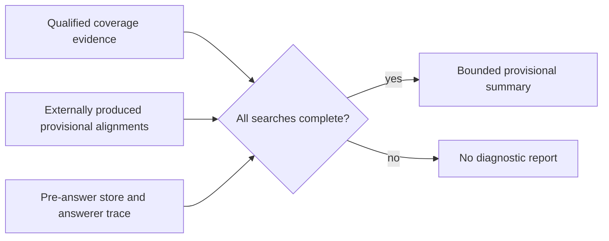

# Provisional stage summary

**BLUF:** The model-free summary accepts only a qualified, non-truncated candidate run and already-produced provisional alignments; it does not establish semantic equivalence, source support or causal attribution.

| Input | Boundary |
|---|---|
| Coverage | The supplied report must be independently hash-verified by the caller. All scheduled dispositions must be complete, with no unproven or incomplete searches. Invalid prior pilot data is refused. |
| Reference | The caller supplies the full as-labeled reference for the selected cut and its provenance. |
| Candidate | The caller supplies records and relations from the exact pre-answer snapshot, including record text and first-seen checkpoint. Missing checkpoint metadata is an error, not evidence of absence. |
| Alignments | The caller supplies unique per-reference verdicts and SHA-256 hashes of the candidate text shown to the aligner. A changed record is uncertain; an `uncertain` candidate-ID hint is never counted as a match. |
| Retrieval | Returned IDs come from the answerer's trace. They are not distiller-search traces. |

`no_match_provisional` and `not_stored_provisional` do not prove that useful meaning is absent. An unmatched edge endpoint is not a link error. A directed edge observed or absent between provisionally matched endpoints is not a source-backed or causal judgment. Selection, update and recovery remain unattributed. This PR contains no model runner and no post-hoc reinterpretation of a sealed model run; such a runner needs its own frozen method, spend accounting and review.
