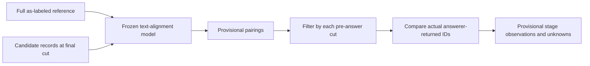

# Exploratory stage alignment

**BLUF:** Propose text-level reference-to-candidate alignments at the three frozen pre-answer cuts, then compare those proposals with actual answerer retrieval; none is a verified semantic or causal attribution.

| Input | Boundary |
|---|---|
| Reference | All labeled cut-44 items and relations; no reference-store filtering |
| Candidate | All final derived records, first-seen checkpoint, and directed relations |
| Retrieval | Only actual candidate answerer returned-item IDs at each frozen pre-answer cut |
| Model | Sonnet 5.5, fixed prompt/schema, batches of at most 10 reference items, one call at a time, one format repair |
| Evidence | No source text is supplied to the aligner; equivalence and source support are not independently established |

The aligner must preserve attribution, scope, time and uncertainty as stated. It may propose `matched`, `no_match` or `uncertain`; unmatched and uncertain are not proof of absence. At each cut, `stored_not_returned` is a provisional answerer-retrieval observation only. A reference edge with an unmatched endpoint is `endpoint_unmatched`, never a link error. A directed edge absent between provisionally matched endpoints is an unverified graph discrepancy, not a causal conclusion. Delayed first-seen alignment is not automatically recovery. Selection, update, causal link errors and recovery remain unknown without source-backed independent adjudication. Do not compare current-turn writes directly with the current reference graph.
