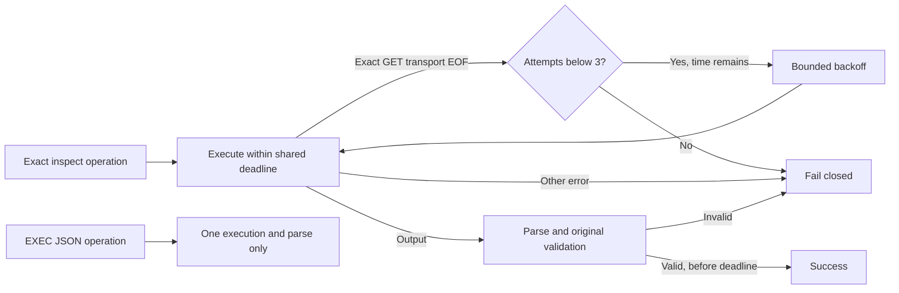

# Namespace Docker failure contract

**The historical M2/T1b first failing call and underlying execute-versus-parse cause are UNKNOWN: the distinguishing evidence was discarded.** `docker_inspect_failed` never establishes a transient inspection failure.

## Evidence boundary

The base `namespace-docker.mjs` `json()` wrapper collapses both execute and JSON parse failures at image, volume, owned/foreign container inspection **and** snapshot-export, driver-ready and warm-embedding EXEC sites. The owner clarification supplies this complete relevant metadata; owner-provided evidence digest: `aaf04fdd7eccfc335eac7e64d2d5cda71879970b593e814d5dfc73e22b029f50`. No host evidence file, retained source snapshot or stack was accessed by this seat. Snapshot absence suggests export but proves nothing. The checkpoint-35/44 M2 result remains inconclusive; no replay occurred. No retained producer evidence establishes a shared `docker-adapter.mjs` defect; that adapter remains unchanged and outside this diagnosis.

`test/pi-namespace-inspection.test.mjs` is an invented, in-memory reproduction, not reconstructed historical evidence: it injects exact CLI GET transport EOF, generic execute errors, malformed JSON and identity violations. Its EXEC cases show the same public code from both execute and parse failures without permitting a second execution.

## Retry and diagnostic rules

| Surface | Contract |
| --- | --- |
| Eligible argv | Constructed internally only: `inspect <64-hex-id>` (foreign inventory uses a fixed ID-and-NetworkSettings-only format), `volume inspect <owned-name>`, `image inspect <sha256> --format {{json .Config.Volumes}}`. No caller-supplied generic argv enters retry logic. |
| Positive transient classifier | Exit status exactly 1, no kill/signal, stderr at most 4096 characters, complete `error during connect: Get "http://<encoded-local-unix-socket>/vN.N/<exact-resource-endpoint>": EOF` or `unexpected EOF`. Only `/var/run/docker.sock` and `/run/docker.sock`; decoded endpoint must match the actual operation and identity. Other transport forms fail closed, including generic `ECONNRESET`, timeouts and daemon errors. |
| Terminal failures | Missing, permission, malformed JSON, validation failure, cancellation, deadline and unclassified errors never retry. Permission/missing take precedence over transport matching. |
| Bounds | Three total executions maximum per logical inspection, one 5000 ms deadline including execution, parsing, validation and 100/200 ms backoffs. Monotonic `now` and abortable `sleep(ms, {signal})` are injectable. A real deadline race also bounds an executor/sleeper that never settles; the default executor receives remaining timeout and abort signal. Late results cannot succeed. |
| Validation | Every eventual success parses a fresh response and passes the original image/label/network/port/mount/user/rootfs/capability checks appropriate to that site. Foreign inventory now also checks the returned full container ID without requesting foreign config. No name retargeting or cached result substitutes. |
| Receipts | Existing `onResource` custody retains fixed `kind`, `phase`, `operation`, `site`, exact `id`, validated `run_id`, `owned`, classification and attempt count. At most four inspection diagnostics per invocation (three attempts plus a backoff interruption); cancellation before dispatch reports attempt 0. Images and foreign IDs are explicitly unowned. No argv, raw errors, stdout/stderr, source text, model/scope names, config, mount paths or credentials are copied. Receipt failures remain fail-closed. |
| Public errors | Execute/parse/deadline/cancel failures retain `docker_inspect_failed`; original validation codes remain. Failed cleanup during creation still becomes `cleanup_unknown`. EXEC JSON failures distinguish operation and malformed JSON versus execute classification in safe receipts, but never retry. |
| Effects | Create/start/exec/write/rm, model/checkpoint work and cleanup mutations remain single-shot. Snapshot, ready and warm EXEC cannot enter the inspection loop even when their stderr looks transient. |

## Cleanup boundary

Caller inspection cancellation does not cancel cleanup's independent inspection deadline or preempt removal. Removal still requires the owned exact ID and matching run label before a single rm. The single-shot absence read now requires exit 1 and a complete, exact-ID Docker missing-resource response; unrelated missing IDs, transient errors, permission failures and successful reads cannot prove absence. Only positive absence followed by the removal receipt releases ownership. Unknown stays unknown; no outer workflow deadline or reaper inference was added.

## Owner smoke follow-up: exact absence grammar

**The prior owner stock disposable smoke remains FAILED (`cleanup_unknown`), not a retroactive PASS.** The successor Task supplies complete stderr `error: no such object: <requested-64-hex-id>\n`. This identifies a cleanup `absent(['inspect', id])` grammar mismatch, not the historical M2 inspection cause or evidence of a transient fault. The fictional lowercase regression fails with `cleanup_unknown` before the fix.

Container absence now additionally accepts exactly `error: no such object: ${id}` alongside the existing `Error: No such object: ${id}` and `Error response from daemon: No such container: ${id}`. Existing outer-whitespace trimming and the 4096-character bound remain unchanged; comparison is whole-string and exact-ID, not case-insensitive or substring matching. Exit status must still be numeric 1 with no kill or signal. Volume grammar, diagnostics, validation, retry bounds and single-shot mutations/absence reads are unchanged.

The focused regressions cover both object-message variants with a trailing newline, and reject wrong/truncated IDs, unlisted casing, extra stderr before/after, another missing ID, permission denial, permission exit code, signal, killed process and non-1/non-numeric exits. Rejected proof emits no absence/removal receipt and does not retry. Tests use only invented in-memory resources; no paid calls or replay occur. No new Docker smoke result is claimed by this change.

## Validation boundary

The focused fictional matrix covers transient-valid and transient-invalid identity/isolation, missing, malformed, permission, unclassified, exhaustion, deadline, cancellation, EXEC/mutation non-retry, fresh isolation reads and cleanup ownership/absence/receipts. It contacts no Docker daemon, model, live/pilot store, source snapshot or holdout.

Local Docker capability probing (`/usr/bin/docker version --format '{{.Server.Version}}'`) was refused by `WORKSPACE_BOUNDARY` because the executable is outside the seat workspace. No alternate route was attempted. The isolated Docker namespace smoke therefore has **no local passing proof**; missing capability is not a pass. Declared server-check receipts are separate evidence, not proof of the namespace smoke. A permitted namespace-smoke run must use fictional content, private labelled resources and leave cleanup enough time to settle; this seat neither merges a PR nor authorizes paid replay.
