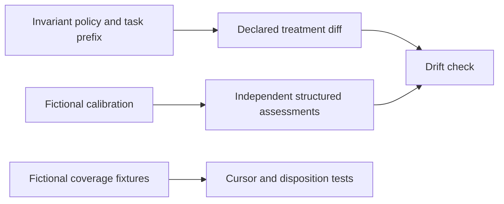

# Retention policy and fictional fixtures

**The versioned policy and fixture bytes are sealed; a passing structured assessment is evidence of the supplied assessment, not proof that a model or treatment is semantically correct.** The source contract is identified by SHA-256 in `retention-r2-v1.json`.

| Artifact | Purpose |
|---|---|
| `retention-r2-v1.json` | Frozen selection, evidence, authority, scope, availability and processing invariants; stable candidate task prefix. |
| `calibration-r2-v1.json` | Fictional selection and failure distinctions, including silence, rare consequence, scoped override, inaccessible prior, interruption, uncertain write and recovery. |
| `coverage-r2-v1.json` | Fictional ancestry and failure fixtures. Unproved compaction closure and batch overflow remain explicit failed gaps; they are not treated as successful processing. |
| `../policy.mjs` | Verifies byte hashes, limits treatment diffs to declared presentation/search surfaces, and compares independently produced structured assessments against every calibration case. |

Changes to policy or fixture bytes require a new version and corresponding hash. A treatment must supply a reason for every changed surface and independently assessed outputs for every case. The drift check cannot establish assessor independence, semantic truth, or a valid pre-observation freeze by itself.
